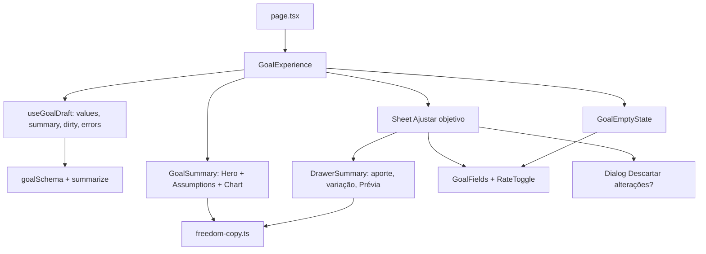

# Ápice: Clareza do Objetivo Design

**Spec**: `.specs/features/apice-clareza/spec.md`
**Status**: Draft

---

## Architecture Overview

Sem camada de servidor nova, sem migração e sem mudar `saveGoal`. Três mudanças estruturais:

1. **Textos e formatação viram funções puras** em `freedom-copy.ts` (frase-resumo, chips, tooltip de retirada, rótulo "Hoje", variação "vs. atual"), testáveis em unit (AD-005, AD-008).
2. **Um estado de rascunho compartilhado** (`useGoalDraft`) alimenta a gaveta e o estado vazio. Ele guarda os valores do formulário, valida com `goalSchema(now)`, calcula `summarize` e sabe se há alterações em relação ao salvo. Isso cumpre APICE-19.11 (uma só lógica de cálculo) e APICE-14.
3. **Campos do formulário extraídos** de `goal-form.tsx` para `GoalFields`, usados pela gaveta (`GoalForm`) e pelo estado vazio (`GoalEmptyState`).

Decisões ativas respeitadas: AD-003 (centavos e pontos-base; só a apresentação arredonda ao real), AD-005 (sem e2e novo; unit e integration), AD-008 (`freedom.ts`, `freedom-copy.ts` e a validação seguem isomórficos, rodam no cliente).

**Abordagens consideradas** (recomendada primeiro):

| Abordagem | Trade-off |
| --------- | --------- |
| A. Hook `useGoalDraft` + `GoalFields` compartilhados (recomendada) | Uma lógica de cálculo e de validação para gaveta e estado vazio; exige refatorar `GoalForm` |
| B. Estado vazio com formulário próprio duplicando a lógica | Mais rápido, mas viola APICE-19.11 e diverge da gaveta com o tempo |
| C. Estado vazio abre a gaveta embutida na página | Reaproveita tudo, mas mantém o contexto quebrado que o AP-19 quer resolver |

---

## Code Reuse Analysis

### Existing Components to Leverage

| Component | Location | How to Use |
| --------- | -------- | ---------- |
| `goalSchema`, `parseRate`, `today` | `src/lib/validation/goal.ts` | Validação do rascunho; mensagens de erro atuais ficam |
| `summarize`, `PRESET_RATES`, `presetFor`, `ageOn` | `src/lib/domain/freedom.ts` | Cálculo, cenário a partir do par e idade atual |
| `formatCompactBRL`, `formatBRL`, `maskBRLInput` | `src/lib/domain/money.ts` | Valores compactos e máscaras (aporte inteiro via novo `formatWholeBRL`) |
| `formatTerm`, `formatRate`, `planLines`, `interestBadge` | `src/lib/domain/freedom-copy.ts` | Prazo, taxa e insight |
| `ageTicks` | `src/lib/domain/age-ticks.ts` | Ticks do eixo X (inalterado) |
| `ChartTooltip`, `Area`, `ReferenceLine` | `src/components/goal-chart.tsx` | Tooltip por idade já existe; ganha guia que acompanha o cursor e toque |
| `Dialog`, `Tooltip`, `Popover`, `Slider`, `Sheet` | `src/components/ui/` | Descarte, tooltips, slider, gaveta |
| `saveGoal` | `src/actions/goals.ts` | Salvar pela gaveta ("Aplicar") e pelo estado vazio ("Salvar objetivo") |
| `maskDateInput`, `brToIso`, `isoToBR` | `src/lib/domain/date-br.ts` | Máscara e conversão da data |

### Integration Points

| System | Integration Method |
| ------ | ------------------ |
| `saveGoal` | Inalterada; mesma ação e `router.refresh()` |
| Banco | Sem mudança; `birth_date` segue na tabela do objetivo |
| Tema | Tokens novos em `globals.css` (claro e escuro) |

---

## Components

### freedom-copy.ts (textos e rótulos)

- **Purpose**: Fonte única dos textos de APICE-01 a APICE-07 e APICE-14.
- **Location**: `src/lib/domain/freedom-copy.ts` (testes em `freedom-copy.test.ts`)
- **Interfaces**:
  - `SUBTITLE`, `DRAWER_INTRO`, `ADJUST_LABEL = "Ajustar objetivo"`, `DEPOSIT_LABEL = "Aporte mensal necessário"`, `TARGET_LABEL = "Patrimônio necessário"`
  - `incomeHeadline(summary): string` - "R$ 20 mil/mês aos 48 anos"
  - `summarySentence(summary): string` - frase de APICE-02.6; sem a cláusula "Isso exige guardar" quando `monthlyCents` é null (APICE-02.8); com `monthlyCents = 0`, "Isso exige guardar R$ 0/mês" não se aplica: usa "Você já tem o necessário."
  - `depositText(summary): string` - "R$ 9.027/mês", "Prazo encerrado" ou "Meta alcançada"
  - `scenarioName(summary): "moderado" | "conservador" | "agressivo" | "personalizado"` e `assumptionChips(summary): { scenario, rate, withdrawal, today }`
  - `withdrawalTooltip(input: { withdrawalBp, targetCents, monthlyIncomeCents }): string` - APICE-05; usada no chip e nos cartões de cenário (no cartão, com a retirada do preset e a renda/meta atuais calculadas com `targetCents`)
  - `todayLabel(summary): string` - "Hoje · R$ 565 mil (11,8%) · 33 anos"
  - `depositDelta(previewCents, savedCents): { direction: "up" | "down"; text: string } | null`
- **Dependencies**: `freedom.ts`, `money.ts`, `percent.ts`
- **Reuses**: `formatRate`, `formatTerm`, `formatShare`

### money.ts

- **Interfaces**: `formatWholeBRL(cents): string` - "R$ 9.027" (arredonda ao real, `Math.round`).

### freedom.ts

- **Interfaces**: `GoalSummary.currentAge: number` (de `ageOn(goal.birthDate, today)`; só exibição); `chartYAxis(targetCents, finalCents): { max: number; ticks: number[] }` substitui `chartYMax` (APICE-08). Algoritmo: `raw = max(target, final)`; passo candidato de `[1, 2, 5] × 10ⁿ` (em centavos) em ordem crescente; escolhe o menor passo com `ceil(raw/step) ≤ 5`; `max = ceil(raw/step) × step`; ticks `0, step, …, max`. Fórmulas financeiras não mudam.

### useGoalDraft

- **Purpose**: Rascunho do objetivo para gaveta e estado vazio.
- **Location**: `src/components/use-goal-draft.ts`
- **Interfaces**:
  - `useGoalDraft({ saved, initial, nowIso }): { values, setValue, set, summary, savedSummary, dirty, errors, touched, reset }`
  - `summary`: último `summarize` válido do rascunho (mantém o último válido se o atual é inválido, APICE-14.14); `null` sem objetivo salvo e sem rascunho válido
  - `dirty`: valores diferem de `initial` (comparação por valor, normalizada com `JSON` das seis strings)
  - `errors` por campo vindos de `goalSchema.safeParse`, expostos só para campos em `touched` (APICE-19.6)
- **Dependencies**: `goalSchema`, `summarize`
- **Reuses**: a lógica que hoje está em `GoalExperience.handleDraft`

### GoalFields

- **Purpose**: Campos do objetivo (renda, guardado, nascimento com idade calculada, idade com slider, cenários) reutilizáveis.
- **Location**: `src/components/goal-fields.tsx` (extraído de `goal-form.tsx`)
- **Interfaces**: `GoalFields({ values, set, errors, touched, nowIso, variant: "drawer" | "inline" })`. Em `inline` os rótulos são os de APICE-19.2 e as premissas avançadas ficam fora (chip "Ajustar").
- **Reuses**: `CurrencyInput`, `Input`, `maskDateInput`, `maskBRLInput`

### AgeSlider

- **Purpose**: Slider em largura total com valor acima do handle e extremos rotulados (APICE-16).
- **Location**: `src/components/age-slider.tsx`
- **Interfaces**: `AgeSlider({ value, min, max, disabled, onChange, labelledBy })`. Setas movem 1 ano (padrão do Radix `step=1`); o rótulo "N anos" é posicionado em `left: calc(pct% + ajuste do thumb)`.
- **Reuses**: `ui/slider.tsx`

### RateToggle (cenários)

- **Purpose**: Cartões de cenário com hierarquia, check, tooltip e quarto estado "Personalizado" (APICE-17).
- **Location**: `src/components/rate-toggle.tsx`
- **Interfaces**: `value: RateValue | "custom" | null`; o cartão "Personalizado" aparece selecionado quando `presetOf(values) === null`; clicar nele abre os campos de taxa (substitui o botão "Personalizar premissas" realçado, que continua como link para abrir os campos). Tooltip por `withdrawalTooltip`.

### GoalHero (card principal)

- **Purpose**: Hierarquia renda → patrimônio e aporte → prazo (APICE-02, 06, 07).
- **Location**: `src/components/goal-hero.tsx`
- **Interfaces**: Card "Renda desejada" (`incomeHeadline`, `text-4xl`) + frase; dois indicadores (`text-2xl`) lado a lado; chips em `AssumptionChips`; barra em `GoalCheckpoints`. Remove pílula, texto "acumulados" e verde do card de aporte; mantém "Como calculamos?" (com os novos nomes). Mostra "Prévia" quando `draftActive`.
- **Reuses**: `planLines` (prazo ao lado do aporte)

### AssumptionChips

- **Purpose**: Chips de premissas, tooltips e link "Ajustar" (APICE-04, 05).
- **Location**: `src/components/assumption-chips.tsx`
- **Interfaces**: `AssumptionChips({ summary, onAdjust })`; usa `Tooltip` (hover e foco) e `assumptionChips`.

### GoalCheckpoints

- **Purpose**: Ponto "Hoje" sem aparência de handle, marcos atingidos preenchidos e futuros menores e vazados, sem cursor (APICE-06, 07).
- **Location**: `src/components/goal-checkpoints.tsx`
- **Interfaces**: rótulo `todayLabel(summary)` acima do ponto; `Progress` usa `bg-progress` (token novo); marcos sem `cursor-pointer`/hover. O ponto "Hoje" é um círculo `size-3` sem anel de handle, `aria-label` com o rótulo.

### GoalChart

- **Purpose**: Eixo Y regular, rótulo da meta, título "Idade", guia no cursor e insight sem pílula (APICE-08 a 13).
- **Location**: `src/components/goal-chart.tsx`
- **Interfaces**: `YAxis` usa `chartYAxis` (`ticks`, `domain`); `ReferenceLine` com `label` à esquerda (`position: "insideTopLeft"`, fundo `var(--card)` por `content` customizado); `XAxis` com `label={{ value: "Idade", position: "insideBottom" }}` e primeiro tick = idade atual (`ageTicks` passa a incluir `first` inteiro); `Tooltip` com `cursor` vertical e `trigger` por toque (recharts já trata `touchmove`); insight em `
` com ícone `Sparkles`/`TrendingUp` sem fundo; cores por `--color-invested` e `--color-returns`.

### GoalExperience (orquestração)

- **Purpose**: Página: cabeçalho com subtítulo, estado vazio ou preenchido, gaveta com resumo e descarte.
- **Location**: `src/components/goal-experience.tsx`
- **Interfaces**: usa `useGoalDraft`; `DrawerSummary` mostra aporte (`text-3xl`, destaque de 300 ms via classe `animate-flash` re-disparada por `key`), patrimônio ao lado, `depositDelta` e "Prévia"; rodapé fixo `Aplicar`/`Cancelar`; `onOpenChange(false)` e "X" passam por `requestClose()`: se `dirty` abre `Dialog` "Descartar alterações?" (`Descartar` → `reset()` e fecha; `Continuar editando` → fecha o diálogo).
- **Reuses**: `Sheet`, `Dialog`

### GoalEmptyState

- **Purpose**: Simulação inline e "Salvar objetivo" (APICE-19).
- **Location**: `src/components/goal-empty-state.tsx`
- **Interfaces**: headline, apoio, `GoalFields variant="inline"`, chip de cenário (`AssumptionChips` com o cenário padrão), resultado ou placeholder, gráfico de exemplo esmaecido (`GoalChart` com um resumo de exemplo fixo e `opacity-40` + `aria-hidden`), botão `Salvar objetivo` chamando `saveGoal`.

### PageHeader

- **Interfaces**: nova prop opcional `subtitle?: string`, renderizada em `
` abaixo do título (uma linha no desktop, APICE-01).

### Tokens de cor

- **Location**: `src/app/globals.css`
- **Interfaces**: `--color-invested` (= `--viz-target`), `--color-returns` (= `--viz-spent`), `--color-progress` (novo, tom próprio entre azul e teal, claro e escuro) expostos ao Tailwind (`bg-progress`, `text-returns`); troca os usos de `--income`/`bg-income` em progresso e card de aporte. `--income` continua para receitas do orçamento.

---

## Data Models

`GoalSummary` ganha `currentAge: number`. Nenhuma coluna, schema ou migração. O tipo `GoalFormValues` não muda.

---

## Error Handling Strategy

| Error Scenario | Handling | User Impact |
| -------------- | -------- | ----------- |
| Rascunho inválido na gaveta | `useGoalDraft` mantém o último `summary` válido; erros por campo só após interação | Resumo não pisca; "Prévia" continua |
| Estado vazio com renda/idade faltando | `summary` é `null` | Placeholder "Preencha a renda e a idade para ver o aporte" |
| Estado vazio com campo tocado inválido | Mensagem do `goalSchema` do campo | Erro só após interação |
| `saveGoal` falha | Mostra `result.error`, mantém valores | Erro abaixo do botão |
| Prazo encerrado / meta alcançada | `depositText` e `summarySentence` tratam `monthlyCents` null e 0 | "Prazo encerrado" / "Meta alcançada" |
| Delta com um dos lados null | `depositDelta` devolve `null` | Sem variação |
| `prefers-reduced-motion` | `motion-reduce:animate-none` no destaque | Sem animação |

---

## Risks & Concerns

| Concern | Location (file:line) | Impact | Mitigation |
| ------- | -------------------- | ------ | ---------- |
| `GoalExperience` guarda `summary` e `open` em estado local misturado com a lógica do rascunho | `src/components/goal-experience.tsx:49-62` | Duplicar lógica no estado vazio | Extrair `useGoalDraft` antes de qualquer UI nova (primeira task) |
| `goal-form.tsx` mistura campos, estado e envio (~280 linhas) | `src/components/goal-form.tsx:70-251` | Extração de `GoalFields` pode regredir a gaveta | Extrair sem mudar comportamento, com o formulário atual coberto por teste de unidade das funções puras e verificação manual |
| Textos antigos fixados em testes | `src/lib/domain/freedom-copy.test.ts` | Falham na troca de nomes | Atualizar na mesma task que renomeia, derivando das strings da spec |
| `chartYMax` é usada em testes e no gráfico | `src/lib/domain/freedom.ts:169`, `freedom.test.ts` | Remoção quebra testes | Substituir por `chartYAxis` e migrar os testes para as metas de APICE-08 (500 mil, 4,8 mi, 20 mi) |
| Cor verde `--income` usada em progresso, card de aporte e rendimentos | `goal-hero.tsx`, `goal-checkpoints.tsx`, `goal-chart.tsx` | Semântica mista persiste se algum uso ficar | Task de tokens troca todos os usos em `/liberdade`; checagem por `grep` de `income` nos três arquivos |
| Sem e2e (AD-005): a interação (foco em tooltip, descarte, toque no gráfico) não tem teste automatizado | componentes de UI | Regressão visual passa | Lógica extraída em funções e hook puros testados em unit; verificação manual no UAT do Verifier |
| Gráfico de exemplo do estado vazio depende de dados fixos | `goal-empty-state.tsx` | Dado de exemplo parecer real | Resumo de exemplo gerado por `summarize` com um objetivo fixo, `aria-hidden`, esmaecido e sem eixos de valor lidos por leitores de tela |

---

## Tech Decisions (only non-obvious ones)

| Decision | Choice | Rationale |
| -------- | ------ | --------- |
| Aporte arredondado ao real só na apresentação | `formatWholeBRL`; `GoalSummary.monthlyCents` segue em centavos | Exemplos do backlog; AD-003 preserva o dado exato |
| Eixo Y por passos 1·2·5×10ⁿ com no máximo 5 intervalos | `chartYAxis` | Metas de 500 mil, 4,8 mi e 20 mi dão 100 mil/1 mi/5 mi |
| `dirty` por comparação de valores | Strings do formulário vs. `initial` | Sem aviso falso ao digitar e desfazer |
| Estado vazio usa o par Moderado, sem seletor próprio | Chip + "Ajustar" abre a gaveta de premissas | Cumpre APICE-19.3 sem duplicar o seletor |
| Destaque do número por `key` + keyframe CSS | `animate-flash` 300 ms | Sem biblioteca; respeita `motion-reduce` |
| Sem decisão nova de projeto | Nenhuma entrada em `STATE.md` | Tudo é feature-local |
