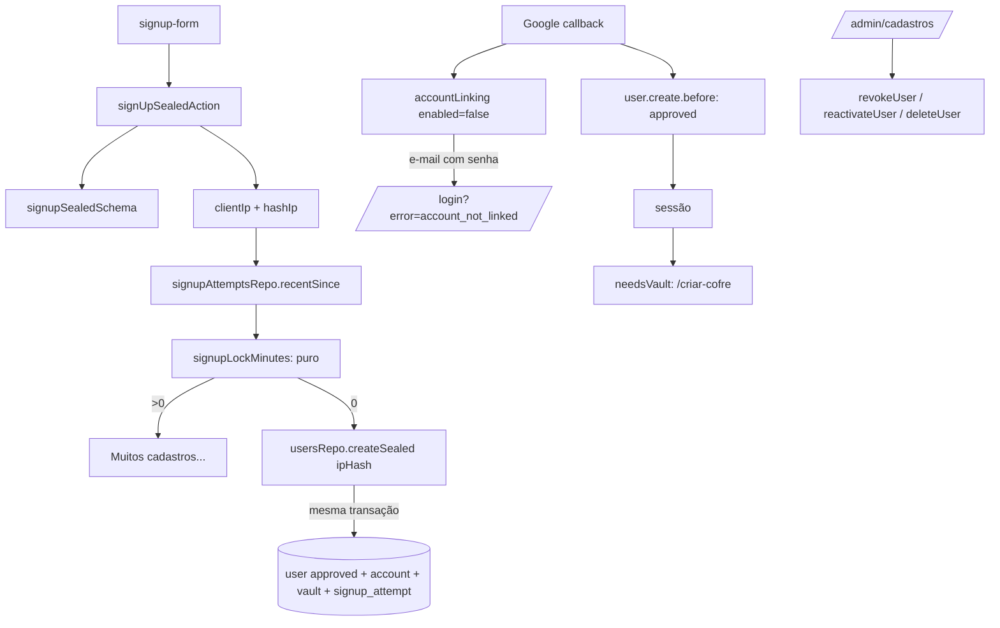

# Cadastro Aberto sem Aprovação Manual Design

**Spec**: `.specs/features/cadastro-aberto/spec.md`
**Status**: Draft

---

## Architecture Overview

Sem arquitetura nova. A mudança é de regra de estado: o status `approved` passa a ser gravado na criação (cadastro por senha e Google), a máquina de estados do admin encolhe para `approved ⇄ revoked`, e um limite por IP guarda a porta do cadastro por formulário. O guard (`auth-guard.ts`, hook de sessão) continua exigindo `approved`: não muda.



---

## Code Reuse Analysis

### Existing Components to Leverage

| Component | Location | How to Use |
| --------- | -------- | ---------- |
| `loginAttemptsRepo` + `lockedMinutes` | `src/lib/db/repos/login-attempts.ts`, `src/lib/login-lock.ts` | Mesmo padrão (tabela de tentativas, janela, minutos arredondados para cima) para o limite de IP |
| `usersRepo.createPendingSealed` | `src/lib/db/repos/users.ts:30` | Renomear para `createSealed`; grava `approved` e o registro de IP na mesma transação |
| `transition` | `src/lib/db/repos/users.ts:104` | Reaproveitar; só mudam as ações válidas |
| `LOGIN_BLOCK_MESSAGE`, `availableActions`, `UserAction` | `src/lib/domain/user-status.ts` | Ajustar textos e transições |
| `loginNotice` | `src/lib/login-notice.ts` | Acrescentar o erro `account_not_linked` |
| `googleUserCreateDecision` | `src/lib/google-hooks.ts` | Devolver `approved` |
| `needsVault`, layout `(app)` | `src/lib/db/repos/vault.ts`, `src/app/(app)/layout.tsx` | Sem mudança: já levam `approved` sem cofre a `/criar-cofre` |
| `UserAdminList` | `src/components/user-admin-list.tsx` | Tirar Aprovar/Rejeitar; `approve` vira "Reativar" |

### Integration Points

| System | Integration Method |
| ------ | ------------------ |
| Better Auth (Google) | `account.accountLinking.enabled = false`: o callback devolve `account not linked` e redireciona ao `errorCallbackURL` (`/login`) com `?error=account_not_linked` (`link-account.mjs:136-143`, `callback.mjs:195-197`). Quem já tem a conta Google vinculada continua entrando, porque é achado por `providerId + accountId` antes dessa checagem (`link-account.mjs:~100`) |
| Banco | Uma tabela nova `signup_attempt`; migração `0016`. Nenhuma migração de status |
| Cabeçalhos | `headers()` do Next na Server Action (`x-forwarded-for`, `x-real-ip`) |

---

## Components

### Máquina de estados do admin (`user-status.ts`)

- **Purpose**: Só `approved ⇄ revoked` mudam por ação do admin.
- **Location**: `src/lib/domain/user-status.ts`
- **Interfaces**:
  - `UserAction = "reactivate" | "revoke"` (remove `reject`; `approve` vira `reactivate`)
  - `TRANSITIONS`: `reactivate: from ["revoked"] → approved`; `revoke: from ["approved"] → revoked`
  - `availableActions`: `approved → [revoke, delete]`; `revoked → [reactivate, delete]`; `pending`/`rejected → [delete]`
  - `LOGIN_BLOCK_MESSAGE.pending = "Sua conta não está liberada. Fale com o administrador"` (OPEN-04); `rejected` e `revoked` iguais
- **Reuses**: a estrutura atual; só os dados mudam.

### Ações do admin (`admin-users.ts`)

- **Location**: `src/actions/admin-users.ts`
- **Interfaces**: remove `approveUser`/`rejectUser`; adiciona `reactivateUser(id)`; `revokeUser` e `deleteUser` iguais. Erro de origem inválida: `NOT_REVOKED = "Este usuário não está revogado"` (reativar), `NOT_APPROVED` (revogar) como hoje. `decide` passa `revokeSessions: action === "revoke"`.
- **Idempotência**: `transition` devolve `ok` ao reativar um usuário já `approved` (linha 122 passa a testar `reactivate`).

### Lista do admin (`user-admin-list.tsx`)

- **Interfaces**: `ACTION_LABEL.reactivate = "Reativar"`; `RUN` sem `approve`/`reject`; botão `reactivate` com variante `default`. Rótulos de status inalterados.

### Cadastro: criação aprovada com registro de IP

- **Purpose**: Criar `approved` e contar o IP na mesma transação (OPEN-01, OPEN-02 AC 2-4, 7).
- **Location**: `src/lib/db/repos/users.ts`
- **Interfaces**:
  - `createSealed(input & { ipHash: string | null }): Promise<{ ok: true } | { ok: false; reason: "duplicate" }>` - `status: "approved"`; com `ipHash`, insere em `signup_attempt` e apaga linhas com mais de 60 minutos, dentro da transação. Duplicado retorna antes de gravar o IP.
- **Reuses**: o corpo atual de `createPendingSealed`.

### Limite por IP

- **Purpose**: Recusar o 6º cadastro do mesmo IP em 60 minutos.
- **Location**: `src/lib/domain/signup-limit.ts` (puro), `src/lib/client-ip.ts`, `src/lib/db/repos/signup-attempts.ts`, `src/actions/auth.ts`
- **Interfaces**:
  - `SIGNUP_MAX = 5`, `SIGNUP_WINDOW_MS = 3_600_000`
  - `signupLockMinutes(times: Date[], now: number): number` - `times` são os instantes dentro da janela, em ordem crescente; com `times.length < 5` devolve 0; senão `ceil((times[len-5] + WINDOW - now) / 60_000)` (a mais antiga das 5 mais recentes)
  - `clientIp(headers: Headers): string | null` - primeiro item de `x-forwarded-for` (cortado por vírgula, aparado); senão `x-real-ip`; vazio vira `null`
  - `hashIp(ip: string): string` - HMAC-SHA-256 em hex, chave `BETTER_AUTH_SECRET` (ver Risks)
  - `signupAttemptsRepo.recentSince(ipHash, since): Promise<Date[]>` - crescente
  - `signUpSealedAction`: após o `safeParse`, `ip = clientIp(await headers())`; se `ip`, lê `recentSince(hashIp(ip), now - WINDOW)` e, se `signupLockMinutes > 0`, devolve `Muitos cadastros a partir deste endereço. Tente novamente em {n} minuto(s)`; senão `createSealed({ ..., ipHash })`. Falha de banco em qualquer passo cai no `catch` existente (`SAVE_FAILED`, sem usuário porque a gravação é uma transação).
- **Dependencies**: `signup_attempt`.
- **Reuses**: padrão de `login-lock.ts` e do texto singular/plural de `signInAction`.

### Mensagem final do cadastro

- **Location**: `src/app/cadastro/signup-form.tsx`
- **Interfaces**: `SENT_MESSAGE = "Cadastro concluído. Você já pode entrar"` mais `<Link href="/login">Ir para o login</Link>` (OPEN-01 AC 1). Os textos de `/cadastro` e `/login` não citam aprovação (AC 4).

### Google

- **Location**: `src/lib/google-hooks.ts`, `src/lib/auth.ts`, `src/lib/login-notice.ts`
- **Interfaces**:
  - `googleUserCreateDecision` devolve `{ data: { status: "approved" } }` para e-mail verificado (OPEN-05 AC 1, 5)
  - `auth.ts`: `account.accountLinking: { enabled: false }`; remove o comentário de `requireLocalEmailVerified`
  - `loginNotice({ error: "account_not_linked" }) = "Este e-mail já tem cadastro com senha. Entre com e-mail e senha"`; qualquer outro `error` continua "Não foi possível entrar com o Google"
  - Hook de sessão e cookie `anon_login_block` inalterados: `pending`/`rejected`/`revoked` legados seguem recusados (OPEN-05 AC 4)
- **Reuses**: `needsVault` e `/criar-cofre` (OPEN-05 AC 6).

---

## Data Models

### `signup_attempt`

```typescript
interface SignupAttempt {
  id: number          // serial PK
  ipHash: string      // HMAC-SHA-256 hex, 64 caracteres
  attemptedAt: Date   // timestamptz, relógio do app, como login_attempt
}
// índice (ipHash, attemptedAt)
```

Sem relação com `user`: o registro não identifica a pessoa e vive no máximo 60 minutos. `usersRepo.remove` não precisa tocá-lo.

---

## Error Handling Strategy

| Error Scenario | Handling | User Impact |
| -------------- | -------- | ----------- |
| IP com 5 cadastros na janela | `signupLockMinutes > 0` antes de criar | Mensagem de limite; nada gravado |
| IP ausente | `clientIp` devolve `null`; `ipHash: null` | Cadastro segue sem limite |
| Banco falha ao ler ou gravar o IP | `catch` da ação | `SAVE_FAILED`; transação desfaz o usuário |
| E-mail duplicado | `createSealed` devolve `duplicate` antes do insert de IP | Mensagem atual; não conta |
| Google com e-mail que tem senha | Better Auth recusa o vínculo | `/login` com a mensagem de OPEN-05 AC 2 |
| Reativar `pending`/`rejected` | `transition` devolve `wrong_state` | "Este usuário não está revogado" |

---

## Risks & Concerns

| Concern | Location | Impact | Mitigation |
| ------- | -------- | ------ | ---------- |
| IPv4 em SHA-256 puro é reversível por força bruta (2^32 entradas) | `hashIp` | O "hash" não protegeria o IP de quem vazasse a tabela | HMAC-SHA-256 com `BETTER_AUTH_SECRET`. A spec diz "hash SHA-256"; o HMAC é SHA-256 com chave. Ajustar AC 2 da spec ao confirmar o Design |
| `x-forwarded-for` é forjável fora da Vercel | `clientIp` | Atacante troca o IP a cada chamada e burla o limite | Na Vercel o cabeçalho é sobrescrito pela borda; fora dela o limite é fraco. Risco aceito e registrado na AD-015 |
| Conferir e criar não são atômicos | `signUpSealedAction` | Cadastros simultâneos passam do limite | Aceito nas premissas da spec |
| `accountLinking.enabled = false` também bloqueia o vínculo de usuário sem conta Google e sem senha | `link-account.mjs:136` | Hoje todo usuário não Google tem `credential`, então não ocorre | Teste de integração com e-mail que tem senha; o caso "sem credential e sem Google" não existe nos dados |
| Usuários Google `pending` já criados ficam sem saída | Banco de produção | Pessoa vê "Sua conta não está liberada" e só o admin exclui | Decidido na spec (ninguém muda). Documentar no `docs/contas.md` se existir seção de status |
| `rejected` e `pending` continuam no enum e no `CHECK` | `auth-schema.ts:24` | Código morto para novos usuários | Mantidos: há linhas legadas; remover exige migração fora de escopo |
| Sem teste de UI (AD-005) | `signup-form`, `user-admin-list`, `login` | Regressão visual | Lógica em funções puras e repos testados; UI por inspeção de código (`file:line`) |
| Testes existentes assumem `pending` e Aprovar/Rejeitar | `users*.int.test.ts`, `admin-users.int.test.ts`, `user-status.test.ts`, `auth-google*.test.ts` | Quebram | São o diff de teste de cada task; não enfraquecer, reescrever contra os ACs |

---

## Tech Decisions (only non-obvious ones)

| Decision | Choice | Rationale |
| -------- | ------ | --------- |
| Registrar o IP na transação do usuário | `createSealed` insere em `signup_attempt` | "Criar e contar" é tudo ou nada; duplicado e validação nunca contam |
| Limite no repo e na ação, cálculo em função pura | `signupLockMinutes` | Testável sem banco, mesma divisão de `lockedMinutes` |
| Desligar o vínculo em vez de checar a conta com senha no hook | `accountLinking.enabled = false` | Menos código próprio; o Better Auth já faz a recusa e redireciona com `?error` |
| `reject` removido, `pending`/`rejected` mantidos no tipo | Compatibilidade com linhas legadas | Remoção do enum exige migração de dados fora de escopo |

> **Project-level decision:** AD-015 registrado em `.specs/STATE.md`.
