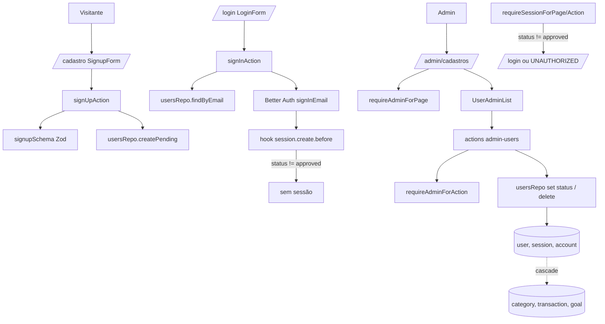

# Cadastro com Aprovação do Administrador Design

**Spec**: `.specs/features/cadastro-aprovacao/spec.md`
**Status**: Draft

---

## Approaches Considered

| Approach | Resumo | Veredito |
| -------- | ------ | -------- |
| **A. Coluna `status` em `user` + repositório próprio (recomendada)** | O status vive no usuário; um hook do Better Auth impede criar sessão de quem não está `approved`; guards de página e ação conferem o status; o administrador é decidido pelo e-mail | Menor mudança, mantém o `ADMIN_EMAIL` como no spec, exclusão usa o cascade que já existe |
| B. Plugin `admin` do Better Auth | Traz `role`, `banned`, listar e remover usuários prontos | Descartada: a identidade do administrador seria por papel no banco (contraria a decisão do spec), não existe estado `pending`, e o plugin expõe endpoints de administração novos para proteger |
| C. Tabela `registration_request` e usuário só na aprovação | O usuário real só existe após aprovar | Descartada: revogar e excluir ficam em dois modelos, a senha precisaria ficar guardada fora do formato do Better Auth até a aprovação |

---

## Architecture Overview

O status é a única fonte de verdade do acesso e é conferido em três camadas, da mais interna para a mais externa:

1. **Criação de sessão** (`databaseHooks.session.create.before` no Better Auth): recusa sessão para usuário que não está `approved`. Cobre também o endpoint `/api/auth/sign-in/email`, que continua exposto.
2. **Guards de servidor** (`requireSessionForPage/Action`): leem o usuário da sessão e tratam status diferente de `approved` como sem sessão. Cobre sessões já abertas.
3. **Proxy** continua só com a checagem otimista de cookie; `/cadastro` entra na lista de rotas públicas.

O administrador não é guardado no banco: `isAdminEmail(email)` compara com `ADMIN_EMAIL` a cada requisição, e `requireAdminForPage/Action` soma `approved` + essa comparação.



---

## Code Reuse Analysis

### Existing Components to Leverage

| Component | Location | How to Use |
| --------- | -------- | ---------- |
| `seedUser` (hash + insert em transação) | `src/lib/db/seed-user.ts` | Mesmo formato de conta; `createPending` repete o par `user` + `account` com `hashPassword` do Better Auth; o seed passa a gravar `approved` |
| `loginAttemptsRepo` | `src/lib/db/repos/login-attempts.ts` | Bloqueio por tentativas reaproveitado sem mudança; exclusão de usuário chama `clear(email)` |
| `ActionResult`, `invalidInput`, `SAVE_FAILED`, `UNAUTHORIZED` | `src/lib/action-result.ts` | Contrato de retorno de todas as novas ações |
| `requireSessionFor*` | `src/lib/auth-guard.ts` | Estendido com status e com as variantes de administrador |
| Padrão de ação (guard, zod, repo, `revalidatePath`, `SAVE_FAILED`) | `src/actions/goals.ts` | Molde das ações de administração |
| `LoginForm`, `LoginPage` | `src/app/login/` | Molde visual e de `useActionState` para `/cadastro` |
| `Dialog`, `Button`, `Badge`, `Table`, `DropdownMenu` | `src/components/ui/` | Lista de usuários e confirmação de exclusão (já existem; sem biblioteca nova) |
| `PageHeader` | `src/components/page-header.tsx` | Cabeçalho de `/admin/cadastros` |
| `insertCredentialUser`, `createSignedInUser` | `src/test/auth.ts` | Ganham parâmetro `status` (padrão `approved`) para os testes existentes seguirem verdes |

### Integration Points

| System | Integration Method |
| ------ | ------------------ |
| Better Auth | `user.additionalFields.status` (`input: false`) para o status chegar em `getSession`; `databaseHooks.session.create.before`; `emailAndPassword.disableSignUp` continua `true` (cadastro passa pela ação, não pelo endpoint) |
| Postgres | Migração Drizzle: coluna `status` em `user` com `UPDATE` dos existentes para `approved`; `ON DELETE CASCADE` já existe em `category`, `subcategory`, `transaction`, `financial_goal`, `session`, `account` |
| Next.js | `proxy.ts` ganha `cadastro` na exclusão do matcher; `revalidatePath("/admin/cadastros")` após cada decisão |

---

## Components

### Domínio de status

- **Purpose**: Tipos e regras de transição puros, usados pelo servidor e pela UI (visibilidade das ações, AC 20).
- **Location**: `src/lib/domain/user-status.ts`
- **Interfaces**:
  - `type UserStatus = "pending" | "approved" | "rejected" | "revoked"`
  - `type UserAction = "approve" | "reject" | "revoke"`
  - `fromStatuses(action): UserStatus[]` - status de origem válidos (`approve`: pending, rejected, revoked; `reject`: pending; `revoke`: approved)
  - `targetStatus(action): UserStatus`
  - `availableActions(status): (UserAction | "delete")[]` - AC 20 da decisão
  - `LOGIN_BLOCK_MESSAGE: Record<Exclude<UserStatus, "approved">, string>` - as três mensagens de login
- **Dependencies**: nenhuma (sem import de servidor, isomórfico como a AD-008)
- **Reuses**: padrão de módulos puros de `src/lib/domain/`

### Validação do cadastro

- **Purpose**: Schema Zod com as mensagens exatas do spec.
- **Location**: `src/lib/validation/signup.ts`
- **Interfaces**: `signupSchema` (`name` trim 1-80, `email` válido e normalizado, `password` 8-128)
- **Dependencies**: `zod`
- **Reuses**: padrão de `src/lib/validation/goal.ts` e `invalidInput`

### Identidade de administrador

- **Purpose**: Decidir quem é o administrador.
- **Location**: `src/lib/admin.ts`
- **Interfaces**: `isAdminEmail(email: string): boolean` - compara normalizado com `process.env.ADMIN_EMAIL`; falso se a variável não existir
- **Dependencies**: variável de ambiente
- **Reuses**: mesma normalização (`trim().toLowerCase()`) do `seedUser`

### Repositório de usuários

- **Purpose**: Todo acesso a `user` para cadastro, decisão e exclusão.
- **Location**: `src/lib/db/repos/users.ts`
- **Interfaces**:
  - `createPending(input: { name; email; password }): Promise<{ ok: true } | { ok: false; reason: "duplicate" }>` - transação com `user` (`status: pending`) e `account`; `ON CONFLICT (email) DO NOTHING` resolve a corrida do AC 8 sem checar antes
  - `findByEmail(email): Promise<{ id; email; status; passwordHash } | null>`
  - `listForAdmin(adminEmail): Promise<AdminUserRow[]>` - exclui o administrador, `pending` primeiro, depois por `created_at` crescente
  - `transition(id, action): Promise<"ok" | "not_found" | "wrong_state">` - `UPDATE ... WHERE id = $1 AND status = ANY(fromStatuses)` com `decided_at = now()`; distingue inexistente de estado inválido com um `SELECT` só quando o `UPDATE` não afeta linha; `approve` sobre `approved` retorna `ok` sem alterar (AC 6)
  - `revokeSessions(id): Promise<void>`
  - `remove(id): Promise<"ok" | "not_found">` - transação: lê o e-mail, apaga o usuário (cascade), apaga `login_attempt` do e-mail
- **Dependencies**: `db`, `auth-schema`, `hashPassword`
- **Reuses**: estrutura de `seed-user.ts` e `login-attempts.ts`

### Configuração do Better Auth

- **Purpose**: Expor o status na sessão e barrar a criação de sessão.
- **Location**: `src/lib/auth.ts`
- **Interfaces**: `user.additionalFields.status`; `databaseHooks.session.create.before: (session) => status === "approved" ? undefined : false` (lê o status pelo `userId` no banco)
- **Dependencies**: `usersRepo` (leitura de status)
- **Reuses**: configuração atual

### Guards

- **Purpose**: Sessão aprovada e, quando pedido, administrador.
- **Location**: `src/lib/auth-guard.ts`
- **Interfaces**:
  - `requireSessionForPage(): Promise<{ userId: string; isAdmin: boolean }>` - redireciona a `/login` se sem sessão ou status != `approved`
  - `requireSessionForAction()` - inalterado no contrato; devolve `UNAUTHORIZED` se status != `approved`
  - `requireAdminForPage(): Promise<{ userId }>` - redireciona a `/` se aprovado e não administrador
  - `requireAdminForAction()` - `UNAUTHORIZED` se não administrador
- **Dependencies**: `auth.api.getSession`, `isAdminEmail`
- **Reuses**: `currentUserId` vira `currentUser` devolvendo `{ id, email, status }`

### Ações de autenticação

- **Purpose**: Cadastro e login com os novos estados.
- **Location**: `src/actions/auth.ts`
- **Interfaces**:
  - `signUpAction(prev, formData): Promise<ActionResult>` - valida, chama `createPending`, devolve `{ ok: true }` ou erro (`fieldErrors` por campo; `duplicate` vira "Este e-mail já está cadastrado" no campo e-mail)
  - `signInAction` (alterada): depois do bloqueio por tentativas, `findByEmail`; se o usuário existe e não está `approved`, confere a senha com `verifyPassword` do Better Auth contra o hash: correta devolve a mensagem de `LOGIN_BLOCK_MESSAGE` sem registrar falha; errada registra falha e devolve "E-mail ou senha inválidos". Usuário `approved` ou inexistente segue o fluxo atual
- **Dependencies**: `signupSchema`, `usersRepo`, `loginAttemptsRepo`, `auth`
- **Reuses**: `signInAction` atual

### Ações de administração

- **Purpose**: Aprovar, rejeitar, revogar e excluir.
- **Location**: `src/actions/admin-users.ts`
- **Interfaces**: `approveUser(id)`, `rejectUser(id)`, `revokeUser(id)`, `deleteUser(id)`, todas `Promise<ActionResult>`; cada uma: `requireAdminForAction`, recusa se `id` é o administrador ("Não é possível revogar ou excluir o administrador" - vale para revogar e excluir; aprovar e rejeitar do administrador não aparecem na lista e retornam "Cadastro não encontrado" porque a linha dele não é listada nem editável: `transition` filtra `email != ADMIN_EMAIL`), `usersRepo`, `revokeSessions` em rejeitar e revogar, `revalidatePath("/admin/cadastros")`, `try/catch` com `SAVE_FAILED`
- **Dependencies**: `usersRepo`, guards, `isAdminEmail`
- **Reuses**: molde de `src/actions/goals.ts`

### Telas de cadastro

- **Purpose**: `/cadastro` (público) com `SignupForm`; link "Criar conta" no login e "Já tenho conta" no cadastro.
- **Location**: `src/app/cadastro/page.tsx`, `src/app/cadastro/signup-form.tsx`, ajuste em `src/app/login/login-form.tsx`
- **Interfaces**: `SignupForm` (client, `useActionState(signUpAction)`); após `{ ok: true }` troca o formulário pela mensagem de envio
- **Dependencies**: `signUpAction`
- **Reuses**: `LoginPage` e `LoginForm` como molde

### Tela de administração

- **Purpose**: `/admin/cadastros` com a lista e as ações.
- **Location**: `src/app/(app)/admin/cadastros/page.tsx`, `src/components/user-admin-list.tsx`
- **Interfaces**: `page` (server) chama `requireAdminForPage` e `usersRepo.listForAdmin`; `UserAdminList({ users })` (client) renderiza linha com status em `Badge`, botões conforme `availableActions(status)`, `Dialog` de confirmação só para Excluir; `useTransition` e `revalidatePath` atualizam a lista (AC 12)
- **Dependencies**: ações de administração, `user-status`
- **Reuses**: `PageHeader`, `Table`, `Badge`, `Dialog`

### Navegação

- **Purpose**: Item "Cadastros" só para o administrador.
- **Location**: `src/components/app-nav.tsx`, `src/app/(app)/layout.tsx`
- **Interfaces**: `AppNav({ isAdmin })`; o layout lê `isAdmin` de `requireSessionForPage`; item `{ href: "/admin/cadastros", label: "Cadastros", icon: UsersIcon }` somado quando `isAdmin`
- **Dependencies**: guard
- **Reuses**: lista `items` atual

---

## Data Models

### `user` (coluna nova)

```typescript
// src/lib/db/auth-schema.ts
status: text("status").$type<UserStatus>().notNull().default("pending"),
decidedAt: timestamp("decided_at"),
// + CHECK (status IN ('pending','approved','rejected','revoked'))
```

**Migração**: `ALTER TABLE user ADD status ... DEFAULT 'pending'`, `ADD decided_at`, e em seguida `UPDATE "user" SET status = 'approved'` para as linhas existentes (AC 16). O padrão `pending` do banco garante que qualquer inserção esquecida fica bloqueada em vez de liberada. O arquivo `auth-schema.ts` é gerado pelo Better Auth; a coluna é adicionada à mão e anotada com comentário para não se perder em regeneração.

**Relationships**: nenhuma nova. A exclusão depende do `ON DELETE CASCADE` existente de `session`, `account`, `category`, `subcategory`, `transaction`, `financial_goal` (verificado em `src/lib/db/schema.ts:30,75,99,157` e `auth-schema.ts`). `category_percent` cai junto via `category`; verificar no teste de exclusão. `login_attempt` não tem FK (guarda só e-mail) e é limpa explicitamente.

```typescript
interface AdminUserRow {
  id: string
  name: string
  email: string
  status: UserStatus
  createdAt: Date
}
```

---

## Error Handling Strategy

| Error Scenario | Handling | User Impact |
| -------------- | -------- | ----------- |
| Campo inválido no cadastro | `invalidInput` com `fieldErrors` | Mensagem exata do spec sob o campo |
| E-mail já existe (inclui corrida) | `ON CONFLICT DO NOTHING`, `reason: duplicate` | "Este e-mail já está cadastrado" |
| Login de não aprovado, senha correta | Ação devolve mensagem de status, hook também recusa a sessão | Mensagem de pendente, rejeitado ou revogado |
| Login de não aprovado, senha errada | `recordFailure` | "E-mail ou senha inválidos" |
| Sessão aberta de usuário não aprovado | Guard devolve sem sessão | Vai para `/login` ou `UNAUTHORIZED` |
| Não administrador chama ação ou página | `requireAdminForAction` / `requireAdminForPage` | `UNAUTHORIZED` ou redirecionamento a `/` |
| Transição inválida | `transition` devolve `wrong_state` | "Este cadastro não está pendente" ou "Este usuário não está aprovado" |
| Usuário inexistente | `not_found` | "Cadastro não encontrado" |
| Administrador alvo de revogar ou excluir | Checagem na ação antes do repo | "Não é possível revogar ou excluir o administrador" |
| Falha de banco | `try/catch`, transação reverte, `console.error` | "Não foi possível salvar. Tente novamente" |

---

## Risks & Concerns

| Concern | Location (file:line) | Impact | Mitigation |
| ------- | -------------------- | ------ | ---------- |
| Endpoint `/api/auth/sign-in/email` é público e cria sessão sem passar pela nossa ação | `src/app/api/auth/[...all]/route.ts` | Pendente poderia obter sessão chamando o endpoint direto | Hook `session.create.before` recusa a sessão na origem; teste de integração chama `auth.api.signInEmail` direto com usuário pendente |
| Guards leem só o `userId` hoje; status ignorado | `src/lib/auth-guard.ts:7-9` | Sessão aberta de usuário revogado continuaria válida | Guard passa a ler `status` do usuário a cada chamada (sem cache de cookie configurado) e revogar/rejeitar apaga as sessões |
| `auth-schema.ts` é arquivo gerado pelo Better Auth | `src/lib/db/auth-schema.ts:1` | Regerar o schema apagaria a coluna `status` | Comentário no arquivo e `additionalFields` no `auth.ts`; teste de schema confere a coluna |
| Usuários existentes bloqueados se o `UPDATE` da migração for esquecido | migração nova | Administrador fora do app | O `UPDATE` vai no mesmo SQL da migração; teste de integração do AC 16 |
| Helpers de teste inserem usuário sem status | `src/test/auth.ts:12` | Com padrão `pending`, todos os testes de sessão existentes quebram | `insertCredentialUser` ganha `status` com padrão `approved` na primeira task |
| Lockout no login conta falhas por e-mail e hoje não distingue status | `src/actions/auth.ts:27-52` | Mensagem de pendente poderia vazar para quem erra a senha | A senha é conferida antes de revelar o status (premissa do spec); teste de senha errada com pendente |
| Cadastro aberto sem limite de taxa | `src/actions/auth.ts` (nova `signUpAction`) | Lista de pendentes pode ser lotada | Risco aceito no spec; exclusão em lote fica como follow-up |
| Exclusão apaga dados financeiros sem desfazer | `src/actions/admin-users.ts` (nova) | Perda acidental | Diálogo de confirmação (AC 15), ação só do administrador, transação única |
| Testes de UI sem cobertura automática | AD-005 | Fluxo da lista e do diálogo não é testado | Lógica de visibilidade em `user-status.ts` com teste unitário; verificação manual no Execute |

---

## Tech Decisions (only non-obvious ones)

| Decision | Choice | Rationale |
| -------- | ------ | --------- |
| Onde fica o status | Coluna em `user` (não tabela separada) | Um `JOIN` a menos, `getSession` já devolve o usuário com `additionalFields` |
| Padrão da coluna | `pending` | Falha segura: inserção sem status fica bloqueada |
| Cadastro sem o endpoint do Better Auth | Ação própria + `createPending` | `disableSignUp: true` fica ligado; nenhum endpoint de cadastro aberto |
| Administrador por e-mail em tempo de execução | `isAdminEmail` a cada requisição | Decisão do spec; sem papel no banco, sem escalada pelo app |
| Revogar e rejeitar apagam sessões; aprovar não | `revokeSessions` | Efeito imediato do bloqueio; aprovar não precisa mexer em sessão |
| Status de rejeitado e revogado separados | `rejected` e `revoked` | Mensagens de login diferentes (spec) |
| Atualização da lista após a ação | `revalidatePath` + `useTransition` | Padrão do projeto (AD-001), sem estado de lista no cliente |

> **Project-level decision (a registrar em `STATE.md` após aprovação do design):** AD-009 - o acesso ao app depende de `user.status = approved`, conferido na criação da sessão e em todo guard; o administrador é a conta de `ADMIN_EMAIL`, decidida em tempo de execução. Toda feature futura que crie usuário ou sessão segue isso.
