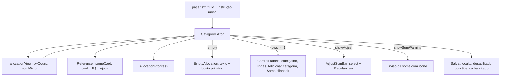

# Categorias: Estado Vazio e Hierarquia Design

**Spec**: `.specs/features/categorias-estado-vazio/spec.md`
**Status**: Draft

---

## Architecture Overview

Mudança só de apresentação, no cliente. `CategoryEditor` continua dono do estado (`rows`, `income`, `result`). A decisão de "o que mostrar" sai do JSX e vira uma função pura em `src/lib/domain/allocation-view.ts`, testável em unit (o projeto não tem teste de componente; e2e está suspenso pela AD-005). Os componentes só leem o resultado dessa função.

---

## Code Reuse Analysis

### Existing Components to Leverage

| Component | Location | How to Use |
| --------- | -------- | ---------- |
| `Progress` (Radix) | `src/components/ui/progress.tsx` | Barra do indicador; já expõe `role="progressbar"` e `aria-valuenow` |
| `InputAffix` | `src/components/input-affix.tsx` | Prefixo `R$` no campo da receita (mesmo uso do campo de valor da linha) |
| `sumLabel`, `TOTAL_MICRO` | `src/lib/domain/percent.ts` | Texto da soma no indicador (`40,00%`) |
| `sumWarning` | `src/lib/domain/sum-warning.ts` | Texto do aviso, sem mudança |
| `COL_PERCENT`/`COL_AMOUNT` | `src/components/category-editor.tsx:51-57` | Mesmas larguras na linha Soma |
| `AlertCircleIcon` | `lucide-react` (já é dependência: `Trash2Icon`) | Ícone do aviso e do erro de salvar |

### Integration Points

| System | Integration Method |
| ------ | ------------------ |
| `saveCategories` | Sem mudança; Salvar com 0 linhas deixa de ser acionável porque o botão não existe |
| `e2e/categories.spec.ts` | Seletores `Adicionar categoria` (linhas 12, 184, 284, 295) quebram no estado vazio; trocar por regex `/Adicionar (primeira )?categoria/` |

---

## Components

### allocationView (função pura)

- **Purpose**: Decide a visibilidade e os textos do editor a partir do nº de linhas e da soma.
- **Location**: `src/lib/domain/allocation-view.ts` (+ `allocation-view.test.ts`)
- **Interfaces**:
  - `allocationView(rowCount: number, sumMicro: number): AllocationView`
  - `AllocationView = { empty: boolean; showSumWarning: boolean; showAdjust: boolean; showSave: boolean; saveHint: string | null; progressValue: number; progressText: string }`
  - Regras: `empty = rowCount === 0`; `showSumWarning = rowCount >= 1 && sum !== TOTAL`; `showAdjust = rowCount >= 2 && sum !== TOTAL`; `showSave = rowCount >= 1`; `saveHint = showSave && sum !== TOTAL ? "Some 100% para salvar" : null`; `progressValue = clamp(sum / MICRO_PER_PERCENT, 0, 100)`; `progressText = (sum === 0 ? "0%" : sumLabel(sum)) + " de 100% alocado"`.
- **Dependencies**: `percent.ts`
- **Reuses**: `sumLabel`, `TOTAL_MICRO`, `MICRO_PER_PERCENT`

### AllocationProgress

- **Purpose**: Indicador neutro `{soma} de 100% alocado` com barra.
- **Location**: `src/components/allocation-progress.tsx`
- **Interfaces**: `AllocationProgress({ value: number, text: string })`; texto visível acima da barra, `aria-label={text}` no `Progress`.
- **Reuses**: `ui/progress.tsx` com `indicatorClassName="bg-muted-foreground"` (neutro, sem vermelho/roxo de ação)

### EmptyAllocation

- **Purpose**: Bloco do estado vazio.
- **Location**: função local em `src/components/category-editor.tsx` (≈15 linhas, só usada ali)
- **Interfaces**: recebe `onAdd`; texto exato da spec e `<Button type="button" onClick={add}>Adicionar primeira categoria</Button>` (variante padrão = primária), dentro de um card com a mesma classe do card da tabela.

### CategoryEditor (edição)

- Chamar `allocationView(rows.length, sumMicro)` na renderização; ramo `empty` mostra `EmptyAllocation` no lugar do card da tabela; some também o rodapé de botões.
- Card da tabela: cabeçalho com `COR` (primeira coluna, antes um `span` vazio), `AÇÕES` sem `text-[10px]`/`tracking-normal`, `É INVESTIMENTO?`; ordem: linhas, botão `Adicionar categoria` (outline, `border-t` dentro do card), linha Soma.
- Linha Soma: `flex items-center gap-x-3` com `span w-9 shrink-0`, `Soma` em `min-w-40 flex-1`, `COL_PERCENT` com `sumLabel`, `COL_AMOUNT` com total R$ ou `—`; `data-testid` atuais mantidos. Abaixo de `sm` mantém `flex-wrap`.
- Rodapé: só `Salvar` (renderizado se `showSave`), `title={saveHint ?? undefined}`. Para o `title` funcionar com o botão desabilitado, o `disabled:pointer-events-auto` atual já está na classe. Descrição acessível: `aria-describedby` apontando para um `span sr-only` com o mesmo texto quando `saveHint`.
- Aviso de soma: movido para fora do `AdjustSumBar` (renderizado pelo editor quando `showSumWarning`), com `AlertCircleIcon aria-hidden` + texto; `AdjustSumBar` passa a renderizar só o select/botão/erro de ajuste (`showAdjust`).
- Erro de salvar: `role="alert"` com o mesmo ícone.
- Ordem na página: `ReferenceIncomeCard`, `AllocationProgress`, (tabela ou vazio), aviso, ajuste, status/erro, Salvar. Todos em coluna `space-y-4`, cada bloco `w-full`.

### ReferenceIncomeCard

- **Edição**: modo campo ganha o mesmo card do modo resumo (`rounded-2xl border bg-card px-4 py-2 shadow-lg`, sem `max-w-md`, largura total); `Input` envolvido em `InputAffix prefix="R$"` dentro de `max-w-xs`; `placeholder` fica `5.000,00`.
- Nova prop `initialValue: string`. Texto de ajuda sob o campo: `value.trim() === ""` → `Informe para ver os valores em R$.`; `value === initialValue && initialValue !== ""` → `Preenchido com a receita do mês; edite para simular.`; senão nenhum.
- Refina a AC ESV-07/2: o texto some quando o usuário troca o valor (deixa de ser "do mês"). Registrado nas premissas da spec.
- `CategoryEditor` repassa `initialValue={initialIncome}`.

### page.tsx

- Remove o `
` `Alocação total obrigatória: 100% da receita`; mantém o segundo `
` com a instrução única.

---

## Data Models

Nenhum. Sem mudança de schema, action ou repo.

---

## Error Handling Strategy

| Error Scenario | Handling | User Impact |
| -------------- | -------- | ----------- |
| Salvar falha no servidor | `result.error` no `role="alert"` com ícone | Mensagem vermelha com ícone, como hoje + ícone |
| Soma ≠ 100% com 1+ linhas | Aviso com ícone e Salvar desabilitado com `title` | Sabe o motivo e o quanto falta |
| Soma > 100% | Barra limitada a 100%, texto com a soma real | Barra cheia e texto `105,00% de 100% alocado` |
| Receita inválida/vazia | Valor em R$ das linhas desabilitado (como hoje), total `—` | Texto de ajuda orienta |

---

## Risks & Concerns

| Concern | Location (file:line) | Impact | Mitigation |
| ------- | -------------------- | ------ | ---------- |
| Sem teste de componente; ACs de DOM não têm teste automático | `vitest.config.ts` (só `*.test.ts` node) | Regressão visual passa despercebida | Lógica de visibilidade/texto extraída para `allocationView` com unit; verificação manual guiada no Verifier (AD-005 suspende e2e novo) |
| E2e existente usa `Adicionar categoria` e `Rebalancear` | `e2e/categories.spec.ts:12,184,284,295,319` | Specs quebram no estado vazio | Task de ajuste mínimo dos seletores; não escrever e2e novo |
| `category-editor.tsx` já tem 452 linhas e mistura estado e layout | `src/components/category-editor.tsx` | Mais um ramo aumenta o arquivo | Lógica de decisão fica fora (`allocationView`); só `EmptyAllocation` pequena fica inline |
| Árvore de trabalho com mudanças não relacionadas (`summary-table`, `transaction-form`, e2e de transação) | `git status` | Commit atômico contaminado | Commits só com `git add` de arquivos da task |

---

## Tech Decisions (only non-obvious ones)

| Decision | Choice | Rationale |
| -------- | ------ | --------- |
| Onde mora a regra de visibilidade | `allocationView` pura em `src/lib/domain` | Única forma de cobrir os ACs com unit hoje |
| Contraste (ESV-08/5) | Sem mudança de token: `--muted-foreground` escuro `oklch(0.7 0.02 270)` mede 7,36:1 sobre `--background` e 6,77:1 sobre `--card`; o claro mede 7,14:1 | O AC já vale; o contraste ruim do pedido vem do Salvar desabilitado (`opacity-50`), que passa a ficar oculto no vazio e explicado nos demais. Cálculo OKLCH→sRGB→WCAG feito na fase de design |
| Barra de progresso neutra | `bg-muted-foreground` no indicador | Pedido: indicador neutro, sem alarme |
| Salvar desabilitado | Mantém `opacity-50`, adiciona `title` + `sr-only` | Explica o motivo sem mexer no componente `Button` global |
| Receita: ajuda condicionada a `value === initialValue` | Texto some ao editar | "Preenchido do mês" seria falso depois da edição |
| AD novo | Nenhum | Decisões são locais à tela |
