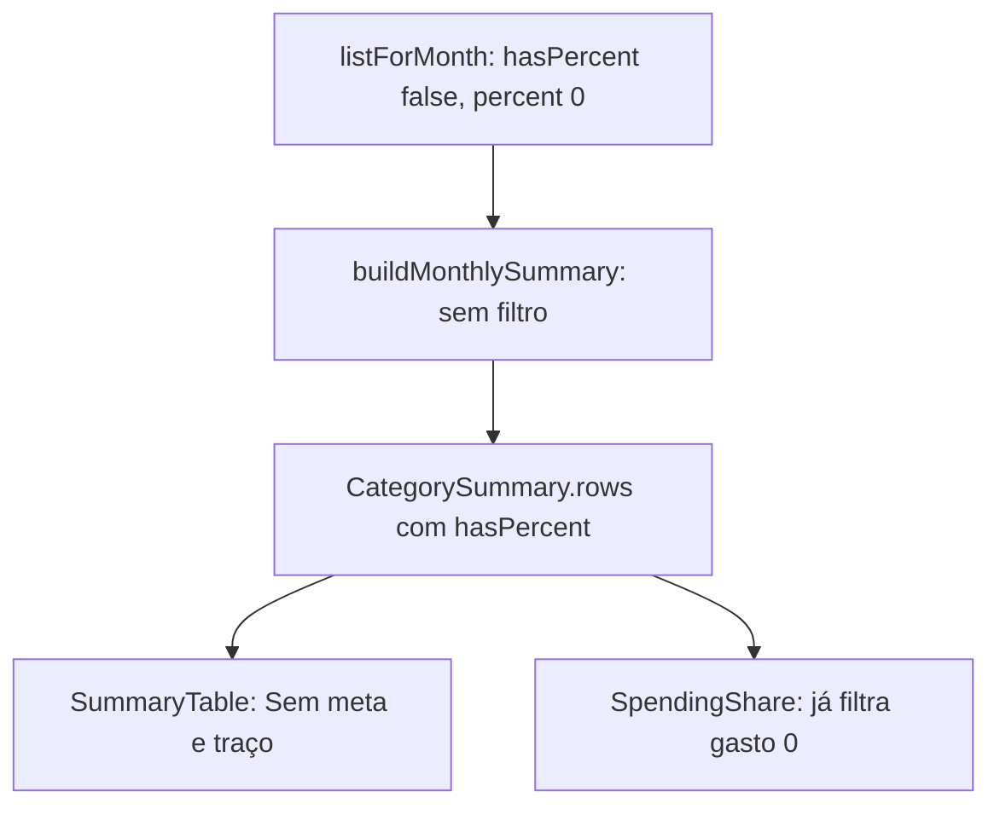

# Categorias Novas Visíveis em Meses Anteriores Design

**Spec**: `.specs/features/categorias-meses-anteriores/spec.md`
**Status**: Draft (revisado após uso: sem estouro em categoria sem meta; excluída sem meta e sem gasto some)

---

## Architecture Overview

Mudança só na leitura e na apresentação. `listForMonth` já devolve a categoria ativa em qualquer mês, com `hasPercent: false` e `percentMicro: 0` quando não há vigência. O único ponto que a esconde é o filtro `shown` em `buildMonthlySummary`. A decisão é remover o filtro e deixar `hasPercent` chegar até `CategorySummary` (já chega, via `...cat`), para a tabela exibir "Sem meta". Sem migração, sem mudança em `replaceSet` e sem nova AD (AD-007 continua valendo).

---

## Code Reuse Analysis

| Component | Location | How to Use |
| --------- | -------- | ---------- |
| `buildMonthlySummary` | `src/lib/domain/budget.ts:156` | Remover `shown`; usar `categories` direto |
| `Category.hasPercent` | `src/lib/domain/budget.ts:83` | Já propagado a `CategorySummary` por `...cat`; só atualizar o comentário |
| `SummaryTable` | `src/components/summary-table.tsx:21` | Ramificar pela `row.hasPercent === false` |
| `SpendingShare` | `src/components/budget-charts.tsx:103` | Sem mudança: `.filter(s => s.cents > 0)` já cumpre o AC 7 |

### Integration Points

| System | Integration Method |
| ------ | ------------------ |
| `src/app/(app)/page.tsx:49` | Sem mudança; passa `summary.rows` a `CategoryOverview` e aos gráficos |

---

## Components

### buildMonthlySummary

- **Purpose**: Montar uma linha para toda categoria recebida.
- **Location**: `src/lib/domain/budget.ts`
- **Interfaces**: assinatura inalterada; `Category` ganha `deleted?: boolean` (omitido = false). Linha com `hasPercent === false`: `targetCents` 0, `overspent` e `exceeded` sempre falsos, `overspentCents` e `exceededCents` 0, `consumedPct` 0. A categoria com `hasPercent === false`, `deleted === true` e gasto 0 é omitida de `rows`.
- **Reuses**: `allocateCents`, cálculo de linha existente.

### categoriesRepo.listForMonth

- **Purpose**: Marcar `deleted: true` na categoria com `deleted_from` não nulo (vista em mês anterior à exclusão).
- **Location**: `src/lib/db/repos/categories.ts` (`columns` ganha `deletedFrom`; o campo não vaza para `Category`)
- **Reuses**: a consulta existente, sem nova query.

### SummaryTable

- **Purpose**: Exibir "Sem meta" e "—" quando `row.hasPercent === false`.
- **Location**: `src/components/summary-table.tsx:88-91` (colunas de percentual e meta)
- **Interfaces**: restante e consumo → `—` (sem barra) quando `hasPercent === false`; percentual → `—` (no lugar de `formatPercentCompact`); meta → `Sem meta` em `text-muted-foreground` (no lugar de `formatBRL(targetCents)`). O restante da linha (gasto, restante, barra, "Estourou") segue a regra atual: sem gasto, nada de alerta; com gasto, "Estourou" com o valor gasto.
- **Reuses**: classes existentes da célula.

---

## Data Models

Nenhuma mudança.

---

## Error Handling Strategy

N/A: leitura somente.

---

## Tech Decisions

| Decision | Choice | Rationale |
| -------- | ------ | --------- |
| Onde remover a omissão | `buildMonthlySummary` (domínio), não a página | O filtro é regra de domínio testada em `budget.test.ts`; manter a regra num ponto só |
| Barras sem meta | Mantidas como estão (barra de meta 0) | Custo zero; o gasto, quando existe, aparece; sem mudança no gráfico |

---

## Risks & Concerns

| Concern | Location | Mitigation |
| ------- | -------- | ---------- |
| Categoria nova aparece em todos os meses anteriores, inclusive anteriores à conta do usuário | `listForMonth` não tem limite inferior | Aceito pela spec (Out of Scope); a navegação de meses já limita o intervalo |
| `design.md` e testes de `percentuais-historico` afirmam a omissão | `.specs/features/percentuais-historico/design.md:91`, `budget.test.ts:383` | Task atualiza o design e troca o teste "omits ... no spending" |
| Sem teste de componente (AD-005) | `summary-table.tsx` | Evidência de UI por inspeção `file:line`; a lógica fica no domínio, coberta por unit |
