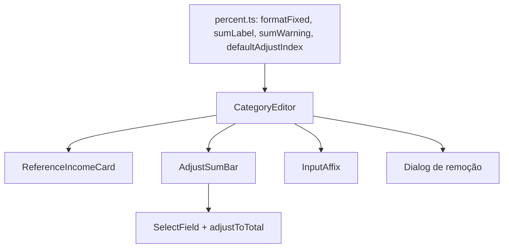

# Categorias: Melhorias de UX/UI Design

**Spec**: `.specs/features/categorias-ux/spec.md`
**Status**: Approved

---

## Architecture Overview

Mudança só no cliente. As regras novas (formatação a 2 casas, aviso de soma, alvo padrão do ajuste) viram funções puras em `percent.ts`, testadas por unidade. `category-editor.tsx` perde o botão "Ajustar" por linha e delega a três componentes novos: card da base, barra de ajuste da soma e campo com prefixo/sufixo. Servidor, schema e validação não mudam; conforme AD-006 o estado da linha e o valor salvo continuam com 6 casas.

---

## Code Reuse Analysis

### Existing Components to Leverage

| Component | Location | How to Use |
| --------- | -------- | ---------- |
| `adjustToTotal`, `parsePercent`, `formatPercent`, `TOTAL_MICRO` | `src/lib/domain/percent.ts` | "Aplicar" reaproveita `adjustToTotal` e a mensagem de fora do intervalo; `formatPercent` continua sendo o formato com até 6 casas |
| `allocateCents` | `src/lib/domain/budget.ts` | R$ da diferença da soma, mesmo arredondamento do R$ por linha |
| `formatBRL`, `parseBRL` | `src/lib/domain/money.ts` | Valor do card da base e validação da base |
| `SelectField` | `src/components/ui/select-field.tsx` | Select do ajuste (valores = índice da linha como texto) |
| `Dialog*` | `src/components/ui/dialog.tsx` | Confirmação de remoção, mesmo padrão do `ColorPicker` |
| `Button` (`icon-sm`, `ghost`) | `src/components/ui/button.tsx` | Lixeira e Salvar bloqueado |
| `Trash2`, `PencilIcon` | `lucide-react` (já usado) | Ícones |
| `subcategoryCountLabel` | `src/lib/domain/category-label.ts` | Texto do diálogo ("4 subcategorias") |

### Integration Points

| System | Integration Method |
| ------ | ------------------ |
| `saveCategories` | Sem mudança: continua recebendo `percent` completo da linha |
| `SubcategoryEditor`/`CategoryCard` | `trailing` recebe a lixeira; o botão de contagem ganha largura fixa para alinhar com o cabeçalho |
| `e2e/categories.spec.ts` | Ajustar a mensagem de soma, o fluxo da base e os botões de ajuste ao novo fluxo (não roda, AD-005) |

---

## Components

### Funções de domínio (`src/lib/domain/percent.ts`)

- **Purpose**: Regras puras e testáveis dos requisitos CATUX-01 a CATUX-03.
- **Interfaces**:
  - `formatPercentFixed(micro: number): string` - 2 casas, sem "%" ("6,30"); arredonda meio para cima em micro-percentual.
  - `percentFieldText(text: string, focused: boolean): string` - em foco ou inválido/vazio devolve o texto; sem foco e válido devolve `formatPercentFixed(parsePercent(text).value)`.
  - `sumLabel(sumMicro: number): string` - `formatPercentFixed(sum)+"%"`, exceto quando a soma ≠ 100% e arredonda para "100,00": devolve `formatPercent(sum)` (até 6 casas).
  - `defaultAdjustIndex(micros: (number | null)[]): number | null` - índice do maior percentual válido (primeiro em empate), `null` se nenhum.
- **Dependencies**: nenhuma (`budget.ts` já importa `percent.ts`, então `percent.ts` não pode importar de volta).
- **Reuses**: `formatPercent`, `parsePercent`, `TOTAL_MICRO`.

### `sumWarning` (`src/lib/domain/sum-warning.ts`)

- **Purpose**: Texto do aviso de soma (CATUX-02).
- **Interfaces**: `sumWarning(sumMicro: number, incomeCents: number | null): string` - `A soma deve ser 100%. Atual: <sumLabel> (<+|->R$ <dif>)`; omite o trecho quando não há receita ou a diferença é R$ 0,00. O espaço de `formatBRL` (U+00A0) vira espaço comum para casar com o texto da spec.
- **Dependencies**: `budget.ts` (`allocateCents`), `money.ts` (`formatBRL`), `percent.ts` (`sumLabel`).

### `InputAffix` (`src/components/input-affix.tsx`)

- **Purpose**: Envolve um `Input` com "%" à direita ou "R$" à esquerda fixos (CATUX-06).
- **Interfaces**: `InputAffix({ prefix?: string; suffix?: string; children })`; wrapper `relative`, texto `absolute` com `pointer-events-none` e `aria-hidden`; o `Input` filho recebe `pl-9` ou `pr-8` via `className`.
- **Dependencies**: nenhuma.
- **Reuses**: tokens de cor `text-muted-foreground`.

### `ReferenceIncomeCard` (`src/components/reference-income-card.tsx`)

- **Purpose**: Mostra "Base de cálculo mensal: R$ X" com "Editar base", ou o campo em edição (CATUX-07).
- **Interfaces**: `ReferenceIncomeCard({ value: string; onChange: (text: string) => void })`; estado local `editing` (inicial: `value` vazio ou inválido). Card quando `!editing` e `parseBRL(value).ok`.
- **Dependencies**: `parseBRL`, `formatBRL`, `Input`, `Label`, `Button`.
- **Reuses**: id `reference-income` e label "Receita de referência (R$)" atuais; foco no campo ao abrir (`autoFocus` só na edição iniciada por clique).

### `AdjustSumBar` (`src/components/adjust-sum-bar.tsx`)

- **Purpose**: Aviso de soma, select de categoria e "Aplicar" (CATUX-02, CATUX-03).
- **Interfaces**: `AdjustSumBar({ sumMicro; incomeCents; options: { index: number; label: string; micro: number | null }[]; onApply: (index: number) => void; error: string | null })`; guarda a escolha do select em estado local e cai para `defaultAdjustIndex` quando a escolha deixa de existir.
- **Dependencies**: funções de domínio acima, `SelectField`, `Button`.
- **Reuses**: texto de erro atual (`role="alert"`) vem do editor via `error`.

### `CategoryEditor` (alterado)

- **Purpose**: Orquestra; remove o `adjust` por linha e o botão "Ajustar".
- **Mudanças**:
  - Campo de percentual: estado `focusedRow: number | null`; `value={percentFieldText(row.percent, focusedRow === i)}` com `onFocus`/`onBlur`; sem mudança no estado da linha ao sair do foco (CATUX-01 AC4).
  - Campo de valor com `InputAffix prefix="R$"` (sem placeholder "R$"), percentual com `suffix="%"` (sem placeholder "%").
  - Rodapé "Soma" usa `sumLabel`.
  - Lixeira: `Button variant="ghost" size="icon-sm"` com `Trash2Icon className="size-4"` e `className="opacity-40 group-hover/row:opacity-100 group-hover/row:text-destructive group-focus-within/row:opacity-100 group-focus-within/row:text-destructive"`; linha ganha `group/row`.
  - `removing: number | null` abre o `Dialog`; `remove(i)` direto quando a categoria não tem subcategorias, senão `setRemoving(i)`; "Remover" no diálogo chama `remove` e fecha. Texto: `"${nome}" e ${plural}...` com "sua 1 subcategoria" / "suas N subcategorias"; nome vazio usa `categoryDisplayName`.
  - Cabeçalho `hidden sm:flex` com larguras iguais às da linha (constantes compartilhadas no arquivo).
  - Salvar: `className="disabled:pointer-events-auto disabled:cursor-not-allowed disabled:opacity-40"`.
  - Mensagem antiga de soma sai; `AdjustSumBar` renderiza o aviso quando `!sumOk`.
- **Reuses**: `update`, `adjustToTotal`, estado `adjustError`.

---

## Data Models

Nenhum. `Row.percent` continua texto com até 6 casas; nada novo é persistido.

---

## Error Handling Strategy

| Error Scenario | Handling | User Impact |
| -------------- | -------- | ----------- |
| Aplicar leva a percentual fora de 0,000001%-100% | `adjustToTotal` devolve a mensagem existente; `adjustError` | Mensagem `role="alert"` abaixo do aviso, percentuais intactos |
| Base inválida | Campo permanece aberto, erro de `parseBRL` | Mensagem vermelha sob o campo |
| Select aponta para linha removida | Cai para o padrão calculado a cada render | Sem estado quebrado |
| Percentual da linha inválido | `percentFieldText` devolve o texto digitado | Usuário vê o que digitou, erro da linha como hoje |

---

## Risks & Concerns

| Concern | Location (file:line) | Impact | Mitigation |
| ------- | -------------------- | ------ | ---------- |
| Alinhar o cabeçalho com linhas `flex-wrap` de largura variável | `src/components/category-card.tsx:60`, `src/components/category-editor.tsx:277-321` | Colunas desalinhadas no desktop | Larguras fixas compartilhadas (percentual `w-28`, valor `w-36`, contagem `w-32`, ação `w-8`), cabeçalho só a partir de `sm`; conferir manualmente em 640, 1024 e 1440px |
| Campo exibe valor derivado enquanto o estado guarda 6 casas | `src/components/category-editor.tsx:288-296` | Usuário vê 6,30 e salva 6,303138; sem mensagem poderia estranhar | Em foco aparece o valor completo; o valor em R$ da linha mostra o efeito |
| Componente grande já com muita responsabilidade | `src/components/category-editor.tsx:1-377` | Mais lógica no mesmo arquivo | Cartão da base, barra de ajuste e afixo saem para arquivos próprios |
| UI sem teste automático (AD-005, AD-008) | - | Regressão de interação passa despercebida | Lógica decisória em funções puras com teste unitário; roteiro de verificação manual na validação |
| `budget.ts` importa `percent.ts` (`budget.ts:1`); `sumWarning` precisa de `allocateCents` | `src/lib/domain/budget.ts:1` | Import circular se `sumWarning` ficar em `percent.ts` | `sumWarning` vive em `sum-warning.ts` |

---

## Tech Decisions (only non-obvious ones)

| Decision | Choice | Rationale |
| -------- | ------ | --------- |
| Formatar o campo sem foco só na exibição | Não reescrever `row.percent` no blur | Preserva as 6 casas sem lógica de "dirty"; AC CATUX-01.4 |
| Select do ajuste com `SelectField` (Radix) | Valor = índice como texto | Mesmo visual dos outros selects; sem opção vazia |
| Lixeira sempre visível a 40% | Sem `opacity-0` | Teclado e toque não têm hover; spec do usuário só pede discrição |
| Diálogo de remoção local ao editor | Estado `removing`, sem componente genérico | Um único uso |

Nenhuma decisão de nível de projeto nova; nada a acrescentar em `STATE.md`.
