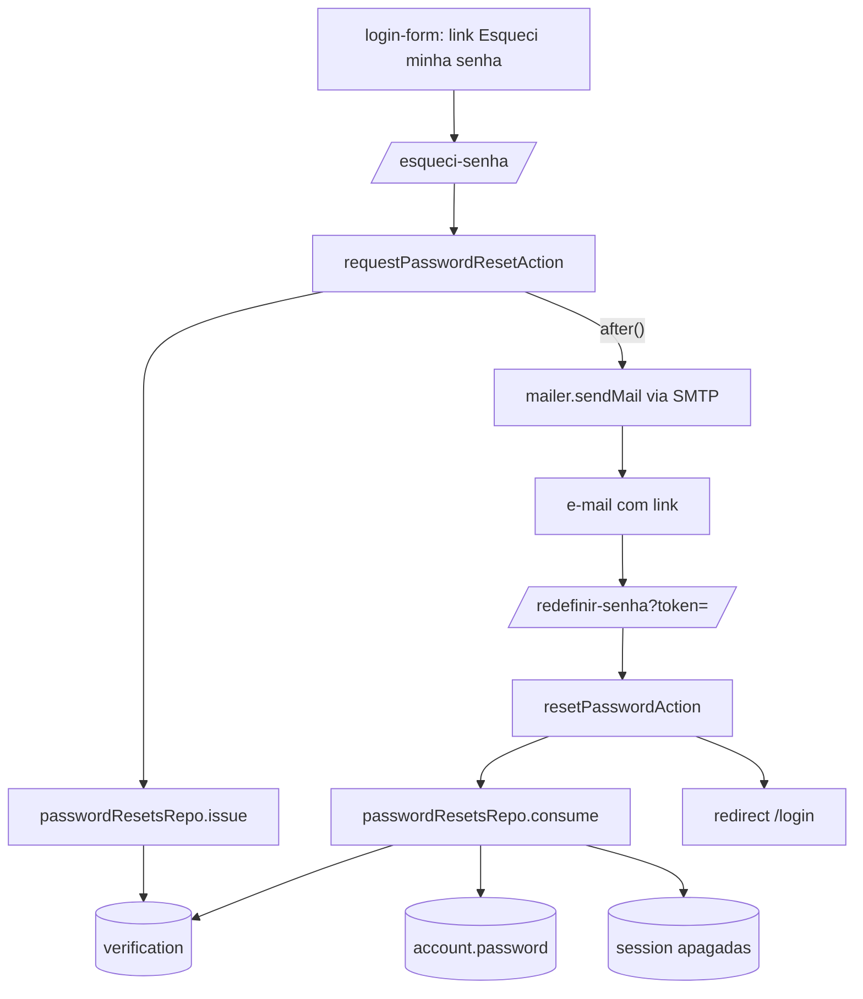

# Esqueci Minha Senha Design

**Spec**: `.specs/features/esqueci-senha/spec.md`
**Status**: Draft

---

## Approach

Três caminhos para o token e a troca de senha:

| Opção | Resumo | Veredito |
| ----- | ------ | -------- |
| A. Fluxo nativo do Better Auth | `emailAndPassword.sendResetPassword` + `/reset-password` | Descartada: não confere `status` (SENHA-09), não invalida links anteriores (SENHA-05), troca a senha e apaga sessões em passos separados (falha no meio deixa senha trocada com sessões vivas) |
| B. Nativo + hooks para os buracos | A, mais `hooks.before` e limpeza no callback | Descartada: remendos em cima de um fluxo opaco; a atomicidade continua fora de alcance |
| **C. Repo próprio (recomendada)** | Token aleatório com hash na tabela `verification`; pedido e troca em transações em `password-resets`; Better Auth só fornece `hashPassword` | Escolhida: controla status, invalidação e atomicidade, no mesmo estilo do `usersRepo.transition` (AD-009). Registrada como AD-010 |

## Architecture Overview



- O pedido responde antes do envio: o e-mail sai dentro de `after()` (`next/server`), então o tempo de resposta é igual para conta aprovada, inexistente ou bloqueada (SENHA-03, sem enumeração por tempo).
- Falha de SMTP cai no `catch` dentro do `after`, vai para `console.error` e a tela já mostrou a mensagem uniforme (AC 7).
- O token tem 32 bytes aleatórios (`randomBytes`, base64url). A tabela guarda só `sha256(token)` em `identifier = "password-reset:<hash>"`, `value = userId`, `expiresAt = agora + 30 min`. Vazamento da tabela não entrega links usáveis.
- O endpoint nativo `/api/auth/request-password-reset` continua desligado (sem `sendResetPassword`), e o `/api/auth/reset-password` nativo só consome identificadores `reset-password:*`, então não toca nos nossos tokens.

---

## Code Reuse Analysis

### Existing Components to Leverage

| Component | Location | How to Use |
| --------- | -------- | ---------- |
| `hashPassword` | `better-auth/crypto` (usado em `src/lib/db/repos/users.ts`) | Gera o hash salvo em `account.password`, o mesmo formato que o login verifica |
| `usersRepo.findByEmail`, `findById` | `src/lib/db/repos/users.ts` | Achar a conta e o status no pedido; normalização de e-mail já feita lá |
| `ActionResult`, `invalidInput`, `SAVE_FAILED` | `src/lib/action-result` | Retorno das duas ações, como `signUpAction` |
| `PASSWORD_MISMATCH_MESSAGE` | `src/lib/validation/signup.ts` | Mensagem "As senhas não coincidem" (AC 7) |
| `PasswordInput` | `src/components/password-input` | Campos de nova senha e confirmação |
| Layout de cartão do login/cadastro | `src/app/login/page.tsx`, `src/app/cadastro/page.tsx` | Mesmo cartão e `Logo` nas duas páginas novas |
| `signupSchema` | `src/lib/validation/signup.ts` | Referência de estilo do zod (`z.email`, trim, lowercase) |
| `insertCredentialUser`, `signInCookie` | `src/test/auth.ts` | Montar contas e sessões nos testes de integração |
| `proxy` matcher | `src/proxy.ts` | Liberar as duas rotas novas sem sessão |

### Integration Points

| System | Integration Method |
| ------ | ------------------ |
| Tabela `verification` (já existe em `auth-schema.ts`) | Insert/delete por drizzle; sem migração |
| `account` (credential) | `update` da coluna `password` na transação |
| `session` | `delete where user_id` na mesma transação (como `usersRepo.revokeSessions`) |
| SMTP | `nodemailer` (nova dependência) lendo `SMTP_*` do ambiente |
| `auth.ts` | Sem mudança; `sendResetPassword` fica de fora de propósito |

---

## Components

### passwordResetsRepo

- **Purpose**: Emitir, validar e consumir tokens de redefinição de forma atômica.
- **Location**: `src/lib/db/repos/password-resets.ts`
- **Interfaces**:
  - `issue(email: string): Promise<{ token: string; email: string } | null>` - Se a conta existe e está `approved`: em uma transação apaga os tokens anteriores do usuário (`identifier like 'password-reset:%'` e `value = userId`), apaga os expirados e insere o novo; devolve o token puro. Senão devolve `null`.
  - `isValid(token: string): Promise<boolean>` - Existe, não expirou e o dono está `approved`. Não consome. Usado ao abrir a página.
  - `consume(token: string, password: string): Promise<"ok" | "invalid">` - Em uma transação: `DELETE ... WHERE identifier = hash AND expires_at > now() RETURNING value`; sem linha → `invalid`; dono não `approved` → `invalid` (o token já foi apagado, e a transação confirma só esse delete); senão atualiza `account.password`, apaga as sessões e devolve `ok`. Erro no meio faz rollback e o token volta a valer.
- **Dependencies**: `db`, `user`, `account`, `session`, `verification`, `hashPassword`, `node:crypto`
- **Reuses**: padrão transacional de `usersRepo.transition`

### mailer

- **Purpose**: Entregar um e-mail de texto simples por SMTP.
- **Location**: `src/lib/mailer.ts`
- **Interfaces**:
  - `sendMail(message: { to: string; subject: string; text: string }): Promise<void>` - Cria o transporte do `nodemailer` na primeira chamada com `SMTP_HOST`, `SMTP_PORT`, `SMTP_USER`, `SMTP_PASS`, `SMTP_FROM`; variável ausente lança `Error("SMTP_HOST não configurado")` (nome da variável faltante).
- **Dependencies**: `nodemailer`, `@types/nodemailer`
- **Reuses**: nada; é o primeiro envio do projeto

### passwordResetEmail

- **Purpose**: Montar assunto e corpo do e-mail (função pura, fácil de testar).
- **Location**: `src/lib/domain/password-reset-email.ts`
- **Interfaces**:
  - `buildPasswordResetEmail(input: { to: string; token: string; baseUrl: string }): { to; subject: "Redefinir sua senha"; text }` - Link `${baseUrl}/redefinir-senha?token=${encodeURIComponent(token)}` e a frase de validade de 30 minutos (AC 10).
  - `RESET_TOKEN_TTL_MINUTES = 30` - Constante única usada pelo repo e pelo texto.
- **Dependencies**: nenhuma

### Validation

- **Purpose**: Esquemas zod e mensagens exatas (lição L-002).
- **Location**: `src/lib/validation/password-reset.ts`
- **Interfaces**:
  - `requestResetSchema` - `email` trim + lowercase + `z.email`, erro "Informe um e-mail válido".
  - `resetPasswordSchema` - `token` não vazio; `password` 8 a 128 com erro "A senha deve ter entre 8 e 128 caracteres"; `confirmPassword` igual a `password`, erro `PASSWORD_MISMATCH_MESSAGE`.
  - `REQUEST_SENT_MESSAGE` e `INVALID_LINK_MESSAGE` - os textos da spec.
- **Reuses**: `PASSWORD_MISMATCH_MESSAGE`

### Server Actions

- **Purpose**: Ligar formulário, validação, repo e e-mail.
- **Location**: `src/actions/password-reset.ts`
- **Interfaces**:
  - `requestPasswordResetAction(prev, formData): Promise<ActionResult>` - Valida; chama `passwordResetsRepo.issue`; se veio token, agenda `after(() => sendMail(...).catch(console.error))`; sempre responde `{ ok: true }` para e-mail bem formado. Erro inesperado do repo cai em `console.error` e na mesma resposta uniforme.
  - `resetPasswordAction(prev, formData): Promise<ActionResult>` - Valida; `consume`; `invalid` → `{ ok: false, error: INVALID_LINK_MESSAGE }`; `ok` → `redirect("/login")`. Falha inesperada → `SAVE_FAILED`, sem consumir (rollback).
- **Dependencies**: repo, mailer, builder do e-mail, schemas, `BETTER_AUTH_URL`
- **Reuses**: `signUpAction` como molde; `invalidInput`

### Pages e formulários

- **Purpose**: As duas telas e o link no login.
- **Location**:
  - `src/app/esqueci-senha/page.tsx` + `request-form.tsx` - campo de e-mail, botão desabilitado enquanto `pending`, mensagem de sucesso em `role="status"`, link "Voltar ao login".
  - `src/app/redefinir-senha/page.tsx` + `reset-form.tsx` - lê `searchParams.token` (Promise no Next 16); sem token ou `!isValid` mostra `INVALID_LINK_MESSAGE` com link para `/esqueci-senha`; senão renderiza o formulário com o token em campo oculto, `PasswordInput` para senha e confirmação, link "Voltar ao login".
  - `src/app/login/login-form.tsx` - link "Esqueci minha senha" para `/esqueci-senha`, ao lado de "Criar conta".
- **Reuses**: cartão e `Logo` de `login/page.tsx`; padrão de `signup-form.tsx` (mismatch local desabilita o botão)

### Guard de visitante

- **Purpose**: Redirecionar quem já está logado (P2 AC 3).
- **Location**: `src/lib/auth-guard.ts`
- **Interfaces**:
  - `redirectIfSignedIn(): Promise<void>` - Reusa `currentUser()`; se houver usuário aprovado, `redirect("/")`.
- **Reuses**: `currentUser`

### Proxy

- **Location**: `src/proxy.ts` - o matcher passa a excluir `esqueci-senha` e `redefinir-senha`.

---

## Data Models

Sem migração. Linha em `verification` por pedido:

```typescript
interface PasswordResetRow {
  id: string            // uuid
  identifier: string    // "password-reset:" + sha256(token) em hex
  value: string         // user.id
  expiresAt: Date       // agora + 30 min
}
```

**Relationships**: `value` aponta para `user.id` por convenção (sem FK, como a tabela do Better Auth). Excluir o usuário deixa a linha órfã até a próxima limpeza; `isValid` e `consume` tratam dono ausente como inválido.

Variáveis novas em `.env.example`: `SMTP_HOST`, `SMTP_PORT`, `SMTP_USER`, `SMTP_PASS`, `SMTP_FROM`.

---

## Error Handling Strategy

| Error Scenario | Handling | User Impact |
| -------------- | -------- | ----------- |
| E-mail vazio ou mal formado no pedido | `requestResetSchema` falha, `invalidInput` | "Informe um e-mail válido", nada enviado |
| E-mail inexistente ou de conta não aprovada | `issue` devolve `null`, nada é enviado | Mensagem uniforme de sucesso |
| SMTP fora do ar ou variável ausente | Erro capturado dentro do `after`, `console.error` | Mensagem uniforme de sucesso |
| Erro de banco ao emitir o token | `console.error` na ação | Mensagem uniforme de sucesso |
| Token ausente, desconhecido, expirado, usado, substituído | `consume`/`isValid` → inválido | "Link inválido ou expirado" com link para pedir outro |
| Conta deixou de ser `approved` | `consume` apaga o token e devolve `invalid`, senha intacta | "Link inválido ou expirado" |
| Senha fora de 8 a 128 ou confirmação diferente | Falha de schema antes do repo; token intacto | Mensagens exatas da spec |
| Duas trocas simultâneas com o mesmo token | `DELETE ... RETURNING` deixa só uma ganhar | Uma troca ok; a outra vê "Link inválido ou expirado" |
| Falha no meio da troca | Rollback da transação; token continua válido | `SAVE_FAILED`; a pessoa tenta de novo |

---

## Risks & Concerns

| Concern | Location (file:line) | Impact | Mitigation |
| ------- | -------------------- | ------ | ---------- |
| `auth-schema.ts` é gerado e tem colunas manuais; `verification` não ganha nada nesta feature | `src/lib/db/auth-schema.ts:62` | Nenhum aqui | Não alterar o arquivo; nenhuma regeneração necessária |
| Endpoint nativo `/api/auth/reset-password` fica exposto e opera na mesma tabela | `src/app/api/auth/[...all]/route.ts` | Poderia consumir tokens se o prefixo coincidisse | Prefixo `password-reset:` difere de `reset-password:`; teste de integração prova que o endpoint nativo não troca senha com um token nosso |
| Pedidos sem limite permitem encher a caixa de alguém com e-mails | `src/actions/password-reset.ts` (novo) | Spam a um e-mail de conta aprovada | Risco aceito na spec (app familiar); cada novo pedido invalida o anterior, então só o volume de e-mail cresce |
| `after()` não roda em teste fora de requisição | `src/actions/password-reset.ts` (novo) | Teste de integração da ação falha ao chamar `after` | A lógica de decidir e montar a mensagem fica em funções puras e no repo, testadas direto; o teste da ação mocka `next/server` |
| Rotas de e-mail só testáveis com SMTP real | e2e | Fluxo ponta a ponta não verificável sem caixa | Mailer injetável por mock de módulo nos testes; e2e cobre só a tela de pedido (mensagem uniforme) e a tela de link inválido |
| Sem teste de componente no projeto | AD-005 | Formulários sem teste de unidade | Cobertos por e2e Playwright, como login e cadastro |
| Token na URL fica em log de acesso e histórico do navegador | `/redefinir-senha?token=` | Reuso do link por quem ler o log | Uso único e 30 minutos de validade; a página não carrega scripts de terceiros |

---

## Tech Decisions (only non-obvious ones)

| Decision | Choice | Rationale |
| -------- | ------ | --------- |
| Fluxo do token | Repo próprio em vez do nativo do Better Auth | Status, invalidação e atomicidade (ver Approach); registrado como AD-010 |
| Token guardado como hash SHA-256 | Sim | Vazamento da tabela não revela links; o token puro só existe no e-mail |
| E-mail em `after()` | Sim | Resposta com tempo uniforme, sem enumeração por latência de SMTP |
| Texto do e-mail | Texto simples, sem HTML | Menos superfície e nada a manter; basta um link |
| Nova dependência | `nodemailer` (+ `@types/nodemailer`) | Escolha do usuário; versão atual 10.x conferida no npm |
| Local das ações | `src/actions/password-reset.ts`, não `auth.ts` | `auth.ts` já concentra login e cadastro; arquivo menor e foco único |
| Limpeza de tokens expirados | Dentro de `issue`, no mesmo delete | Sem job agendado; a tabela só cresce com pedidos e a limpeza acompanha |
