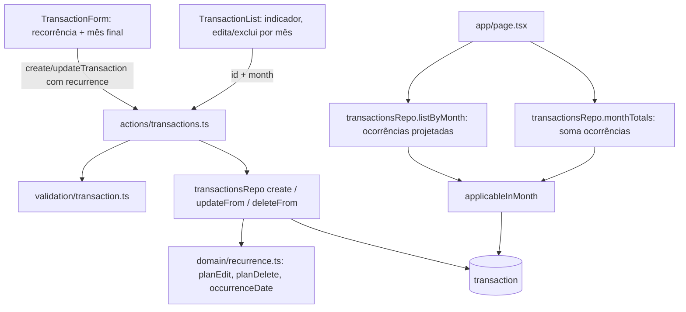

# Gastos e Ganhos Recorrentes Design

**Spec**: `.specs/features/gastos-recorrentes/spec.md`
**Status**: Draft

**Relação com `subcategorias`**: as duas features alteram `schema.ts`, `repos/transactions.ts`, `validation/transaction.ts`, `transaction-form.tsx`, `transaction-list.tsx` e `app/(app)/page.tsx`. Implementar uma de cada vez. A migração é gerada pelo `drizzle-kit` na hora da implementação, então a numeração segue a ordem de chegada. Se `subcategorias` entrar primeiro, a divisão de série (abaixo) copia também `subcategory_id` para o novo segmento, e a consulta de totais por subcategoria usa o mesmo filtro `applicableInMonth`.

---

## Architecture Overview

Segue AD-001 (Server Components leem, Server Actions escrevem), AD-002 (Drizzle + node-postgres) e AD-003 (centavos inteiros, datas de calendário sem fuso). Nenhuma decisão ativa é substituída. Acrescenta AD-004 (leituras de transações por mês passam pelo filtro de recorrência).

Abordagem escolhida: **segmentos de série na própria tabela `transaction`**. Uma transação recorrente é uma linha que vale do mês da sua `date` até `recurrence_end` (ou sem fim). Editar a ocorrência do mês M não cria uma linha por mês: encerra o segmento que contém M no mês M-1 e abre um novo segmento a partir de M com os dados editados. Os segmentos de uma série compartilham `series_id` e nunca se sobrepõem, então cada mês tem no máximo uma ocorrência por série. A ocorrência é calculada na leitura (data projetada = mês exibido + dia).



**Alternativas descartadas:**
- **Tabela de exceções por mês (`transaction_override`)**: resolver o valor de um mês exige achar a última exceção anterior; a regra "editar M sobrescreve as edições posteriores" vira limpeza de várias linhas. Os segmentos já guardam o mesmo estado com uma consulta simples.
- **Cópias reais por mês**: já excluída pela spec.

---

## Code Reuse Analysis

### Existing Components to Leverage

| Component | Location | How to Use |
| --------- | -------- | ---------- |
| `transactionsRepo` (`create`, `update`, `remove`, `listByMonth`, `monthTotals`) | `src/lib/db/repos/transactions.ts` | Estender: `create` grava os campos de recorrência; `listByMonth` e `monthTotals` passam a usar `applicableInMonth`; `update`/`remove` ganham o caminho de recorrência |
| `transactionSchema` | `src/lib/validation/transaction.ts` | Acrescentar `recurrence` e `recurrenceEnd` ao `common`, com `superRefine` no campo `recurrenceEnd` |
| `monthRange`, `parseMonth`, `isValidCalendarDate`, `YearMonth` | `src/lib/domain/month.ts` | Limites do mês, validação do mês final e do dia |
| `invalidInput`, `SAVE_FAILED`, `ActionResult` | `src/lib/action-result.ts` | Erros por campo, como hoje |
| `buildMonthlySummary` | `src/lib/domain/budget.ts` | Sem mudança: recebe `incomeCents` e `spentByCategory` já somados com as ocorrências |
| `TransactionForm`, `TransactionList` | `src/components/` | Estender: campo de recorrência, indicador e texto de exclusão |
| Padrão `db.transaction(async (tx) => …)` | `src/lib/db/repos/categories.ts:37` | Edição e exclusão de série em uma transação de banco |
| `toLocaleDateString`-free `formatDate` | `transaction-list.tsx` | Formatar a data projetada |

### Integration Points

| System | Integration Method |
| ------ | ------------------ |
| Banco | 4 colunas novas e 3 CHECKs em `transaction`; linhas existentes ficam `recurring = false` pelo default |
| `categoriesRepo` (bloqueio de exclusão de categoria) | Sem mudança: a FK `category_id … on delete restrict` e a contagem por categoria já enxergam as linhas de segmento |
| `app/(app)/page.tsx` | Sem mudança: `Occurrence` já traz o `month` usado por editar e excluir |

---

## Components

### domain/recurrence.ts (funções puras)

- **Purpose**: Regras de recorrência sem acesso a banco, testáveis por unidade.
- **Location**: `src/lib/domain/recurrence.ts`
- **Interfaces**:
  - `type Segment = { id: string; seriesId: string | null; date: string; recurringDay: number | null; endMonth: string | null }` (`endMonth` = `AAAA-MM`)
  - `monthKey(date: string): string` - `"2026-10-15"` → `"2026-10"`
  - `previousMonthKey(key: string): string`
  - `lastDayOfMonth(key: string): number`
  - `occurrenceDate(seg: Segment, key: string): string` - `key + "-" + min(recurringDay, lastDay)`; retorna `seg.date` quando não recorrente
  - `appliesInMonth(seg: Segment, key: string): boolean` - `monthKey(seg.date) <= key && (endMonth === null || endMonth >= key)`
  - `planEdit(input: { segments: Segment[]; id: string; month: string; next: EditedData }): EditPlan` - lista de operações `{ deleteIds, updateInPlace?, truncate?, insert? }`
  - `planDelete(input: { segments: Segment[]; id: string; month: string }): { deleteIds: string[]; truncate?: { id: string; endMonth: string } }`
  - `resolveDay(prev: Segment, key: string, submittedDate: string): number` - mantém `recurringDay` original quando o dia enviado é igual ao dia projetado do mês (preserva dia 31 numa ocorrência de 28/02); caso contrário usa o dia enviado
- **Dependencies**: `YearMonth`/`isValidCalendarDate` de `month.ts`.
- **Reuses**: tipos de `month.ts`.

### Transações: schema e migração

- **Purpose**: Guardar o segmento de série.
- **Location**: `src/lib/db/schema.ts` + migração gerada em `drizzle/`
- **Interfaces**: ver Data Models.
- **Dependencies**: nenhuma.
- **Reuses**: padrão de `check(...)` da tabela `transaction`.

### Validação da recorrência

- **Purpose**: Normalizar e validar `recurrence` e `recurrenceEnd`.
- **Location**: `src/lib/validation/transaction.ts`
- **Interfaces**:
  - Entrada: `recurrence?: "none" | "forever" | "until"` (padrão `"none"`), `recurrenceEnd?: string` (`AAAA-MM`)
  - Saída: `recurrence: "none" | "forever" | "until"`, `recurrenceEndMonth: string | null` (`null` quando `recurrence !== "until"`)
  - Mensagens (campo `recurrenceEnd`): "Informe o mês final", "Mês final inválido", "O mês final deve ser igual ou posterior ao mês do lançamento"
- **Dependencies**: `monthKey` de `recurrence.ts`.
- **Reuses**: `transactionSchema`, `isValidCalendarDate`.

### transactionsRepo (estendido)

- **Purpose**: Persistir, projetar e dividir segmentos.
- **Location**: `src/lib/db/repos/transactions.ts`
- **Interfaces**:
  - `applicableInMonth(userId, range)` - condição SQL: `(not recurring and date in mês) or (recurring and date < endExclusive and (recurrence_end is null or recurrence_end >= start))`
  - `create(userId, tx)` - grava `recurring`, `recurrence_day`, `recurrence_end`, `series_id` (= `id` do primeiro segmento)
  - `listByMonth(userId, range): Promise<Occurrence[]>` - `Occurrence = Transaction & { recurring: boolean; recurrenceEnd: string | null; month: string }` com `date` já projetada; ordena por data projetada desc e `createdAt` desc, em TypeScript
  - `monthTotals(userId, range)` - mesma agregação, usando `applicableInMonth` (o valor não depende do dia, então continua sendo um `SUM … GROUP BY`)
  - `updateFrom(userId, id, month, data): Promise<boolean>` - em `db.transaction`: carrega os segmentos da série com `FOR UPDATE`, aplica `planEdit`; `false` se o segmento não existe ou não se aplica ao mês
  - `deleteFrom(userId, id, month): Promise<boolean>` - mesmo esquema com `planDelete`
- **Dependencies**: `recurrence.ts`, `schema.ts`.
- **Reuses**: `ownedBy`, `inMonth`, `fields`, `columns`.

### Server Actions

- **Purpose**: Autenticar, validar e delegar.
- **Location**: `src/actions/transactions.ts`
- **Interfaces**:
  - `createTransaction(input)` - aceita `recurrence`/`recurrenceEnd`
  - `updateTransaction(input, month?: string)` - `month` = `AAAA-MM` da ocorrência exibida; omitido, usa o mês da `date` guardada. Se a linha guardada é recorrente e `monthKey(input.date) !== month`, retorna `fieldErrors.date = "A data deve estar no mês da ocorrência"`
  - `deleteTransaction(id, month?: string)` - idem
- **Dependencies**: `transactionsRepo`, `transactionSchema`.
- **Reuses**: `requireSessionForAction`, `invalidInput`, `isOwnCategory`.

### TransactionForm

- **Purpose**: Escolher a recorrência.
- **Location**: `src/components/transaction-form.tsx`
- **Interfaces**:
  - `TransactionFormValues` ganha `recurrence` e `recurrenceEnd` (`AAAA-MM`)
  - Prop nova `month?: string` (mês da ocorrência em edição), repassada a `updateTransaction`
  - Campo "Repetir": três opções (radio nativo, como o campo Tipo) "Não recorrente" / "Sempre" / "Até mês/ano"; `<input type="month">` visível só em "Até mês/ano"; erro do campo `recurrenceEnd` abaixo
- **Dependencies**: actions.
- **Reuses**: padrão de `fieldset` + radio nativo (SPEC_DEVIATION já registrada no arquivo), `Input`, `Label`.

### TransactionList

- **Purpose**: Mostrar o indicador e operar por mês.
- **Location**: `src/components/transaction-list.tsx`
- **Interfaces**:
  - Sem prop nova: usa `occurrence.month`; `Transaction` passa a ser `Occurrence`
  - Selo "Recorrente" na linha (`data-testid="recurring-badge"`)
  - Edição carrega `recurrence`/`recurrenceEnd` da ocorrência e passa `month`
  - Exclusão de recorrente: título "Excluir esta e as próximas ocorrências?"; avulsa mantém o texto atual
- **Dependencies**: `Occurrence` do repo.
- **Reuses**: diálogos existentes.

---

## Data Models

### Colunas novas em `transaction`

```typescript
{
  recurring: boolean;          // NOT NULL DEFAULT false
  recurrenceDay: number | null; // smallint 1..31: dia pretendido da ocorrência
  recurrenceEnd: string | null; // date: primeiro dia do mês final (inclusive); null = sem fim
  seriesId: string | null;      // uuid: agrupa os segmentos de uma série
}
```

- `date` de uma linha recorrente é a primeira ocorrência do segmento (dia já limitado ao tamanho do mês). `recurrenceDay` guarda o dia pretendido (31 mesmo que `date` seja 28/02).
- CHECK `transaction_recurring_fields`: `recurring = (recurrence_day is not null) and recurring = (series_id is not null)`.
- CHECK `transaction_recurrence_day_range`: `recurrence_day between 1 and 31`.
- CHECK `transaction_recurrence_end`: `recurrence_end is null or (recurring and recurrence_end >= date_trunc('month', date)::date)`.
- Índice parcial `transaction_user_recurring_idx` em `(user_id, date)` onde `recurring`.
- Ganho recorrente é permitido: o CHECK `transaction_kind_category` não muda.

**Relationships**: `series_id` não é FK; é o `id` do primeiro segmento. Nenhuma tabela nova.

### Regras de `planEdit` (mês editado M, segmento S que contém M)

1. Apaga os segmentos da mesma série com início posterior a M (a edição de M sobrescreve edições posteriores). Série `null` (avulsa): nada a apagar.
2. Se S começa em M, ou S é avulsa: atualiza S no lugar com os dados novos.
3. Se S começa antes de M: S vira `recurrence_end = M-1` e um segmento novo é inserido em M com os dados novos e a mesma `series_id`.
4. Dados novos com "Não recorrente": a linha resultante tem `recurring = false`, `recurrence_day = null`, `series_id = null`. Nos passos 2-3 isso a torna avulsa; a série anterior termina em M-1.
5. Dados novos recorrentes: `series_id` = a da série de S, ou o `id` de S quando S era avulsa. `recurrence_day` = `resolveDay(...)`.
6. Em S avulsa, o mês da `date` pode mudar (comportamento atual); em S recorrente, não (a action rejeita antes).

### Regras de `planDelete` (mês M)

Apaga os segmentos da série com início posterior a M. S começando em M é apagada; S começando antes de M recebe `recurrence_end = M-1`. S avulsa é apagada.

---

## Error Handling Strategy

| Error Scenario | Handling | User Impact |
| -------------- | -------- | ----------- |
| `Até mês/ano` sem mês final, mês final inválido ou anterior ao lançamento | Zod `superRefine` com `path: ["recurrenceEnd"]` | Mensagem sob o campo de mês final |
| Mês da `date` diferente da ocorrência editada (linha recorrente) | Action retorna `fieldErrors.date` | "A data deve estar no mês da ocorrência" |
| Segmento inexistente, de outro usuário, ou que não se aplica ao `month` | Repo retorna `false` | "Transação não encontrada" (inclui o reenvio de uma edição já aplicada, sem duplicar linhas) |
| `month` fora do formato `AAAA-MM` | Action trata como "Transação não encontrada" | Mesma mensagem |
| Falha no meio de uma divisão ou exclusão de série | `db.transaction` desfaz tudo | "Não foi possível salvar" (`SAVE_FAILED`) |
| Categoria do gasto de outro usuário | `isOwnCategory` existente | "Categoria não encontrada" |

---

## Risks & Concerns

| Concern | Location (file:line) | Impact | Mitigation |
| ------- | -------------------- | ------ | ---------- |
| Qualquer consulta futura de transações por mês que filtre só por `date` ignora as recorrentes e subconta o resumo | `src/lib/db/repos/transactions.ts:38` (`inMonth`) | Totais errados | `inMonth` é substituído por `applicableInMonth`; AD-004 registra a regra; teste de integração compara lista e totais do mesmo mês |
| `updateFrom`/`deleteFrom` mexem em várias linhas; duas requisições simultâneas poderiam deixar segmentos sobrepostos | `src/lib/db/repos/transactions.ts` (novo) | Duas ocorrências da mesma série no mesmo mês | `db.transaction` com `SELECT … FOR UPDATE` nos segmentos da série; teste de invariante "sem sobreposição" após sequências de edições |
| Dia 29-31 virar 28 depois de uma edição que reenvia a data projetada | `src/components/transaction-form.tsx` | Ocorrências de março em diante no dia 28 em vez de 31 | `recurrence_day` separado de `date` e `resolveDay` mantendo o dia original quando a data enviada é a projetada; teste unitário 31/01 → editar em fevereiro → março em 31/03 |
| `Transaction` é tipo de linha do banco e a lista usa `t.id` como chave e alvo de edição | `src/components/transaction-list.tsx:26` | Ocorrências de meses diferentes compartilham `id` | Chave única por mês na lista (cada mês exibe 1 ocorrência por segmento); ações recebem `id` + `month` |
| Cobertura atual de `updateTransaction` assume `date` livre | `src/actions/transactions.int.test.ts` | Regressão no comportamento de avulsas | `month` opcional preserva o contrato; testes existentes rodam sem mudança |
| Valor reenviado após sucesso (duplo clique) numa divisão de série | `updateFrom` | Segunda chamada cai em "não encontrada" | Aceito: não duplica dados; a UI fecha o diálogo no sucesso |

---

## Tech Decisions (only non-obvious ones)

| Decision | Choice | Rationale |
| -------- | ------ | --------- |
| Estado da recorrência | Segmentos na tabela `transaction` com `series_id` | Uma consulta resolve lista e totais; "a última edição vence" vira apagar segmentos posteriores |
| Dia pretendido | Coluna `recurrence_day` separada de `date` | Evita perder o dia 31 após passar por mês curto |
| Edição de ocorrência avulsa | Mantém mudança livre de mês | Contrato atual; a trava do mês vale só para linhas recorrentes |
| `month` nas actions | Parâmetro opcional `AAAA-MM` | Compatível com chamadas e testes atuais |
| Ordenação da lista | Em TypeScript após a projeção | A data projetada não existe no banco |
| Mês final | Guardado como `date` do primeiro dia do mês | Comparação e CHECK simples com `date_trunc` |

> **Project-level decision:** registrada como AD-004 em `.specs/STATE.md`.
