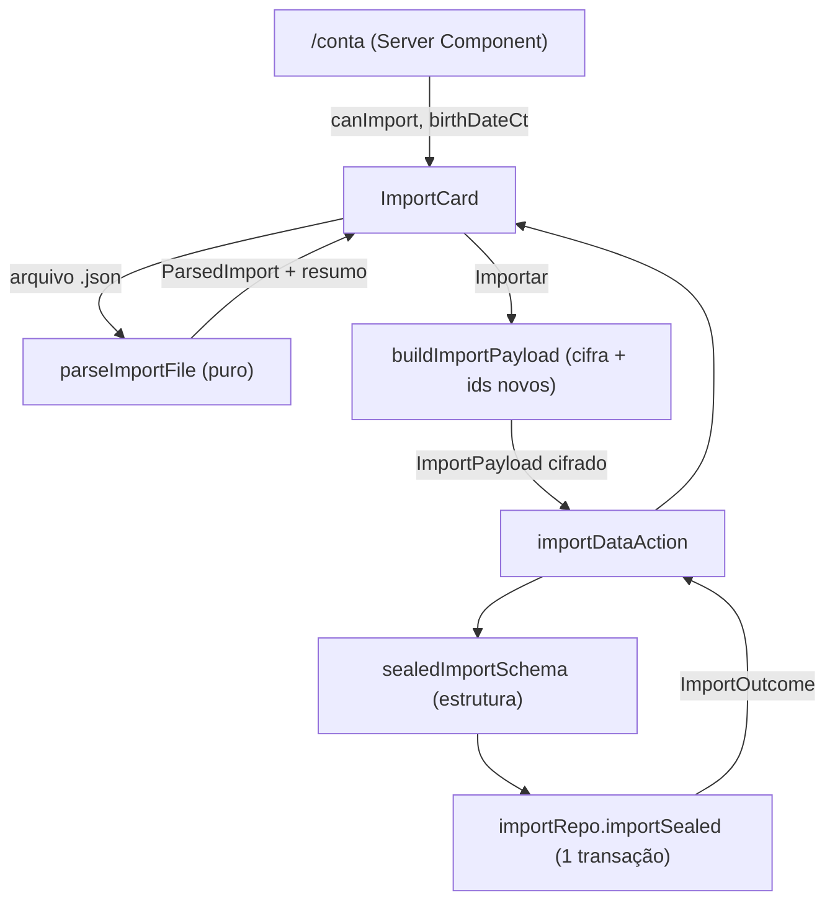

# Importar dados Design

**Spec**: `.specs/features/importar-dados/spec.md`
**Status**: Draft

---

## Architecture Overview

Tudo que depende de texto em claro roda no navegador; o servidor valida só a estrutura e grava em uma transação. Segue AD-011 (cifra no cliente), AD-001/AD-011 (Server Action de escrita, sem API REST) e AD-012 (conta com cofre).



Fluxo do clique em "Importar":

1. `parseImportFile` já validou o arquivo ao ser escolhido (nada foi enviado).
2. `buildImportPayload` gera UUIDs novos, remapeia referências, cifra cada campo com a DEK e o `userId` da sessão e descarta a meta se ela conflita com a data de nascimento da conta.
3. `importDataAction` exige sessão aprovada, valida a estrutura com Zod e chama o repo.
4. `importRepo.importSealed` abre uma transação, trava a linha de `user` (`FOR UPDATE`), confere conta vazia, insere tudo e devolve o resultado. Qualquer erro desfaz tudo.

---

## Code Reuse Analysis

### Existing Components to Leverage

| Component | Location | How to Use |
| --------- | -------- | ---------- |
| `openExport`/`OpenedExport` | `src/lib/vault/export.ts` | `OpenedExport` é o formato do arquivo; `parseImportFile` valida `unknown` para esse tipo. Um teste de round-trip liga os dois |
| `sealTransaction`, `sealGoal`, `sealBirthDate`, `fieldAad` | `src/lib/vault/seal.ts` | Cifrar transações, meta e nascimento com o AAD da linha de destino |
| Cifra de nome/percentual | `src/lib/vault/legacy-package.ts` | Mesmo padrão (`encryptField` + `textCodec`/`microCodec` + `fieldAad.categoryName/percent/subcategoryName`); `buildImportPayload` o replica com ids novos |
| `ciphertextSchema`, `nullableCiphertextSchema` | `src/lib/validation/ciphertext.ts` | Formato `v1:<base64url>` de cada campo cifrado |
| `isValidCalendarDate` | `src/lib/domain/month.ts` | Datas do arquivo e do payload |
| `isCategoryColor`, `MAX_SUBCATEGORIES` | `src/lib/domain/color`, `src/lib/validation/category-sealed.ts` | Cor 1..8 e teto de 30 subcategorias |
| `MAX_CENTS` | `src/lib/domain/money.ts` | Teto do valor (99.999.999.999) |
| `birthDateGoalConflict`, `ageOn`, `today` | `src/lib/validation/birth-date.ts`, `src/lib/domain/freedom.ts` | Conflito meta × nascimento; limites da meta vêm das constantes de `src/lib/validation/goal.ts` (exportar as três que hoje são locais) |
| `openBirthDate` | `src/lib/vault/open.ts` | Abrir `birthDateCt` da conta de destino no navegador |
| `vaultRepo.getBirthDateSealed`/`setBirthDateSealed` | `src/lib/db/repos/vault.ts` | Ler e gravar o nascimento cifrado (`user_vault.birth_date_ct`) |
| `goalsRepo.upsertSealed` (lógica) | `src/lib/db/repos/goals.ts` | Padrão de insert da meta com colunas em claro explicitamente `NULL`; dentro da transação do import usa `tx` |
| `requireSessionForAction`, `SAVE_FAILED`, `logActionError` | `src/lib/auth-guard.ts`, `src/lib/action-result.ts`, `src/lib/log.ts` | Mesmo esqueleto de `exportDataAction` |
| `ExportButton` | `src/components/export-button.tsx` | Modelo de estado (`pending`/`error`) e do uso de `useVault()` |
| `ContentCard` | `src/app/(app)/conta/page.tsx` | Cartão da nova seção |
| Padrão de transação com `FOR UPDATE` | `legacyRepo.commitMigration` (`src/lib/db/repos/legacy.ts`) | Travar `user` para serializar importações concorrentes |

### Integration Points

| System | Integration Method |
| ------ | ------------------ |
| Banco | `category`, `category_percent`, `subcategory`, `transaction`, `financial_goal`, `user_vault.birth_date_ct`; nenhuma migração de schema |
| `/conta` | Página lê `importRepo.isEmpty(userId)` e `vaultRepo.getBirthDateSealed(userId)` no servidor e passa ao cartão |
| `next.config.ts` | Limite de corpo de Server Action de 8 MB já cobre o teto de 7.000.000 caracteres; sem mudança |
| Revalidação | `revalidatePath("/", "layout")` depois do commit para as visões mensais refletirem os dados |

---

## Components

### parseImportFile

- **Purpose**: Valida o texto do arquivo e devolve o conteúdo tipado mais o resumo, ou o erro de arquivo.
- **Location**: `src/lib/vault/import-file.ts` (puro, isomórfico, sem importar servidor)
- **Interfaces**:
  - `parseImportFile(text: string): { ok: true; data: OpenedExport; summary: ImportSummary } | { ok: false; error: string }`
  - `ImportSummary = { transactions: number; categories: number; subcategories: number }`
  - `IMPORT_INVALID = "Arquivo inválido. Use o arquivo exportado pelo Orçamento."`, `IMPORT_TOO_LARGE = "Arquivo muito grande (máximo 20 MB)"`
- **Dependencies**: Zod, `isValidCalendarDate`, `MAX_CENTS`, `isCategoryColor`
- **Reuses**: tipo `OpenedExport`. Aplica as regras da Assumption "Validação do conteúdo" e as referências cruzadas: gasto aponta para categoria do arquivo, subcategoria pertence à categoria, ganho sem categoria, `recurring` ⇔ `recurrenceDay` ⇔ `seriesId`, `recurrenceEnd` ≥ mês da data, nomes ativos únicos sem diferenciar maiúsculas, subcategorias únicas por categoria, quantidades. Não valida soma de percentuais.

### buildImportPayload

- **Purpose**: Troca ids, remapeia referências e cifra tudo para a conta de destino.
- **Location**: `src/lib/vault/import-payload.ts`
- **Interfaces**:
  - `buildImportPayload(input: { data: OpenedExport; userId: string; dek: CryptoKey; accountBirthDate: string | null; now: Date; newId?: () => string }): Promise<{ payload: ImportPayload; goalSkipped: boolean }>`
  - `newId` padrão `crypto.randomUUID`; injetável nos testes.
- **Dependencies**: `seal.ts`, `crypto/aead`, `birth-date.ts`
- **Reuses**: `sealTransaction`, `sealGoal`, `sealBirthDate`, `fieldAad`. Série: um mapa `oldSeriesId → novo` (todos os segmentos recebem o mesmo). O conflito meta × nascimento usa a data da conta ou, se ela não tem, a do arquivo; em conflito `payload.goal = null` e `goalSkipped = true`. Se o corpo serializado passa de 7.000.000 caracteres, rejeita com `IMPORT_INVALID`. Falha de cifra lança e o componente mostra `SAVE_FAILED` sem requisição.

### importDataAction

- **Purpose**: Valida a estrutura e grava o import da sessão.
- **Location**: `src/actions/import-data.ts`
- **Interfaces**:
  - `importDataAction(payload: ImportPayload): Promise<{ ok: true; transactions: number; categories: number } | { ok: false; error: string }>`
  - `NOT_EMPTY = "Só é possível importar em uma conta sem transações nem categorias"`
- **Dependencies**: `requireSessionForAction`, `importRepo`, `sealedImportSchema`
- **Reuses**: esqueleto de `exportDataAction`; entrada inválida devolve `SAVE_FAILED` (padrão de `commitLegacyMigrationAction`).

### sealedImportSchema

- **Purpose**: Valida a estrutura do payload no servidor, sem ver conteúdo.
- **Location**: `src/lib/validation/import-sealed.ts`
- **Interfaces**: `sealedImportSchema` (Zod). Ids `z.uuid`; datas válidas; cor 1..8; cifras `ciphertextSchema`; limites de quantidade; regras de referência (gasto exige categoria, subcategoria da categoria, ganho sem ambas, trio de recorrência, `recurrenceEnd`); todo `categoryId` e `subcategoryId` referenciado existe no próprio payload.
- **Reuses**: `ciphertextSchema`, `isValidCalendarDate`, `isCategoryColor`, `MAX_SUBCATEGORIES`.

### importRepo

- **Purpose**: Leitura de "conta vazia" e gravação atômica.
- **Location**: `src/lib/db/repos/import.ts`
- **Interfaces**:
  - `isEmpty(userId: string): Promise<boolean>`
  - `importSealed(userId: string, payload: ImportPayload): Promise<{ ok: true; transactions: number; categories: number } | { ok: false; reason: "not_empty" }>`
- **Dependencies**: `db`, tabelas, `vaultRepo`
- **Reuses**: padrão de transação de `legacyRepo.commitMigration`. Ordem na transação: `SELECT user FOR UPDATE` → conta linhas de `transaction` e `category` do usuário (qualquer uma ⇒ `not_empty`) → inserir categorias → vigências → subcategorias → transações (lotes de 1.000 linhas) → meta se o usuário não tem (`INSERT … ON CONFLICT DO NOTHING`) → nascimento se `user_vault.birth_date_ct` é `NULL`. Sempre `userId` da sessão; as colunas em claro ficam `NULL`.

### ImportCard

- **Purpose**: Seletor de arquivo, resumo, confirmação e resultado.
- **Location**: `src/components/import-card.tsx` (client), usado em `src/app/(app)/conta/page.tsx`
- **Interfaces**: `<ImportCard canImport={boolean} accountBirthDateCt={string | null} />`
- **Dependencies**: `useVault()`, `parseImportFile`, `buildImportPayload`, `importDataAction`, `openBirthDate`
- **Reuses**: `ExportButton` (estado e botão), `Button`, `Input`, `Alert`. Estados: sem arquivo → arquivo válido com resumo e "Importar" → "Importando..." (desabilitado) → resultado ("Importação concluída: N transações, N categorias", mais o aviso de meta se `goalSkipped`) ou erro. Com `canImport = false` mostra "Disponível apenas em conta sem transações nem categorias". Escolher outro arquivo descarta o estado anterior.

---

## Data Models

```typescript
// src/lib/vault/types.ts (isomórfico)
export interface ImportPayload {
  categories: {
    id: string;                // UUID novo
    color: number;
    isInvestment: boolean;
    deletedFrom: string | null;
    nameCt: Ct;
    versions: { fromMonth: string; percentCt: Ct }[];
    subcategories: { id: string; nameCt: Ct }[];
  }[];
  transactions: {
    id: string;                // UUID novo
    kind: TransactionKind;
    date: string;
    categoryId: string | null;
    subcategoryId: string | null;
    amountCt: Ct;
    descriptionCt: Ct | null;
    recurring: boolean;
    recurrenceDay: number | null;
    recurrenceEnd: string | null;
    seriesId: string | null;   // UUID novo, igual em todos os segmentos da série
  }[];
  goal: GoalDto | null;        // null: arquivo sem meta ou meta em conflito
  birthDateCt: Ct | null;      // null: arquivo sem nascimento
}
```

Mesma forma de `ExportPayload`, sem `GoalDto` aninhado diferente; o que muda é que os ids são novos e o servidor os aceita do cliente (como já faz em `TransactionDto.id`). Relações: transação → categoria (`restrict`), transação → subcategoria pela FK composta `(subcategory_id, category_id)`.

---

## Error Handling Strategy

| Error Scenario | Handling | User Impact |
| -------------- | -------- | ----------- |
| Arquivo > 20 MB | `file.size` checado antes de ler | "Arquivo muito grande (máximo 20 MB)" |
| JSON inválido, chaves ausentes, regra violada, referência quebrada, limite excedido, nomes duplicados | `parseImportFile` devolve `IMPORT_INVALID`; botão não habilita | "Arquivo inválido. Use o arquivo exportado pelo Orçamento." |
| Corpo cifrado > 7.000.000 caracteres | `buildImportPayload` rejeita | Mesma mensagem de arquivo inválido |
| Falha ao cifrar | Exceção capturada no componente antes de enviar | "Não foi possível salvar. Tente novamente" |
| Sessão ausente | `requireSessionForAction` | UNAUTHORIZED (tratado como nas outras actions) |
| Payload estruturalmente inválido (cliente adulterado) | `sealedImportSchema` falha | `SAVE_FAILED` |
| Conta com dados (inclusive importação concorrente que perdeu a corrida) | `importRepo` devolve `not_empty` sob `FOR UPDATE` | NOT_EMPTY |
| Erro de banco no meio | Transação desfaz tudo; `logActionError` sem conteúdo | `SAVE_FAILED`; conta intacta |
| Meta em conflito com nascimento | `goalSkipped` | Importa o resto + "Meta não importada: a idade de aposentadoria é incompatível com a data de nascimento da conta" |

---

## Risks & Concerns

| Concern | Location (file:line) | Impact | Mitigation |
| ------- | -------------------- | ------ | ---------- |
| Teto de 8 MB no corpo de Server Action | `next.config.ts:7` | Importações grandes falhariam sem mensagem clara | Cap de 15.000 transações e 7.000.000 caracteres validado no cliente (IMPORT-13); fatiar quebraria o tudo ou nada |
| Id vindo do cliente para PK de `transaction` | `src/lib/db/schema.ts:115` | Colisão de id de outra conta reportaria erro de PK | UUIDs aleatórios novos; colisão cai no rollback e em `SAVE_FAILED` (probabilidade desprezível) |
| `birthDateGoalConflict` só existe no cliente | `src/lib/validation/birth-date.ts:41` | O servidor não confere o conflito (não vê as idades, estão cifradas) | Aceito: é regra de UX que o servidor também não aplica em `goals-sealed`; o cliente decide |
| Constantes de limites de meta são locais em `goal.ts` | `src/lib/validation/goal.ts:8-11` | Duplicar valores no parser de arquivo os deixaria divergir | Exportar `MAX_INCOME_CENTS`, `MIN_RATE_BP`, `MAX_RATE_BP` e reutilizar |
| `OpenedExport` não tem validador, só tipo | `src/lib/vault/export.ts:9` | Forma do arquivo e do parser podem divergir | Teste de round-trip `buildExport` → `parseImportFile` na task do parser |
| Sem teste de componente (AD-005, AD-008) | `src/components/export-button.tsx` | `ImportCard` fica sem cobertura automatizada | Toda a lógica vai para módulos puros testáveis; o componente só orquestra; evidência de UI por inspeção de código |

---

## Tech Decisions (only non-obvious ones)

| Decision | Choice | Rationale |
| -------- | ------ | --------- |
| Onde validar o arquivo | Navegador, módulo puro | O servidor nunca vê claro; reutiliza o isomorfismo de AD-008 |
| Reaproveitar ou trocar ids | Trocar todos | AAD liga a cifra ao id; reuso colide com a PK se a origem ainda existe |
| Conflito meta × nascimento | Decidido no cliente | O servidor só vê cifra; o restante da importação não deve falhar por isso |
| Decidir "meta já existe" e "nascimento já existe" | Servidor, na transação | Fonte de verdade e imune a corrida; o cliente não precisa saber |
| Uma requisição só | Sim, com teto de tamanho | Tudo ou nada sem protocolo de staging |
| Nova action e repo em vez de reusar `categoriesRepo`/`transactionsRepo` | Repo próprio de import | Os repos normais validam soma 100% e unicidade por conjunto e criam um item por vez; o import grava estado histórico completo (categorias excluídas, várias vigências) |
| Rate limit | Nenhum | Ação exige sessão e só grava em conta vazia (spec) |

Nenhuma decisão aqui vira AD novo: são locais à feature e conformes a AD-001, AD-003, AD-004, AD-007, AD-011 e AD-012.
