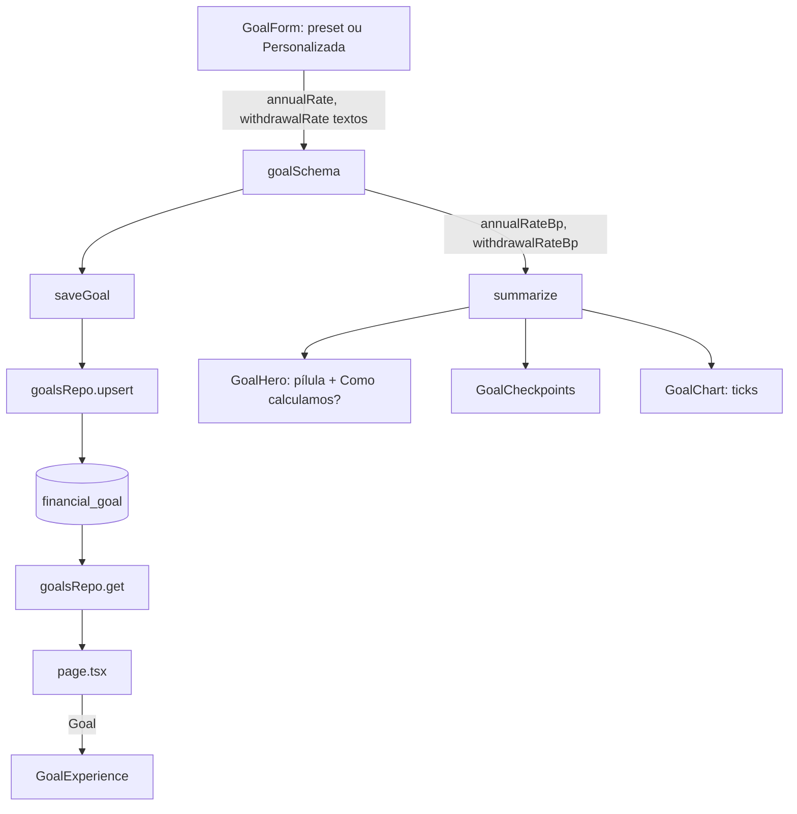

# Liberdade: Ajustes de UX e Taxa Personalizada Design

**Spec**: `.specs/features/liberdade-ajustes-ux/spec.md`
**Status**: Draft

---

## Architecture Overview

Duas camadas mudam. A UI (marcos, eixo, prefixo, seletor, card) é local aos componentes de `/liberdade`. A taxa personalizada atravessa as camadas: o objetivo passa a carregar a retirada como dado próprio (`withdrawalRateBp`), em vez de derivá-la da rentabilidade. A tabela 6→4, 8→6, 10→7 deixa de ser regra de cálculo e vira só a origem dos presets e do backfill.



## Code Reuse Analysis

### Existing Components to Leverage

| Component | Location | How to Use |
| --------- | -------- | ---------- |
| `WITHDRAWAL_RATE_BP`, `ANNUAL_RATES` | `src/lib/domain/freedom.ts:6-11` | Viram a tabela dos presets (`presetWithdrawalBp`) e a fonte do backfill; `getWithdrawalRate` sai |
| `parseBRL` / `Result` | `src/lib/domain/money.ts` | Padrão de `{ok,value}/{ok,error}` para o parse da taxa |
| `RadioGroup` + Radix Item | `src/components/rate-toggle.tsx` | Mantém o radiogroup acessível; só o item ganha 3 linhas |
| `Input` | `src/components/ui/input.tsx` | Base do campo com prefixo, com `pl` maior |
| `ageTicks` | `src/components/goal-chart.tsx:27` | Reescrita para contar da idade final |
| `fieldErrors` de `goalSchema` | `src/lib/validation/goal.ts` | Mesmo mecanismo para `annualRate` e `withdrawalRate` |

### Integration Points

| System | Integration Method |
| ------ | ------------------ |
| Banco | Migração `0011`: coluna `withdrawal_rate_bp`, CHECKs novas, backfill |
| `saveGoal` / `goalsRepo` | Passam o campo novo; sem outra mudança |
| `page.tsx` | Monta `initial.withdrawalRate` e o `annualRate` em texto pt-BR |

---

## Components

### Domínio de taxas (`src/lib/domain/freedom.ts`)

- **Purpose**: meta, aporte e resumo a partir do par (rentabilidade, retirada).
- **Interfaces**:
  - `Goal.annualRateBp: number`, `Goal.withdrawalRateBp: number` (tipos `AnnualRateBp` e `getWithdrawalRate` removidos)
  - `PRESET_RATES: { annualBp: 600|800|1000; withdrawalBp: 400|600|700 }[]` - tabela única dos presets
  - `presetFor(annualBp, withdrawalBp): 600 | 800 | 1000 | null` - o preset cujo par coincide
  - `targetCents(monthlyIncomeCents, withdrawalRateBp)` - `round(renda × 12 × 10.000 ÷ retirada)` (AJL-12)
  - `GoalSummary.withdrawalRateBp` vem do objetivo
- **Reuses**: `monthlyRate`, `requiredMonthlyCents`, `projectTimeline` sem mudança.

### Parse e validação de taxa (`src/lib/validation/goal.ts`)

- **Purpose**: texto de taxa → pontos-base, com as mensagens exatas da spec.
- **Interfaces**:
  - `parseRate(text): Result<number>` (exportada para teste): aceita `^\d{1,2}([.,]\d{1,2})?$` após `trim`; senão erro `"Informe a taxa com até 2 casas decimais, ex.: 6,5"` (AJL-15, AJL-22); `bp = round(valor × 100)`
  - `goalSchema` ganha `withdrawalRate: string`; regras em ordem por campo: formato → faixa 100..1500 (AJL-13/14) → `withdrawal > annual` falha em `withdrawalRate` (AJL-18; igual passa, AJL-23)
  - saída `GoalInput` com `annualRateBp` e `withdrawalRateBp`; `RATE_MESSAGE` e o `find` em `ANNUAL_RATES` saem
- **Reuses**: o `fail(path, message)` interno.

### Persistência

- **Location**: `src/lib/db/schema.ts`, `drizzle/0011_*.sql`, `src/lib/db/repos/goals.ts`
- Coluna `withdrawalRateBp: smallint("withdrawal_rate_bp").notNull()`; sem `default` no schema (o backfill é só da migração)
- CHECKs: `financial_goal_annual_rate` passa a `BETWEEN 100 AND 1500`; nova `financial_goal_withdrawal_rate` `BETWEEN 100 AND 1500 AND withdrawal_rate_bp <= annual_rate_bp`
- Repo: `get` e `upsert` incluem o campo; o `as AnnualRateBp` sai

### `RateToggle` (`src/components/rate-toggle.tsx`)

- **Purpose**: três perfis iguais + botão "Personalizada".
- **Interfaces**: `RateToggle({ value: "6"|"8"|"10"|null, onChange(rate), onCustom(), customActive })`
  - radiogroup `grid-cols-3 items-stretch`; cada item é `flex flex-col` com título (`font-medium`), `N% a.a.` e `Retirada: M% a.a.` (M de `PRESET_RATES`, pt-BR via `formatRate`); mesma altura vem do grid + `min-h` único (AJL-24/25)
  - `value=""` no radiogroup quando `customActive` (nenhum destaque, AJL-32); só o item marcado leva `data-[state=checked]` (AJL-27)
  - `Personalizada` é um `<button type="button" aria-pressed>` fora do radiogroup, abaixo do grid
- **Reuses**: classes do item atual.

### `GoalForm` (`src/components/goal-form.tsx`)

- `GoalFormValues` ganha `withdrawalRate: string` (padrão `"6"`; `annualRate` padrão `"8"`)
- Estado local `custom: boolean`, iniciado em `presetFor(parse(annualRate), parse(withdrawalRate)) === null` e posto em `true` por `onCustom`
- Escolher preset: `set` de `annualRate` e `withdrawalRate` juntos pela tabela e `custom=false` (AJL-20)
- `custom`: dois `Input` "Rentabilidade real (% a.a.)" e "Taxa de retirada (% a.a.)" com sufixo `%`, `inputMode="decimal"`, `aria-invalid` e `fieldErrors` (AJL-11); iniciam com os valores do preset ativo, pois já estão no estado
- A linha "Taxa de retirada N% a.a." e `getWithdrawalRate` saem (AJL-26)
- Campos de dinheiro usam `CurrencyInput`; rótulos sem "(R$)"

### `CurrencyInput` (`src/components/currency-input.tsx`, novo)

- **Purpose**: `Input` com `R$` fixo à esquerda (AJL-09).
- **Interfaces**: mesmas props de `Input`; `<div class="relative">` + `<span aria-hidden class="absolute left-3.5 ... text-muted-foreground">R$</span>` + `Input className="pl-10"`. O `value` não inclui `R$` (AJL-17); o `label` nomeia o campo.

### `GoalCheckpoints` (`src/components/goal-checkpoints.tsx`)

- `status(checkpoint, isLast)`: reached → "Atingido"; sem previsão → "Sem previsão"; senão `Aos ${age} anos` e, no último, `... (Meta)` (AJL-01..04)
- `li` ganham `min-w-0`; o `span` do status `truncate whitespace-nowrap` (AJL-05, proteção). Para o último marco caber em 360 px na grade 2×2 e na linha de `@xl`, o texto fica em `text-xs`; a verificação é visual (Risks).

### `GoalChart` (`ageTicks`)

- `ageTicks(first, last)`: `to = floor(last)`, `from = ceil(first)`, `step = ceil((to-from)/8)`; gera de `to` para baixo em passos de `step` até `from` e inverte. Resultado: contém `to`, tem no máximo 9 itens, crescente, sem repetição (AJL-06/07/08).

### `GoalHero` e `freedom-copy.ts`

- `formatRate(bp)`: `(bp/100).toLocaleString("pt-BR", { maximumFractionDigits: 2 })` + `%` → "6%", "6,5%" (AJL-31)
- `heroPill(summary)`: `Gera ${formatBRL(monthlyIncomeCents)}/mês com retirada de ${formatRate(withdrawalRateBp)} a.a.` (AJL-28)
- `heroFacts` passa a usar `formatRate`; o `dl` do card some (AJL-29) e a lista entra dentro do `details` "Como calculamos?", antes dos parágrafos (AJL-30)
- Pílula: `<p class="w-fit rounded-full bg-income/15 px-3 py-1 text-sm text-income">` logo após o valor da Meta.

---

## Data Models

```typescript
type Goal = {
  monthlyIncomeCents: number;
  savedCents: number;
  birthDate: string;
  retirementAge: number;
  annualRateBp: number;     // 100..1500
  withdrawalRateBp: number; // 100..1500, <= annualRateBp
};
```

Migração `0011` (SQL escrito à mão, pois o `drizzle-kit` geraria `NOT NULL` sem backfill):

1. `ADD COLUMN "withdrawal_rate_bp" smallint`
2. `UPDATE financial_goal SET withdrawal_rate_bp = CASE annual_rate_bp WHEN 600 THEN 400 WHEN 800 THEN 600 WHEN 1000 THEN 700 END` (AJL-16)
3. `ALTER COLUMN ... SET NOT NULL`; `DROP CONSTRAINT financial_goal_annual_rate`; `ADD CONSTRAINT` das duas CHECKs

---

## Error Handling Strategy

| Error Scenario | Handling | User Impact |
| -------------- | -------- | ----------- |
| Taxa vazia, não numérica ou com 3+ casas | `parseRate` falha | Mensagem do AJL-15 sob o campo |
| Taxa fora de 1%..15% | `goalSchema` | Mensagens AJL-13 / AJL-14 |
| Retirada > rentabilidade | `goalSchema` em `withdrawalRate` | Mensagem AJL-18 |
| Rascunho inválido na prévia | Já tratado: `handleDraft` mantém o último resumo válido | Prévia não pisca |
| Linha do banco violando CHECK | Só alcançável fora do schema; `saveGoal` já devolve `SAVE_FAILED` | Erro genérico de salvar |

---

## Risks & Concerns

| Concern | Location (file:line) | Impact | Mitigation |
| ------- | -------------------- | ------ | ---------- |
| Testes existentes assumem `targetCents(renda, annualRateBp)`, `getWithdrawalRate` e `AnnualRateBp` | `src/lib/domain/freedom.test.ts`, `src/lib/validation/goal.test.ts`, `src/lib/db/repos/goals.int.test.ts`, `src/actions/goals.int.test.ts` | Suítes quebram na troca de assinatura | Cada tarefa de domínio atualiza esses testes no mesmo commit, derivando os valores esperados da spec (ex.: 6,5/4,5 com R$ 20.000 → R$ 5.333.333,33) |
| Sem teste de componente (AD-005) e sem e2e de `/liberdade` | `e2e/` | Sobreposição, altura dos botões e prefixo só aparecem visualmente | Lógica extraída em funções puras testadas (`ageTicks`, `status`, `formatRate`, `heroPill`, `presetFor`); verificação visual manual em 360 e 1280 px na validação |
| `ageTicks` e `status` hoje não são exportados | `goal-chart.tsx:27`, `goal-checkpoints.tsx:7` | Não testáveis | Exportar, ou mover para `freedom-copy.ts` / módulo de domínio puro |
| Migração em banco com dados | `drizzle/` | `NOT NULL` sem backfill falharia | SQL manual em 3 passos; teste de integração do repo grava e lê o campo; aplicar a migração no `orcamento_test` privado antes dos testes |
| `freedom.ts` deve ficar isomórfico (AD-008) | `src/lib/domain/freedom.ts` | Import de servidor quebra o cliente | Nenhum import novo; `parseRate` fica em `validation/goal.ts`, já isomórfico |

---

## Tech Decisions (only non-obvious ones)

| Decision | Choice | Rationale |
| -------- | ------ | --------- |
| Retirada como dado do objetivo | Coluna própria, não derivada | Decisão do usuário (digita as duas); presets só preenchem o par |
| Modo Personalizada | Estado local derivado do par salvo (`presetFor`) + clique | Sem coluna de modo; reabrir sempre reconstrói a mesma tela (AJL-19) |
| Retirada ≤ rentabilidade também no banco | CHECK de relação | Defesa em profundidade; a mensagem amigável vem do `goalSchema` |
| Ticks contados da idade final | Passo a partir de `to` para trás | Garante o rótulo final; custo: a idade inicial pode ficar sem rótulo |
| Formato das taxas | `Intl` pt-BR, sem zeros à direita | "6%" nos presets e "6,5%" no custom, como no pedido |
