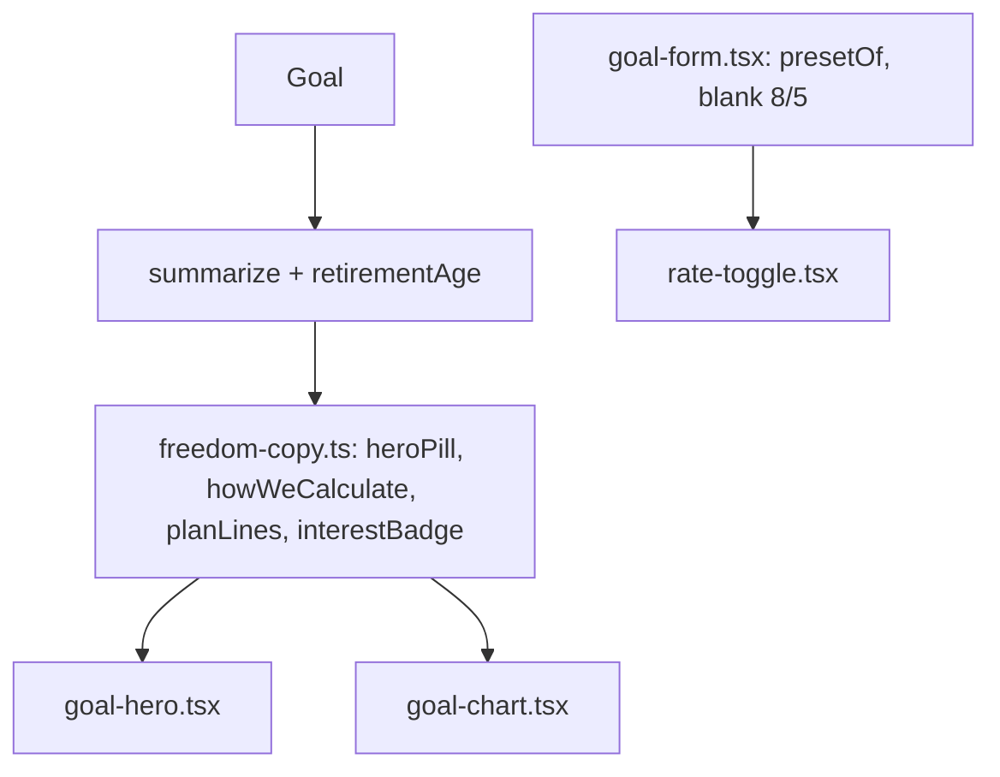

# Liberdade: Copy Financeira e Hierarquia do Hero Design

**Spec**: `.specs/features/liberdade-copy-hierarquia/spec.md`
**Status**: Draft

---

## Architecture Overview

Sem camada nova. Todo texto com regra (pílula, popover, linhas do card, indicador de rendimentos) vira função pura em `src/lib/domain/freedom-copy.ts`, testável em unit sem renderizar componente (AD-005). Os componentes só chamam essas funções. `GoalSummary` ganha `retirementAge`, o único dado novo. O estado "personalizado" do seletor deixa de ser um booleano solto e passa a derivar do par digitado.

Conforme as decisões ativas: AD-003 (centavos inteiros; nada novo), AD-005 (sem e2e; unit nas funções de copy) e AD-008 (`freedom.ts` e `freedom-copy.ts` seguem isomórficos, sem import de servidor).

---

## Code Reuse Analysis

### Existing Components to Leverage

| Component | Location | How to Use |
| --------- | -------- | ---------- |
| `heroPill`, `howWeCalculate`, `HOW_DISCLAIMER`, `formatRate` | `src/lib/domain/freedom-copy.ts` | Reescrever os textos mantendo as assinaturas |
| `formatCompactBRL`, `formatBRL` | `src/lib/domain/money.ts` | Meta compacta e rendimentos compactos |
| `interestSharePct`, `timeline` | `src/lib/domain/freedom.ts` | Percentual e `interestCents` do último ponto, sem recalcular |
| `formatTerm` | `src/components/goal-hero.tsx:12` | Mover para `freedom-copy.ts` (único uso é o Hero) para `planLines` usá-lo sem import de componente |
| `presetFor`, `PRESET_RATES` | `src/lib/domain/freedom.ts` | Derivar o cenário marcado do par digitado |
| `checkpointLabel` + testes | `src/lib/domain/freedom-copy*.ts` | Modelo do estilo de teste dos novos textos |

### Integration Points

| System | Integration Method |
| ------ | ------------------ |
| `goalSchema` / `saveGoal` | Nenhuma mudança; valores do formulário seguem como texto |
| Banco | Nenhuma mudança; sem migração |

---

## Components

### freedom-copy.ts (domínio de texto)

- **Purpose**: Fonte única dos textos financeiros de `/liberdade`.
- **Location**: `src/lib/domain/freedom-copy.ts`
- **Interfaces**:
  - `heroPill(summary): string` - "Renda de R$ 20.000,00/mês · retirada inicial de 5% a.a."
  - `howWeCalculate(summary): string` - "…taxa de retirada inicial de 5% a.a., o patrimônio-alvo é de R$ 4.800.000,00."
  - `HOW_DISCLAIMER: string` - novo aviso do popover
  - `formatTerm(months): string` - movido do Hero, comportamento igual
  - `planLines(summary): { reach: string; term: string } | { reached: true } | null` - `months > 0`: `reach` = "para alcançar R$ 4,8 mi aos 48 anos", `term` = "Você chega ao Ápice em: 14 anos e 11 meses"; `months = 0` e `monthlyCents = 0`: `{ reached: true }`; `months = 0` e `monthlyCents = null`: `null`
  - `interestBadge(summary): string | null` - "R$ 2,6 mi vêm dos rendimentos · 55% do patrimônio final"; sem percentual quando `interestSharePct` é null; `null` sem timeline
  - `PLAN_REACHED = "Meta alcançada"`
- **Dependencies**: `freedom.ts` (tipos), `money.ts`
- **Reuses**: `formatRate`, `perYear` existentes

### freedom.ts

- **Purpose**: Expor a idade do ápice no resumo.
- **Location**: `src/lib/domain/freedom.ts` (`GoalSummary`, `summarize`)
- **Interfaces**: `GoalSummary.retirementAge: number`, copiado de `goal.retirementAge`. Nenhuma fórmula muda.

### GoalHero

- **Purpose**: Aplicar a nova hierarquia do card de aporte e remover "Distância do Alvo".
- **Location**: `src/components/goal-hero.tsx`
- **Interfaces**: troca o `<dl>` por `planLines(summary)`: sob o valor, uma linha de apoio ("para alcançar…", `text-sm text-muted-foreground`) e a linha do prazo em `font-medium`; `{ reached: true }` mostra "Meta alcançada" em `text-income`; `null` não mostra linha.
- **Reuses**: classes e estrutura atuais; popover inalterado.

### GoalChart

- **Purpose**: Novo indicador de rendimentos.
- **Location**: `src/components/goal-chart.tsx`
- **Interfaces**: `summaryText = interestBadge(summary)` na pílula e no `aria-label` do `figure`; sem texto quando `null`.

### RateToggle e GoalForm

- **Purpose**: Cenários explícitos, novo rótulo e estado personalizado derivado.
- **Location**: `src/components/rate-toggle.tsx`, `src/components/goal-form.tsx`
- **Interfaces**:
  - `rate: "6% real a.a."` (`${formatRate} real a.a.`); a linha de retirada continua "Retirada: X% a.a."
  - Botão: "Personalizar premissas"
  - `GoalForm`: `blank.withdrawalRate = "5"`; `custom` passa a significar só "campos de taxa visíveis"; o cenário marcado vem de `presetOf(values)` sempre (também com campos abertos) e o botão só é realçado quando `presetOf(values) === null`. `RateToggle` recebe `value` e `customActive` já calculados (`customActive = presetOf(values) === null`) e um `onCustom` que abre os campos.
  - Corrigir os comentários desatualizados de `goal-form.tsx` ("6 → 4, 8 → 6, 10 → 7") e `rate-toggle.tsx`.
- **Reuses**: `presetOf`, `PRESET_RATES`

---

## Data Models

Só o tipo `GoalSummary` ganha `retirementAge: number`. Nenhuma coluna, schema ou migração.

---

## Error Handling Strategy

| Error Scenario | Handling | User Impact |
| -------------- | -------- | ----------- |
| `months = 0`, guardado ≥ meta | `planLines` → `{ reached: true }` | "R$ 0,00 / mês" e "Meta alcançada" |
| `months = 0`, guardado < meta | `planLines` → `null` | "Prazo encerrado", sem linhas extras |
| Timeline vazia | `interestBadge` → `null`; `GoalChart` já devolve `null` sem timeline | Gráfico não aparece, como hoje |
| `interestSharePct` null | Valor sem percentual e sem " · " | Só "R$ X vêm dos rendimentos" |
| Objetivo salvo com par fora dos presets (8% e 6%) | `presetOf` → `null` | Nenhum cenário marcado, botão realçado, campos abertos |

---

## Risks & Concerns

| Concern | Location (file:line) | Impact | Mitigation |
| ------- | -------------------- | ------ | ---------- |
| Teste existente fixa os textos antigos ("Gera…", "segura…", aviso antigo) | `src/lib/domain/freedom-copy.test.ts:70,79,85,92` | Falham na troca de copy | Atualizar essas expectativas na mesma task que muda o texto, derivadas dos textos da spec (LCH-01 a LCH-03) |
| Lista `FORBIDDEN` do teste cobre só 3 raízes e 3 textos | `freedom-copy.test.ts:24-30` | Regressão de "segura"/"principal" passa | Ampliar para as raízes de LCH-11 e para todos os textos novos |
| Valor inicial do formulário diverge do preset | `goal-form.tsx:40` | Gaveta vazia abre em modo personalizado | `blank.withdrawalRate = "5"` (LCH-10) |
| Comentários dizem 6→4, 8→6, 10→7 | `goal-form.tsx:97`, `rate-toggle.tsx:23` | Leitor assume regra errada | Corrigir na task do formulário |
| Componentes (`GoalHero`, `RateToggle`, `GoalForm`) sem teste automático | `src/components/` | Regressão visual não detectada | Regras de texto e de estado ficam em funções puras testadas; resto por verificação manual (AD-005) |
| `presetOf` mora dentro de `goal-form.tsx` e não é exportado | `goal-form.tsx:49` | LCH-09 e LCH-10 sem teste | Extrair a lógica "par → cenário marcado" para função pura em `freedom.ts` (`presetFor` já existe; basta testar o caso do `blank`) e testar `blank` via constante exportada |

---

## Tech Decisions (only non-obvious ones)

| Decision | Choice | Rationale |
| -------- | ------ | --------- |
| Onde moram os textos novos | Funções puras em `freedom-copy.ts` | Testáveis em unit, sem teste de componente |
| `planLines` devolve união em vez de strings soltas | `{reach, term}` / `{reached}` / `null` | Os três casos de `months` ficam num ponto só, cobertos por teste |
| `retirementAge` no `GoalSummary` | Campo novo, copiado do objetivo | Alternativa (idade pelo último ponto da linha do tempo) falha com `months = 0` |
| Estado personalizado | Derivado do par digitado, não guardado | Elimina a divergência cenário marcado × valores (LCH-09) |
| "Meta alcançada" | Só com `months = 0` e `monthlyCents = 0` | Decisão confirmada; com a meta não atingida o texto seria falso |

Nenhuma decisão aqui vira regra de projeto; não há `AD-NNN` novo.
