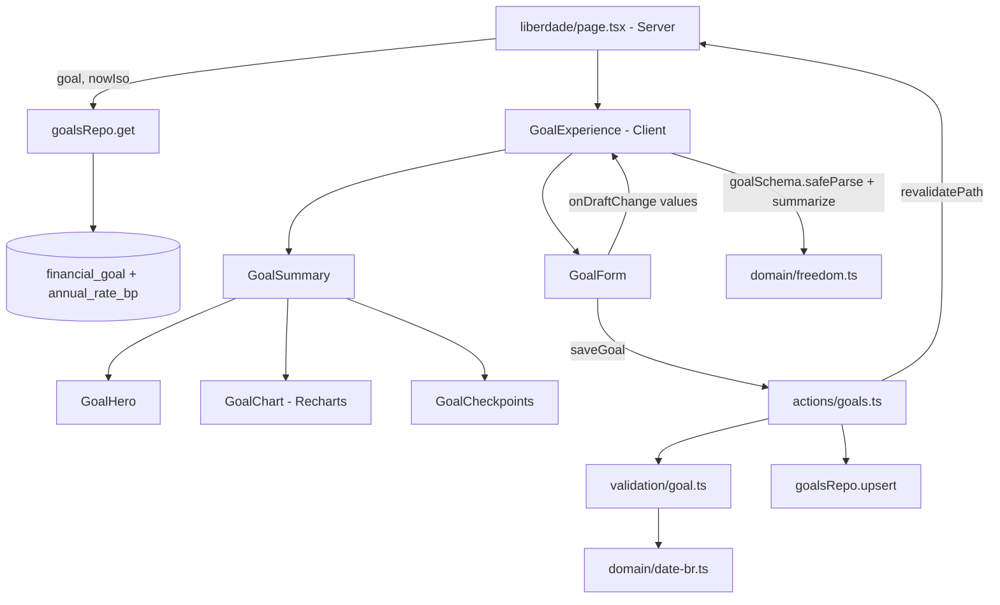

# Liberdade: Experiência do Objetivo Design

**Spec**: `.specs/features/liberdade-experiencia/spec.md`
**Status**: Draft

---

## Architecture Overview

Segue AD-001 (Server Component lê, Server Action escreve), AD-003 (centavos inteiros, `date` sem fuso) e AD-005 (sem e2e novo). Acrescenta a AD-008: a prévia do simulador roda no cliente com as mesmas funções puras do domínio e o mesmo `goalSchema` do servidor. Nenhuma AD ativa é substituída. No nível da feature, esta spec substitui a taxa fixa de 8% e a projeção a cada 4 anos de `liberdade-financeira`.

**Abordagens consideradas para a prévia ao vivo** (critério: LEX-09 pede recálculo sem requisição e Success Criteria exige menos de 100 ms):

| Abordagem | Resultado |
| --------- | --------- |
| **A. Cliente dono do estado, domínio puro no cliente (escolhida)** | Cada alteração roda `goalSchema(now).safeParse` e `summarize` no navegador. Sem rede, mesma validação do salvar, sem lógica duplicada. |
| B. Ida ao servidor a cada ajuste (debounce) | Viola 100 ms e depende de rede; descartada. |
| C. Reimplementar o cálculo só para a prévia | Duas fórmulas divergem com o tempo; descartada. |

A página lê o objetivo e passa ao cliente `GoalExperience` o objetivo salvo, os valores do formulário e `now` como string ISO (o servidor e o cliente calculam do mesmo instante, sem divergência de hidratação). `GoalExperience` guarda o `summary` exibido; o formulário avisa cada rascunho e só um rascunho válido substitui o `summary`.



---

## Code Reuse Analysis

### Existing Components to Leverage

| Component | Location | How to Use |
| --------- | -------- | ---------- |
| `summarize`, `requiredMonthlyCents`, `monthsUntilRetirement`, `ageOn`, `progressBp` | `src/lib/domain/freedom.ts` | Núcleo mantido; ganham a taxa por parâmetro |
| `goalSchema(now)` | `src/lib/validation/goal.ts` | Valida servidor e prévia; ganha taxa e data DD/MM/AAAA |
| `KindToggle` (padrão) | `src/components/kind-toggle.tsx` | Modelo do controle segmentado de taxa (RadioGroup radix com `aria-label`) |
| `Progress` com `indicatorClassName` | `src/components/ui/progress.tsx` | Barra com `bg-income` e brilho sem alterar o componente |
| Padrão Recharts (`ResponsiveContainer`, `tick`, `tooltipStyle`, `isAnimationActive={false}`, `<figure>`) | `src/components/budget-charts.tsx` | Mesmo estilo de tooltip, eixos e tokens `--viz-*` |
| Tokens `--income`, `--glow-a`, `--viz-target`, `--viz-spent`, `--viz-grid` | `src/app/globals.css:92,100,170,182` | Cores do Hero, barra e camadas do gráfico, claras e escuras |
| `maskBRLInput`, `formatBRL`, `formatShare` | `src/lib/domain/money.ts`, `percent.ts` | Máscara de dinheiro nos campos (já exportada), formatação |
| `isValidCalendarDate` | `src/lib/domain/month.ts:38` | Valida a data convertida de DD/MM/AAAA |
| Radix `Slider` | pacote `radix-ui` (já instalado) | Base do novo `ui/slider.tsx` |
| `PageHeader`, `ContentCard` | `src/components/` | Layout da página e cartão do gráfico |

### Integration Points

| System | Integration Method |
| ------ | ------------------ |
| Banco | Nova coluna `financial_goal.annual_rate_bp` (migração 0009, default 800) |
| Página `/liberdade` | Monta `GoalExperience` no lugar de `GoalSummary` + `GoalForm` soltos |
| Resumo (`/`) | Sem integração |

---

## Components

### freedom (domínio, alterado)

- **Purpose**: Cálculos do objetivo agora parametrizados pela taxa, mais linha do tempo e checkpoints.
- **Location**: `src/lib/domain/freedom.ts`
- **Interfaces**:
  - `ANNUAL_RATES = [600, 800, 1000] as const`, `type AnnualRateBp`, `DEFAULT_ANNUAL_RATE_BP = 800` (substitui `ANNUAL_RATE_BP`).
  - `targetCents(monthlyIncomeCents, annualRateBp)` - `renda × 12 × 10000 ÷ taxa` (600, 800, 1000 dividem 120000: sempre inteiro).
  - `monthlyRate(annualRateBp): number` - `(1 + taxa/10000)^(1/12) − 1`, substitui a constante `MONTHLY_RATE`.
  - `requiredMonthlyCents({ targetCents, savedCents, months, annualRateBp })` - mesma fórmula e `ceil(x − 1e-6)`.
  - `projectedCents({ savedCents, monthlyCents, months, annualRateBp }, m)` - `saved × g + aporte × (g − 1) ÷ i` com `g = (1+i)^m` (LEX-11 AC 2; remove o forçar-ao-alvo de `projectMilestones`).
  - `projectTimeline(input): TimelinePoint[]` - pontos em m = 0, 12, 24 … < prazo, mais m = prazo. `TimelinePoint = { months, age (fracionária, eixo), ageYears, investedCents, interestCents, totalCents }`. `age = idadeApos − (prazo − m) ÷ 12`; `ageYears = idadeApos − ⌈(prazo − m) ÷ 12⌉`. Vazio se `months = 0`.
  - `buildCheckpoints(input): Checkpoint[]` - frações 2500, 5000, 7500, 10000 pb do alvo. `Checkpoint = { fractionBp, valueCents, reached, months: number | null, ageYears: number | null, positionBp }`. `reached = guardado ≥ valor`; senão, se `prazo > 0`, `months` é o menor m ≥ 1 com `projectedCents ≥ valor` (busca linear até o prazo; sempre existe para 100% pelo arredondamento do aporte para cima); se `prazo = 0`, `months = null`. `ageYears` pela regra de idade de `projectTimeline`. O de 100% prevê no prazo.
  - `interestSharePct(timeline): number | null` - `round(rendimentos ÷ total)` do último ponto; `null` sem linha do tempo.
  - `Goal` ganha `annualRateBp: AnnualRateBp`; `GoalSummary` ganha `monthlyIncomeCents`, `annualRateBp`, `timeline`, `checkpoints`, `interestSharePct`. `Milestone` e `projectMilestones` são removidos (LIB-12/13 substituídos).
- **Dependencies**: `month.ts`. Sem I/O, sem import de servidor: roda no cliente (AD-008).
- **Reuses**: `requiredMonthlyCents`, `monthsUntilRetirement`, convenção de `now` injetado.

### date-br (domínio, novo)

- **Purpose**: Data brasileira no formulário, ISO no banco.
- **Location**: `src/lib/domain/date-br.ts`
- **Interfaces**:
  - `isoToBR(iso: string): string` - `"1993-09-18"` → `"18/09/1993"`.
  - `brToIso(text: string): string | null` - exige `DD/MM/AAAA`, converte e valida com `isValidCalendarDate`; `"1993-09-18"` e `"31/02/1993"` dão `null`.
  - `maskDateInput(raw: string): string` - mantém só dígitos (máx. 8) e insere as barras: `"18091993"` → `"18/09/1993"`, `"1809"` → `"18/09"`.
- **Reuses**: `isValidCalendarDate`; mesmo estilo de `maskBRLInput`.

### goalSchema (validação, alterado)

- **Purpose**: Mesma validação para salvar e para a prévia.
- **Location**: `src/lib/validation/goal.ts`
- **Interfaces**: entrada ganha `annualRate: string` (`"6"`, `"8"`, `"10"`); `birthDate` passa a ser DD/MM/AAAA. Data: `brToIso` nulo → `"Data de nascimento inválida"`; vazia mantém "Informe a data de nascimento"; demais regras (futura, idade > 120) inalteradas, sobre o ISO convertido. Taxa fora dos três valores, vazia ou ausente → `"Escolha uma taxa de 6%, 8% ou 10% ao ano"` no campo `annualRate`. Saída: `{ monthlyIncomeCents, savedCents, birthDate (ISO), retirementAge, annualRateBp }`.
- **Reuses**: padrão `transform` + `ctx.addIssue`, `ageOn`, `parseBRL`.

### schema + goalsRepo (persistência, alterados)

- **Purpose**: Guardar e devolver a taxa.
- **Location**: `src/lib/db/schema.ts`, `src/lib/db/repos/goals.ts`, `drizzle/0009_*.sql`
- **Interfaces**: coluna `annualRateBp: smallint("annual_rate_bp").notNull().default(800)` com `check("financial_goal_annual_rate", annual_rate_bp IN (600, 800, 1000))`; `get` devolve a taxa; `upsert` a grava no insert e no `set`. O `default 800` atende LEX-04 AC 5: o `ADD COLUMN … DEFAULT` preenche as linhas existentes.
- **Dependencies**: `db`, `financialGoal`. Filtro por `userId` inalterado (LIB-11).

### saveGoal (action, quase inalterada)

- **Location**: `src/actions/goals.ts`
- **Interfaces**: o tipo de entrada vem de `goalSchema`, então ganha `annualRate` sem mudança de código além do tipo.

### ui/slider (novo)

- **Purpose**: Slider acessível com o estilo do design system.
- **Location**: `src/components/ui/slider.tsx` (Client)
- **Interfaces**: `Slider(props: ComponentProps<typeof SliderPrimitive.Root>)` com trilho `bg-subtle`, faixa `bg-primary`, polegar com `focus-visible:ring`. Setas movem 1 passo (comportamento nativo do Radix, LEX-08 AC 8).
- **Reuses**: padrão de `ui/progress.tsx` e `ui/radio-group.tsx`.

### RateToggle (novo)

- **Purpose**: Controle segmentado Conservador · 6% / Moderado · 8% / Agressivo · 10%.
- **Location**: `src/components/rate-toggle.tsx` (Client)
- **Interfaces**: `RateToggle({ value, onChange })`, `aria-label="Taxa esperada"`, 3 colunas, mesmo visual de `KindToggle`.
- **Reuses**: `RadioGroup` e o padrão de classes de `KindToggle`.

### GoalExperience (novo, dono do estado)

- **Purpose**: Mantém o `summary` exibido e liga formulário e resumo.
- **Location**: `src/components/goal-experience.tsx` (Client)
- **Interfaces**: `GoalExperience({ saved: Goal | null, initial: GoalFormValues | undefined, nowIso: string })`.
  - `summary` inicial: `summarize(saved, new Date(nowIso))` ou `null`.
  - `handleDraft(values)`: `goalSchema(now).safeParse(values)`; se válido, `setSummary(summarize(data, now))`; se inválido, não faz nada (LEX-09 AC 4). `handleDraft` também recebe o reset do Cancelar: com `initial`, recalcula do objetivo salvo; sem objetivo salvo, volta a `null` (AC 7).
  - Renderiza `GoalSummary` quando `summary !== null`, depois `GoalForm`.
- **Dependencies**: `goalSchema`, `summarize`, `GoalSummary`, `GoalForm`.

### GoalForm (alterado)

- **Purpose**: Campos controlados com slider e taxa; sem calcular nada.
- **Location**: `src/components/goal-form.tsx` (Client)
- **Interfaces**: `GoalForm({ initial, onDraftChange })`; `GoalFormValues` ganha `annualRate: string` e `birthDate` em DD/MM/AAAA. Campos: renda e guardado (`maskBRLInput`), nascimento (`maskDateInput`, `inputMode="numeric"`, `placeholder="DD/MM/AAAA"`), idade (campo numérico + `Slider` de idade atual + 1 a 90, desabilitado enquanto a data de nascimento for inválida; valor do slider limitado à faixa, o campo numérico guarda o texto digitado), `RateToggle`. Cada `set` chama `onDraftChange(next)`. Salvar e Cancelar como hoje; Cancelar chama `onDraftChange(initial ?? null)`.
- **Reuses**: estado, `useTransition`, `fieldErrors` e `role="alert"` do formulário atual.

### GoalSummary, GoalHero, GoalCheckpoints, GoalChart (apresentacionais)

- **Location**: `src/components/goal-summary.tsx` (compõe), `goal-hero.tsx`, `goal-checkpoints.tsx`, `goal-chart.tsx` (Client por usar Recharts)
- **GoalHero**: cartão com glow (`radial-gradient` de `--glow-a` e brilho de `--income`, `shadow-lg`); alvo em `font-display text-4xl`, guardado e percentual (`formatShare`), "a {taxa}% ao ano", selo `Gera {formatBRL(monthlyIncomeCents)}/mês sem consumir o principal`; bloco de ação com "Aporte mensal necessário" (maior peso visual) ou "Prazo encerrado"; "Falta" e "Prazo restante" como texto secundário (`<dl>` simples, sem caixas).
- **GoalCheckpoints**: `Progress` com `indicatorClassName="bg-income shadow-[0_0_12px_var(--income)]"` e `value = min(100, progressBp / 100)`; abaixo, lista de 4 itens (valor compacto, "Atingido" / "Previsão: aos N anos" / "Sem previsão") posicionados na barra por `positionBp`; no celular a lista vira coluna sob a barra para não sobrepor rótulos. Ícone de check além do texto para "Atingido".
- **GoalChart**: `<figure aria-label="Evolução do patrimônio: alvo {valor}, aos {idade} anos, rendimentos {X}% do total">`; `AreaChart` com duas `Area` empilhadas (`stackId`): "Total investido" em `--viz-target`, "Rendimentos" em `--viz-spent`; eixo X numérico em `age` com ticks inteiros, eixo Y em BRL compacto, `CartesianGrid` com `--viz-grid`, `Tooltip` com conteúdo próprio (idade, investido, rendimentos, total, usando `tooltipStyle`); `ReferenceDot` para cada checkpoint 25/50/75% com `months` não nulo; legenda em texto; frase "Rendimentos: X% do patrimônio aos N anos". Omitido quando `timeline` vazia.
- **Reuses**: `budget-charts.tsx` (estilo), `formatCompactBRL` (nova em `money.ts`, `Intl` compact pt-BR com 1 casa), `formatBRL`, `formatShare`.

### Página /liberdade (alterada)

- **Location**: `src/app/(app)/liberdade/page.tsx`
- **Comportamento**: lê o objetivo; monta `initial` com `isoToBR(birthDate)` e `annualRate = String(annualRateBp / 100)`; renderiza `GoalExperience` com `nowIso = new Date().toISOString()`. O parágrafo de introdução deixa de citar 8% fixos e fala em "a taxa escolhida".

---

## Data Models

```typescript
// src/lib/db/schema.ts (acrescenta uma coluna e um check)
annualRateBp: smallint("annual_rate_bp").notNull().default(800),
// check("financial_goal_annual_rate", sql`${t.annualRateBp} IN (600, 800, 1000)`)

// src/lib/domain/freedom.ts
type AnnualRateBp = 600 | 800 | 1000;
type Goal = { monthlyIncomeCents; savedCents; birthDate /* ISO */; retirementAge; annualRateBp: AnnualRateBp };
type TimelinePoint = { months: number; age: number; ageYears: number; investedCents: number; interestCents: number; totalCents: number };
type Checkpoint = { fractionBp: 2500 | 5000 | 7500 | 10000; valueCents: number; reached: boolean; months: number | null; ageYears: number | null; positionBp: number };
```

A migração 0009 é gerada por `npm run db:generate` e só pode conter `ALTER TABLE financial_goal ADD COLUMN annual_rate_bp … DEFAULT 800 NOT NULL` e o `CHECK`.

---

## Error Handling Strategy

| Error Scenario | Handling | User Impact |
| -------------- | -------- | ----------- |
| Rascunho inválido durante a prévia | `safeParse` falha, `summary` não muda | Prévia do último resultado válido; sem erro até enviar |
| Envio inválido | `goalSchema` → `invalidInput` com erro por campo (inclui `annualRate`) | Mensagem sob o campo; objetivo salvo intacto |
| Data em formato antigo (`1993-09-18`) | `brToIso` nulo | "Data de nascimento inválida" |
| Sem sessão | `requireSessionForAction` (inalterado) | Gravação recusada |
| Falha do banco | `try/catch` → `SAVE_FAILED` | Alerta no formulário; a prévia continua exibida, mas o objetivo salvo permanece o anterior |
| Prazo 0 | `timeline` vazia, checkpoints sem previsão | Gráfico omitido; "Sem previsão" |
| Slider fora da faixa (idade digitada 95) | Valor do slider limitado a 90 | Slider no limite; campo numérico mantém 95 |

---

## Risks & Concerns

| Concern | Location (file:line) | Impact | Mitigation |
| ------- | -------------------- | ------ | ---------- |
| Falha de salvar deixa a prévia mostrando valores não gravados | `goal-experience.tsx` (novo) | Usuário acha que salvou | Em erro, o formulário continua aberto com o alerta; só `ok` fecha o formulário. A prévia só vira "oficial" após `router.refresh` com sucesso |
| Testes existentes usam `birthDate` ISO e `ANNUAL_RATE_BP` | `src/lib/validation/goal.test.ts`, `src/lib/domain/freedom.test.ts`, `src/actions/goals.int.test.ts`, `src/lib/db/repos/goals.int.test.ts` | Quebram com a nova assinatura | Cada task atualiza os testes do seu módulo na mesma mudança, derivando os valores esperados da spec, não do código |
| Aritmética em ponto flutuante na busca do mês do checkpoint | `freedom.ts` (novo) | Checkpoint de 100% poderia cair no mês seguinte ao prazo por erro de 1e-9 | O 100% usa o prazo diretamente; teste para taxa 6%, 8% e 10%; busca limitada a `months` |
| Busca linear por checkpoint a cada digitação | `freedom.ts` (novo) | Custo O(prazo × 3) por tecla; prazo máximo 1440 meses, ~4 mil operações | Aceitável (muito abaixo de 100 ms); sem memoização |
| Recharts em Server Component | `budget-charts.tsx:1` | Erro de renderização | `goal-chart.tsx` com `"use client"`, como `budget-charts.tsx` |
| Teclado e leitor de tela no gráfico | `goal-chart.tsx` (novo) | LEX-12 AC 4 e 8 dependem do comportamento do Recharts | O Recharts 3 liga a camada de acessibilidade por padrão (a confirmar na task contra a documentação instalada); `aria-label` e a frase de rendimentos garantem o conteúdo em texto mesmo sem ela |
| Sem teste de componente no projeto (só `*.test.ts` em ambiente node) e e2e suspenso | `vitest.config.ts` | Hero, slider, checkpoints e gráfico sem cobertura automática | Toda regra de negócio está em funções puras testadas (domínio, `date-br`, schema); a UI recebe verificação manual no navegador (tema claro e escuro, celular) |
| `Progress` do shadcn recebe `translateX` inline | `ui/progress.tsx:25` | Brilho cortado pelo `overflow-x-hidden` do trilho | O brilho é aplicado ao indicador por `shadow` dentro do trilho; ajustar com `overflow-visible` no `Progress` só desta tela se cortar (conferir na task) |

---

## Tech Decisions (only non-obvious ones)

| Decision | Choice | Rationale |
| -------- | ------ | --------- |
| Prévia sem servidor | `goalSchema` + `summarize` no cliente (AD-008) | Menos de 100 ms, uma só regra de validação |
| Eixo X do gráfico | Idade fracionária (`age`), ticks inteiros; tooltip mostra `ageYears` | Curva contínua, texto com a idade em anos completos da spec |
| Último ponto do gráfico | Valor projetado real, sem forçar ao alvo | Honesto; difere do alvo em centavos (Success Criteria) |
| Taxa em pontos-base | `annualRateBp` 600/800/1000 | Coerente com AD-003 e `ANNUAL_RATE_BP` atual |
| Estado do rascunho | `GoalForm` guarda os valores; `GoalExperience` guarda só o `summary` | Cada um com uma responsabilidade; sem estado duplicado dos campos |
| Slider de idade desabilitado sem data válida | Faixa depende da idade atual | Sem data não há faixa; o campo numérico segue editável |
| `now` como ISO vindo do servidor | `nowIso` prop | Evita diferença de hidratação e usa o mesmo instante nos dois lados |
