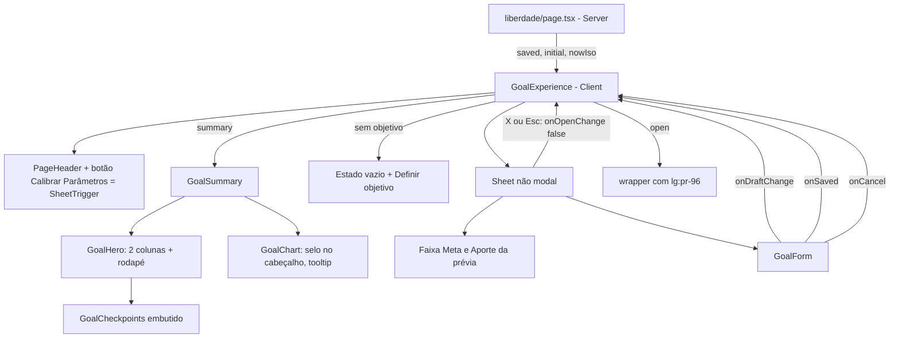

# Liberdade: Layout Enxuto Design

**Spec**: `.specs/features/liberdade-layout/spec.md`
**Status**: Draft

---

## Architecture Overview

Só apresentação e estado de tela. Segue AD-001 (a página continua Server Component e lê o objetivo), AD-005 (sem e2e novo, UI sem teste de componente) e AD-008 (prévia no cliente com `goalSchema` e `summarize`). Domínio, validação, banco e `saveGoal` não mudam; nenhuma AD nova é necessária.

Três decisões moldam o desenho:

1. **O cabeçalho e o botão passam para dentro do `GoalExperience`.** O botão "Calibrar Parâmetros" precisa do estado da gaveta, e a reserva de espaço à direita só pode ser aplicada por quem tem esse estado. A página fica só com leitura e `metadata`.
2. **A gaveta é um `Sheet` não modal sobre o Dialog do Radix.** Sem overlay, sem trava de foco, sem fechar ao clicar fora. Ela vive num portal; o conteúdo da página recebe `lg:pr-96` enquanto ela está aberta (24rem = 384 px, a largura da gaveta).
3. **O Hero decide colunas pela largura dele, não pela da tela** (container query do Tailwind v4, `@container` e `@xl:`). O menu lateral (218 px) e a gaveta tiram largura do conteúdo, então um breakpoint de tela erraria nos dois casos. A 1280 px de tela com a gaveta aberta o Hero fica com 966 − 384 = 582 px, acima do corte de 576 px (`@xl`).

O fechamento da gaveta descarta o rascunho **desmontando** o formulário: o conteúdo do Radix só existe aberto, então reabrir monta o `GoalForm` de novo com `initial`. O que falta é restaurar o resumo exibido; isso fica em `GoalExperience.handleOpenChange(false)`. O salvamento com sucesso fecha por outro caminho (`onSaved`), que não restaura o resumo, para a prévia virar o resultado oficial.

---

## Code Reuse Analysis

### Existing Components to Leverage

| Component | Location | How to Use |
| --------- | -------- | ---------- |
| Dialog do Radix (`radix-ui`) | `src/components/ui/dialog.tsx` | Base do `Sheet`: mesmo padrão de wrappers com `data-slot`; sem o `DialogOverlay` |
| `PageHeader` (aceita `children` à direita) | `src/components/page-header.tsx` | Título "Liberdade" com o botão no topo direito |
| `GoalHero`, `GoalCheckpoints`, `GoalChart`, `GoalSummary` | `src/components/goal-*.tsx` | Reescritos no lugar: mesmas props (`summary`) |
| `GoalForm` | `src/components/goal-form.tsx` | Perde o estado `editing` e o botão "Calibrar Parâmetros"; ganha `onSaved` e `onCancel` |
| `GoalExperience` | `src/components/goal-experience.tsx` | Passa a ser dono de `open`, do cabeçalho e do estado vazio |
| `formatBRL`, `formatShare`, `formatTerm`, `formatCompactBRL` | `money.ts`, `percent.ts`, `goal-hero.tsx` | Textos do Hero e da faixa da gaveta |
| Tokens `--glow-a`, `--income`, `--viz-*`, `bg-primary/10`, `text-link` | `src/app/globals.css` | Cores do Hero, do plano de ação e do gráfico |
| Padrão de animação `data-open:animate-in`, `slide-in-from-right` | `tw-animate-css` (já importado) | Entrada e saída da gaveta |
| Layout do app (`main` com `md:ml-[218px]`, `max-w-5xl`) | `src/app/(app)/layout.tsx` | Não muda; a reserva de espaço é padding dentro do `GoalExperience` |

### Integration Points

| System | Integration Method |
| ------ | ------------------ |
| Página `/liberdade` | `page.tsx` renderiza só `<GoalExperience>`; o cabeçalho sai dela |
| `saveGoal`, `goalSchema`, `summarize` | Inalterados |
| Banco | Sem mudança |

---

## Components

### Sheet (novo)

- **Purpose**: Painel lateral à direita, não modal, sobre o Dialog do Radix.
- **Location**: `src/components/ui/sheet.tsx` (Client)
- **Interfaces**:
  - `Sheet`, `SheetTrigger`, `SheetClose`, `SheetTitle`, `SheetDescription` - repassam `Root`, `Trigger`, `Close`, `Title`, `Description` do Radix.
  - `SheetContent({ className, children, showCloseButton = true, ...props })` - portal + `DialogPrimitive.Content` com `fixed inset-y-0 right-0 z-50 flex w-full flex-col border-l border-border bg-popover text-popover-foreground shadow-2xl outline-none lg:w-96`, animação `data-open:animate-in data-open:slide-in-from-right data-closed:animate-out data-closed:slide-out-to-right`, rolagem interna (`overflow-y-auto`), botão X no canto. **Não renderiza overlay.**
- **Dependencies**: `radix-ui` `Dialog`, `Button`, `XIcon`.
- **Reuses**: estrutura de `dialog.tsx`.
- **Uso esperado**: `<Sheet open onOpenChange modal={false}>`; o chamador impede o fechamento por clique fora com `onInteractOutside={(e) => e.preventDefault()}` em `SheetContent`.

### GoalExperience (alterado)

- **Purpose**: Dono de `open`, da prévia, do cabeçalho e do estado vazio.
- **Location**: `src/components/goal-experience.tsx` (Client)
- **Interfaces**: `GoalExperience({ saved, initial, nowIso })` (inalterada).
  - Estado: `open: boolean`, `summary: Summary | null` (como hoje).
  - `handleOpenChange(next)`: se `next` é falso (X, Esc, Cancelar), faz `setSummary(saved ? summarize(saved, now) : null)` e `setOpen(false)`; se verdadeiro, `setOpen(true)`.
  - `handleSaved()`: `setOpen(false)` **sem** tocar no `summary`.
  - `handleDraft(values)`: igual a hoje, sem o ramo `null` (o descarte vem de `handleOpenChange`).
  - Layout: `
` com `PageHeader` (botão `SheetTrigger asChild` "Calibrar Parâmetros" só quando `saved`), `GoalSummary` quando há `summary`, estado vazio quando `!saved && !summary`, e `Sheet` com `SheetContent` (`modal={false}`).
  - Dentro da gaveta: `SheetTitle` "Calibrar Parâmetros", `SheetDescription` com o parágrafo de introdução hoje no topo da página (texto inalterado), `DrawerSummary`, `GoalForm`.
- **Estado vazio**: cartão `rounded-2xl border border-border bg-card p-6` com o texto de introdução e `SheetTrigger asChild` "Definir objetivo".
- **DrawerSummary** (função local): `dl` com "Meta Patrimonial" (`formatBRL(summary.targetCents)` ou "—") e "Aporte Estratégico Mensal" (`"{formatBRL} / mês"`, "Prazo encerrado" se `monthlyCents` nulo, ou "—" sem prévia).
- **Dependencies**: `Sheet`, `GoalForm`, `GoalSummary`, `PageHeader`, `summarize`, `goalSchema`.

### GoalForm (alterado)

- **Purpose**: Só os campos e os botões; a abertura e o fechamento são de quem o hospeda.
- **Location**: `src/components/goal-form.tsx` (Client)
- **Interfaces**: `GoalForm({ initial, onDraftChange, onSaved, onCancel, nowIso })`. Remove `editing` e o botão "Calibrar Parâmetros" (que passa a ser o gatilho da gaveta). Sucesso do `saveGoal` chama `onSaved()` e `router.refresh()`; Cancelar chama `onCancel()`; o botão Cancelar aparece sempre (inclusive sem objetivo salvo). O `grid` dos campos vira coluna única (a gaveta tem 384 px); os botões ficam num rodapé fixo da gaveta (`sticky bottom-0`). `onDraftChange` continua a receber os valores a cada alteração.
- **Reuses**: todo o estado, `useTransition` e `fieldErrors` atuais.

### GoalHero (reescrito)

- **Purpose**: Hero em duas colunas com a barra no rodapé.
- **Location**: `src/components/goal-hero.tsx`
- **Interfaces**: `GoalHero({ summary })`; continua exportando `formatTerm`.
- **Estrutura**: `<section aria-label="Resumo do objetivo" class="@container overflow-hidden rounded-2xl border border-border bg-card shadow-lg" style={glow}>` com
  - `div.grid.@xl:grid-cols-[1.1fr_1fr]`:
    - **Destino** (`p-5`): "Meta Patrimonial"; alvo `font-display text-3xl @xl:text-2xl @3xl:text-3xl`; selo `Gera {renda}/mês perpétuos a {taxa}% a.a.` (pill `bg-income/15 text-income`); linha `{guardado} acumulados ({formatShare} do alvo)`.
    - **Plano de ação** (`bg-primary/10 p-5`, sem borda nem raio; o `overflow-hidden` do card recorta os cantos): "Aporte Estratégico Mensal" (`text-link`); valor `font-display text-4xl @xl:text-3xl @3xl:text-4xl` seguido de ` / mês` em corpo pequeno, ou "Prazo encerrado"; `Tempo até o Ápice: {formatTerm(months)}`; `Distância do Alvo: {formatBRL(remaining)}`.
  - Rodapé: `div.border-t.border-border.px-5.py-4` com `<GoalCheckpoints summary>`.
- **Alturas esperadas** (para o critério de 340 px): destino ~170 px; rodapé ~100 px; total ~270 a 300 px.
- **Reuses**: `glow` atual, `formatTerm`, `formatShare`.

### GoalCheckpoints (alterado)

- **Purpose**: Barra e checkpoints como rodapé do Hero.
- **Location**: `src/components/goal-checkpoints.tsx`
- **Interfaces**: mesma assinatura. Remove a linha "Progresso … 7,2%" (o percentual passa a existir só no Hero); mantém o `Progress` com `aria-label="Progresso do objetivo: {share}"`, o brilho decorativo e as marcas; cada item da lista fica em duas linhas (ícone e valor compacto; estado em texto) sem a linha "25% do alvo". Grade `grid-cols-2 @xl:grid-cols-4`.
- **Nota**: `@xl:` aqui consulta o container mais próximo, o Hero.

### GoalChart (alterado)

- **Purpose**: Selo no cabeçalho, sem marcas fixas, tooltip como leitura.
- **Location**: `src/components/goal-chart.tsx`
- **Interfaces**: mesma assinatura. Mudanças:
  - Cabeçalho: título à esquerda; à direita o selo `Rendimentos: {X}% do patrimônio aos {N} anos` (pill `bg-income/15 text-income`) e a legenda.
  - Remove o `
` do rodapé (frase e "marcas nos 25%…"), o cálculo `marks` e os `ReferenceDot`.
  - `Area`: `activeDot={{ r: 4, stroke: "var(--card)", strokeWidth: 2 }}`; `Tooltip cursor` com linha sólida fina (`stroke: var(--muted-foreground)`).
  - Mantém tooltip por ponto anual, `aria-label` da figura (com a mesma frase) e a tabela `sr-only`.
- **Reuses**: tudo o que existe.

### GoalSummary (alterado)

- **Location**: `src/components/goal-summary.tsx`
- **Interfaces**: `GoalSummary({ summary })`: `GoalHero` (já com a barra) e `GoalChart`. Não renderiza mais `GoalCheckpoints` à parte.

### Página /liberdade (alterada)

- **Location**: `src/app/(app)/liberdade/page.tsx`
- **Comportamento**: lê o objetivo e devolve só `<GoalExperience saved initial nowIso />`; o `PageHeader` (eyebrow "Independência financeira", título "Ápice") e o parágrafo de introdução passam para o `GoalExperience`, com os mesmos textos. `metadata` ("Ápice") fica. `metadata`, `moneyText` e a montagem de `initial` ficam.

---

## Data Models

Nenhum. `GoalFormValues`, `Goal` e `GoalSummary` ficam como estão.

---

## Error Handling Strategy

| Error Scenario | Handling | User Impact |
| -------------- | -------- | ----------- |
| `saveGoal` com campo inválido | `fieldErrors` no `GoalForm`; gaveta não fecha | Mensagem sob o campo; objetivo salvo intacto |
| `saveGoal` com falha de servidor | `result.error` como alerta no `GoalForm`; gaveta aberta | Alerta na gaveta; a prévia segue exibida, o salvo não mudou |
| Rascunho inválido | `safeParse` falha, `summary` não muda | Hero e gráfico mantêm o último resultado válido |
| X ou Esc com rascunho | `handleOpenChange(false)` restaura o resumo salvo | Descarta o rascunho |
| Clique fora da gaveta | `onInteractOutside` com `preventDefault` | Nada acontece; gaveta fica aberta |
| Sem objetivo e sem prévia válida | Estado vazio | Cartão com "Definir objetivo" |
| Prazo 0 | `timeline` vazia, aporte nulo | Hero com "Prazo encerrado" e "Tempo até o Ápice: 0 meses"; gráfico omitido |

---

## Risks & Concerns

| Concern | Location (file:line) | Impact | Mitigation |
| ------- | -------------------- | ------ | ---------- |
| Retorno do foco ao botão depende do Radix: no modo não modal o foco só volta ao `Trigger` se o usuário não interagiu fora antes | `Sheet` (novo) | Quem clicou na página com a gaveta aberta perde o retorno de foco | Aceito: é o comportamento padrão do Radix para dialogs não modais; o foco entra na gaveta ao abrir (LAY-10 AC 12 vale para o caso principal). Registrado como lacuna possível na validação |
| A reserva `lg:pr-96` fixa 384 px mesmo em telas muito largas, onde sobra margem | `goal-experience.tsx` (novo) | Em ≥1700 px o conteúdo estreita sem necessidade | Aceito: simples e previsível; sem cálculo de margem livre |
| Entre 1024 px e cerca de 1150 px de tela, com a gaveta aberta, o Hero fica abaixo de 576 px e empilha | `goal-hero.tsx` (novo) | A meta de 340 px de altura não vale nesse caso (o Hero empilhado passa disso) | Comportamento previsto: a meta vale com o Hero a partir de 576 px; a faixa de resumo da gaveta (LAY-13) cobre a leitura |
| Texto "R$ 3.000.000,00" em 2 colunas estreitas (Hero de 576 px a 640 px) pode estourar a coluna | `goal-hero.tsx` (novo) | Quebra de layout | Tamanhos de fonte por container query (`@xl:text-2xl`, `@3xl:text-3xl`); conferir no navegador a 1280 px com a gaveta aberta |
| `GoalForm` perde o estado `editing`: qualquer outro uso do componente quebra | `src/components/goal-form.tsx` | Compilação | Único uso é `goal-experience.tsx`; `grep` confirma antes do commit |
| Sem teste de componente no projeto (AD-005) | `vitest.config.ts` | Gaveta, container queries e foco sem cobertura automática | Toda regra de negócio está em funções puras já testadas; verificação manual no navegador (1280 px, 390 px, temas claro e escuro), medindo a altura do Hero |
| Dois `SheetTrigger` possíveis (cabeçalho e estado vazio) | `goal-experience.tsx` (novo) | O Radix guarda um só `triggerRef` | Só um é renderizado por vez (`saved` decide) |
| Recharts: `activeDot` e `cursor` mudam por versão | `goal-chart.tsx` | Ponto ativo ou linha-guia não aparecem | Conferir no navegador; props existem no `Area` e no `Tooltip` do Recharts 3.10.1 (tipos instalados) |

---

## Tech Decisions (only non-obvious ones)

| Decision | Choice | Rationale |
| -------- | ------ | --------- |
| Onde fica o estado da gaveta | No `GoalExperience`, que também renderiza o cabeçalho | A reserva de espaço e o botão dependem do mesmo `open`; sem contexto nem atributo global |
| Como reservar espaço | `lg:pr-96` no wrapper da página | CSS puro, sem efeito colateral no layout do app; o container de 966 px já deixa 48 px de folga até a gaveta |
| Breakpoint do Hero | Container query `@xl` (576 px) | A largura útil varia com o menu lateral e a gaveta |
| Descartar o rascunho | Desmontagem do conteúdo da gaveta + restauração do `summary` | Evita um `reset` manual dos campos; o Radix só monta o conteúdo aberto |
| Salvar com sucesso | `onSaved` fecha sem restaurar o `summary` | A prévia vira o resultado salvo (LAY-08 AC 8) |
| Gaveta não modal | Sem overlay, sem trava de foco, clique fora ignorado | Escolha do usuário: a prévia precisa ficar visível e clicável |
| Marcas de 25/50/75% no gráfico | Removidas; os checkpoints ficam na barra | Pedido do usuário; o tooltip já dá o patrimônio por ano |
| Fração do checkpoint | Sai do texto da lista (fica o valor compacto e o estado) | Economiza uma linha para caber nos 340 px; a posição segue na marca da barra |
