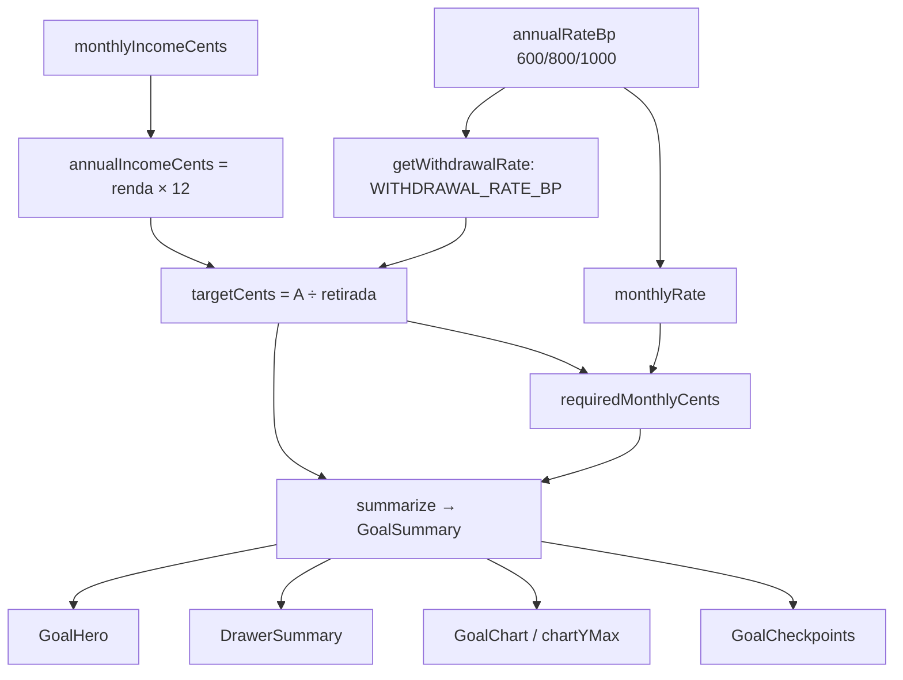

# Liberdade: Taxa de Retirada Design

**Spec**: `.specs/features/liberdade-taxa-retirada/spec.md`
**Status**: Approved

---

## Architecture Overview

A mudança é no domínio puro (`freedom.ts`) e na camada de texto. Os componentes continuam lendo `GoalSummary`; só ganham dois campos e novos rótulos. Nada de servidor, banco ou ação muda.



`summarize` é a fonte única da meta: calcula `targetCents` uma vez e repassa o mesmo valor a `requiredMonthlyCents`, `projectTimeline`, `buildCheckpoints`, `progressBp` e ao resumo. Nenhum componente recalcula meta.

---

## Code Reuse Analysis

### Existing Components to Leverage

| Component | Location | How to Use |
| --------- | -------- | ---------- |
| `ANNUAL_RATES`, `AnnualRateBp` | `src/lib/domain/freedom.ts` | Chaves da tabela de retirada; `Record<AnnualRateBp, number>` faz o compilador exigir uma entrada por cenário |
| `monthlyRate`, `requiredMonthlyCents`, `projectedCents` | `src/lib/domain/freedom.ts` | Inalterados; ganham testes que travam a fórmula e a convenção de fim de mês |
| `summarize`, `GoalSummary` | `src/lib/domain/freedom.ts` | Ponto único de cálculo; adicionar `withdrawalRateBp` e `annualIncomeCents` |
| `GoalHero`, `DrawerSummary`, `GoalChart`, `GoalCheckpoints` | `src/components/` | Já leem `summary.targetCents`; só o texto do Hero e do seletor mudam |
| `RateToggle` | `src/components/rate-toggle.tsx` | Troca só o `aria-label`; opções e visual ficam |
| `formatBRL`, `formatShare` | `src/lib/domain/money.ts` e Hero | Formatação dos novos valores |

### Integration Points

| System | Integration Method |
| ------ | ------------------ |
| Banco (`financial_goal.annual_rate_bp`, check 600/800/1000) | Inalterado; a retirada é derivada na leitura |
| `goalSchema` e `saveGoal` | Inalterados (RET-15) |
| Prévia no cliente (AD-008) | `getWithdrawalRate` fica em `freedom.ts`, que não importa servidor |

---

## Components

### Tabela e leitura da taxa de retirada

- **Purpose**: Guardar em um só lugar a relação rentabilidade → retirada e expô-la por função.
- **Location**: `src/lib/domain/freedom.ts`
- **Interfaces**:
  - `WITHDRAWAL_RATE_BP: Record<AnnualRateBp, number>` = `{ 600: 400, 800: 600, 1000: 700 }`
  - `getWithdrawalRate(annualRateBp: number): number` - devolve a retirada em pontos-base; lança `RangeError("Rentabilidade sem taxa de retirada definida: <n>")` fora da tabela
- **Dependencies**: `ANNUAL_RATES`
- **Reuses**: `AnnualRateBp`

### Meta patrimonial

- **Purpose**: Patrimônio que sustenta a renda desejada na taxa de retirada.
- **Location**: `src/lib/domain/freedom.ts`
- **Interfaces**:
  - `annualIncomeCents(monthlyIncomeCents: number): number` - `renda × 12`
  - `targetCents(monthlyIncomeCents: number, annualRateBp: number): number` - mesma assinatura de hoje; passa a ser `Math.round(annualIncomeCents(renda) * 10_000 / getWithdrawalRate(annualRateBp))`
- **Dependencies**: `getWithdrawalRate`
- **Reuses**: nome e assinatura atuais (RET-15); todos os chamadores seguem válidos

Conferência numérica (R$ 20.000/mês; renda anual = 24.000.000 centavos): 6% → 24.000.000 × 10.000 ÷ 400 = 600.000.000 (R$ 6.000.000,00); 10% → ÷ 700 = 342.857.142,86 → 342.857.143 (R$ 3.428.571,43); 8% → ÷ 600 = 400.000.000 (R$ 4.000.000,00). O pedido original dizia R$ 4.800.000; o usuário decidiu que a tabela prevalece (ver Risks & Concerns, linha 1).

### Resumo

- **Purpose**: Entregar à UI todos os derivados da mesma meta.
- **Location**: `src/lib/domain/freedom.ts`
- **Interfaces**:
  - `GoalSummary` ganha `withdrawalRateBp: number` e `annualIncomeCents: number`
  - `summarize(goal, now)` chama `targetCents` uma vez e repassa o resultado
- **Dependencies**: `targetCents`, `getWithdrawalRate`, `annualIncomeCents`
- **Reuses**: estrutura atual de `summarize`

### Textos

- **Purpose**: Rótulos e explicação sem promessa de renda, testáveis sem renderizar componente.
- **Location**: `src/lib/domain/freedom-copy.ts` (novo, puro)
- **Interfaces**:
  - `RATE_TITLE = "Rentabilidade real esperada"`, `RATE_HINT = "Taxa real estimada (descontada a inflação)"`
  - `HOW_WE_CALCULATE: string[]` - parágrafos do "Como calculamos?" (texto do pedido, variação por cenário, premissa sem garantia)
  - `heroFacts(summary): { label: string; value: string }[]` - Rentabilidade real, Taxa de retirada, Renda desejada
- **Dependencies**: `formatBRL`, `GoalSummary`
- **Reuses**: padrão de módulo puro com teste unitário (ex.: `spending-pace.ts`)

### UI

- **Purpose**: Mostrar os fatos e a explicação mantendo o visual.
- **Location**: `src/components/goal-hero.tsx`, `goal-form.tsx`, `goal-experience.tsx`, `rate-toggle.tsx`
- **Interfaces**:
  - Hero: troca o selo "Gera … perpétuos …" por `<dl>` com `heroFacts` e um `<details>` "Como calculamos?" com `HOW_WE_CALCULATE`
  - Form: título `RATE_TITLE`, legenda `RATE_HINT`, linha "Taxa de retirada M% a.a." sob o seletor, vinda de `getWithdrawalRate`
  - `INTRO` da gaveta sem "sem consumir o principal"
- **Dependencies**: `freedom-copy.ts`, `GoalSummary`
- **Reuses**: tokens e classes atuais; sem componente novo de UI

---

## Data Models

Nenhum modelo novo e nenhuma coluna nova.

```typescript
export const WITHDRAWAL_RATE_BP: Record<AnnualRateBp, number> = { 600: 400, 800: 600, 1000: 700 };

type GoalSummary = {
  // ...campos atuais
  withdrawalRateBp: number;
  annualIncomeCents: number;
};
```

---

## Error Handling Strategy

| Error Scenario | Handling | User Impact |
| -------------- | -------- | ----------- |
| Rentabilidade fora de 600/800/1000 | `getWithdrawalRate` lança `RangeError` | Inalcançável: o banco, o `goalSchema` e `AnnualRateBp` barram antes; se ocorrer, a tela quebra visivelmente em vez de mostrar meta errada |
| Prazo encerrado | `monthlyCents = null` (já existe) | "Prazo encerrado" |
| Guardado ≥ meta | `requiredMonthlyCents` devolve 0 (já existe) | Aporte R$ 0,00 |

---

## Risks & Concerns

| Concern | Location (file:line) | Impact | Mitigation |
| ------- | -------------------- | ------ | ---------- |
| O pedido original citava R$ 4.800.000 para 8%, inconsistente com 6% de retirada | `spec.md` RET-04 | R$ 240.000 ÷ 6% = R$ 4.000.000 | Resolvido: o usuário confirmou 8% → 6% e meta R$ 4.000.000; spec e testes usam esse valor |
| Meta e aporte sobem para objetivos já salvos | `src/lib/domain/freedom.ts` (`summarize`) | Usuário vê aporte maior ao abrir a tela | Registrar no `validation.md`; sem migração porque o valor é calculado na leitura |
| `targetCents` hoje devolve sempre inteiro; com 7% passa a depender de `Math.round` | `src/lib/domain/freedom.ts:16` | Meta com 1 centavo de arredondamento; marcos usam `Math.round` sobre ela | Testes de 10% e da renda máxima fixam o valor; marcos já partem do valor arredondado |
| `freedom.test.ts` (452 linhas) tem expectativas com a meta antiga (×200/×150/×120) | `src/lib/domain/freedom.test.ts` | Falhas esperadas após a mudança | A task de domínio atualiza essas expectativas a partir da spec, não do resultado da implementação |
| UI sem teste automático (AD-005, AD-008) | `src/components/goal-*.tsx` | Fiação errada de meta na tela passaria | Textos e fatos saem de `freedom-copy.ts` (testado); `chartYMax(summary.targetCents, …)` e a linha "Meta" já usam o mesmo campo; verificação manual dos três cenários no Verifier |

---

## Tech Decisions (only non-obvious ones)

| Decision | Choice | Rationale |
| -------- | ------ | --------- |
| Onde fica a tabela | `Record<AnnualRateBp, number>` em pontos-base em `freedom.ts` | O tipo força uma entrada por cenário; um cenário novo não compila sem retirada |
| Sem função `calculateFinancialIndependence` | `summarize` é o ponto único | Uma segunda função duplicaria a lógica (spec, Assumptions) |
| "Como calculamos?" | `<details>` nativo | Funciona em toque e teclado sem dependência; o `Tooltip` do projeto abre só por hover/foco |
| Textos em módulo puro | `freedom-copy.ts` | Permite testar RET-11 a RET-14 sem teste de componente (AD-008) |
| Arredondamento da meta | `Math.round` ao centavo, aplicado uma vez | Hero, marcos, gráfico e aporte usam o mesmo inteiro |
