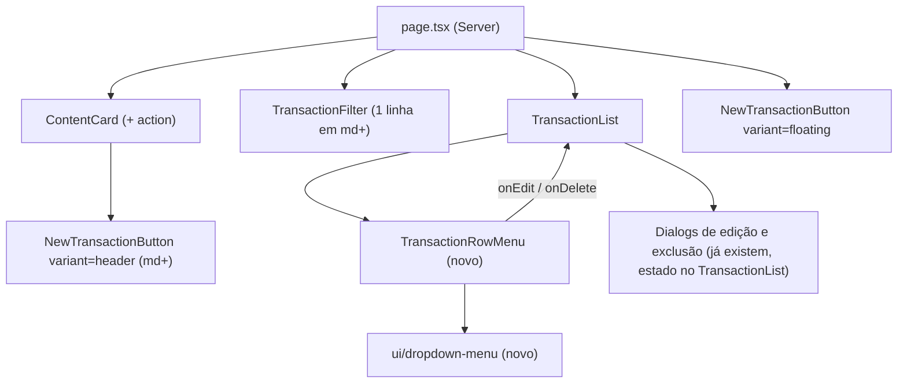

# Lista de Transações: Filtros e Ações Design

**Spec**: `.specs/features/lista-transacoes-ux/spec.md`
**Status**: Approved

---

## Architecture Overview

Mudança só de apresentação, sem dados, actions nem domínio novos. Quatro pontos de contato, todos em componentes existentes, mais um wrapper de UI novo.

Os dois botões "Nova transação" são duas instâncias do mesmo componente, cada uma com seu `Dialog` fechado por padrão. Só uma abre por vez, e o conteúdo do `Dialog` só monta aberto.

---

## Code Reuse Analysis

### Existing Components to Leverage

| Component | Location | How to Use |
| --------- | -------- | ---------- |
| `NewTransactionButton` | `src/components/new-transaction-button.tsx` | Ganha `variant: "floating" \| "header"`; o modal e o formulário ficam intactos |
| `ContentCard` | `src/components/content-card.tsx` | Ganha o slot opcional `action` no cabeçalho |
| `TransactionFilter` | `src/components/transaction-filter.tsx` | Só muda as classes de grid; lógica e debounce intactos |
| `TransactionList` | `src/components/transaction-list.tsx` | Troca os dois `Button` de linha pelo `TransactionRowMenu`; os `Dialog` de edição e exclusão não mudam |
| `Button` (`ghost`, `icon-sm`) | `src/components/ui/button.tsx` | Gatilho do menu |
| Estilo do popover | `src/components/ui/select.tsx:72` | Mesmas classes (`rounded-xl border bg-popover shadow-xl`, animações) no `DropdownMenuContent` |
| `radix-ui` | `package.json:28` | O pacote já traz `DropdownMenu` (`@radix-ui/react-dropdown-menu` 2.1.24); sem dependência nova |

### Integration Points

| System | Integration Method |
| ------ | ------------------ |
| `page.tsx` | Passa `<NewTransactionButton variant="header" …/>` em `ContentCard action`; o flutuante segue no fim da página |
| `deleteTransaction` / `TransactionForm` | Nenhuma mudança; o menu só chama `setEditing(t)` e `setDeleting(t)` |

---

## Components

### `ui/dropdown-menu.tsx` (novo)

- **Purpose**: Wrapper shadcn-style de `DropdownMenu` da `radix-ui`, com a aparência do popover do app.
- **Location**: `src/components/ui/dropdown-menu.tsx`
- **Interfaces**: `DropdownMenu`, `DropdownMenuTrigger`, `DropdownMenuContent`, `DropdownMenuItem` (com `variant="destructive"`).
- **Dependencies**: `radix-ui`, `cn`.
- **Reuses**: classes do `SelectContent`; convenção `data-slot` dos demais `ui/*`.

### `TransactionRowMenu` (novo)

- **Purpose**: Botão "⋯" por linha com os itens Editar e Excluir (LISTA-03/04/05).
- **Location**: `src/components/transaction-row-menu.tsx`
- **Interfaces**: `TransactionRowMenu({ onEdit, onDelete }: { onEdit: () => void; onDelete: () => void })`
- **Dependencies**: `ui/dropdown-menu`, `Button`, `EllipsisIcon` (lucide-react, existe).
- **Reuses**: gatilho `Button variant="ghost" size="icon-sm"` com `aria-label="Ações do lançamento"`; item "Excluir" em tom destrutivo.

### `TransactionList` (alterado)

- Substitui o `` com os dois botões por `<TransactionRowMenu onEdit={() => setEditing(t)} onDelete={() => { setDeleteError(null); setDeleting(t); }} />`. Os diálogos continuam fora da linha, controlados pelo estado do componente (LISTA-05).

### `TransactionFilter` (alterado)

- Container passa de `grid gap-3 sm:grid-cols-2` para `grid grid-cols-1 gap-3 md:grid-cols-[minmax(0,2fr)_minmax(0,1fr)_minmax(0,1fr)]`; o `sm:col-span-2` do campo de busca é removido (LISTA-01). Abaixo de 768px os três ficam empilhados, o que muda o `sm:grid-cols-2` atual entre 640 e 767px (conforme a spec).

### `NewTransactionButton` (alterado)

- **Interfaces**: `variant?: "floating" | "header"` (padrão `"floating"`).
- `floating`: o botão atual, inalterado, em todas as larguras (LISTA-07).
- `header`: `<Button className="hidden md:inline-flex"><PlusIcon/>Nova transação</Button>`, variante primária padrão (LISTA-06/07).
- O `DialogContent` é o mesmo nas duas variantes; extrair o miolo em uma função interna evita duplicação.

### `ContentCard` (alterado)

- Novo `action?: ReactNode`, renderizado depois do `note`. O `header` passa a agrupar `note` e `action` em um `div flex items-center gap-3` (sem mudar o visual quando `action` falta).

---

## Data Models

N/A: sem mudança de dados.

---

## Error Handling Strategy

| Error Scenario | Handling | User Impact |
| -------------- | -------- | ----------- |
| Exclusão falha | Já tratado: `deleteError` no diálogo de confirmação | Igual a hoje |
| Menu abre na última linha | `DropdownMenuContent` usa colisão do Radix (inverte para cima) | Menu sempre visível (edge case da spec) |

---

## Risks & Concerns

| Concern | Location (file:line) | Impact | Mitigation |
| ------- | -------------------- | ------ | ---------- |
| Abrir `Dialog` a partir de um `DropdownMenuItem` pode deixar o `body` com `pointer-events: none` ou perder o foco ao fechar o menu | `src/components/transaction-list.tsx` (diálogos controlados) | Página sem clique após Editar/Excluir | Os `Dialog` não ficam dentro do menu e usam estado do `TransactionList`; a task de verificação confere que a página segue clicável depois de fechar cada diálogo |
| Teste e2e atual clica "Editar"/"Excluir" direto na linha | `e2e/transaction-list.spec.ts:37,45` | Spec e2e quebra | Task atualiza o spec para abrir o menu antes; por AD-005 a execução do e2e não é gate |
| Sem teste de componente (AD-005) e sem lógica pura nova | n/a | Os critérios de layout e menu não têm teste unitário | O gate é lint + typecheck + build; critérios de layout (largura ≥ 768 / < 768) e menu verificados no navegador e cobertos no e2e atualizado |
| Dois botões com o nome "Nova transação" no desktop | `src/components/new-transaction-button.tsx` | Seletor ambíguo em e2e (strict mode) | Seletores escopados: header dentro do bloco "Transações do mês"; flutuante por `.fixed` |
| Gatilho "⋯" pequeno em toque | `transaction-list.tsx` | Alvo de toque curto | `size="icon-sm"` (28px) com `min-h`/padding da linha; avaliar `size="icon"` (40px) em mobile na verificação |

---

## Tech Decisions

| Decision | Choice | Rationale |
| -------- | ------ | --------- |
| Duas instâncias de `NewTransactionButton` em vez de um `Dialog` compartilhado por contexto | Duas instâncias com `variant` | Sem contexto novo; `Dialog` fechado é barato e só um abre por vez |
| Menu via `DropdownMenu` da `radix-ui` | Wrapper `ui/dropdown-menu.tsx` | Dependência já instalada, acessível por teclado (LISTA-04 AC7) sem código próprio |
| Responsividade por classes Tailwind (`md:`) | CSS, sem JS (`matchMedia`) | Renderização no servidor sem flash; o `md` já é o breakpoint do flutuante |

> Nenhuma decisão de projeto nova para o `STATE.md`: as escolhas são locais da feature e seguem AD-001 (Server Components) e AD-005 (sem e2e como gate).
