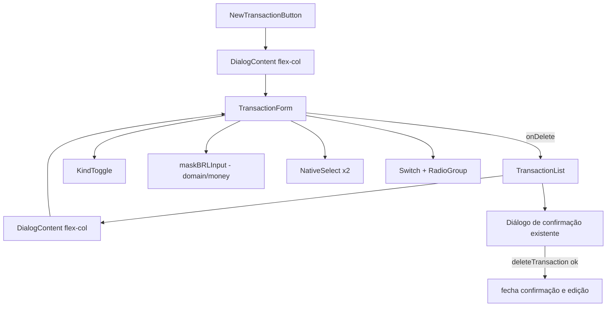

# Modal de Transação Design

**Spec**: `.specs/features/modal-transacao/spec.md`
**Status**: Draft

---

## Architecture Overview

Mudança só de interface. `TransactionForm` continua dono do estado e do `submit`; ganha um corpo rolável e um rodapé próprio. A exclusão continua em `TransactionList` (dona do diálogo de confirmação); o form só avisa por callback.

Layout do form: `<form class="flex min-h-0 flex-col">` com corpo `overflow-y-auto` (`flex-1`) e rodapé `shrink-0` com borda superior. Isso cumpre rodapé fixo (MODT-11) em qualquer largura; no mobile o botão primário usa `w-full`, no `sm:` volta à largura natural. O `DialogContent` dos dois chamadores troca para `flex flex-col max-h-[calc(100dvh-2rem)] sm:max-w-md` (o padrão `sm:max-w-sm` é estreito para o valor grande).

---

## Code Reuse Analysis

| Component | Location | How to Use |
| --------- | -------- | ---------- |
| `NativeSelect` | `src/components/ui/native-select.tsx` | Categoria e Subcategoria; aceita `aria-invalid` |
| `RadioGroup`/`RadioGroupItem` | `src/components/ui/radio-group.tsx` | Frequência (`forever`/`until`) e base do KindToggle (Radix, `role=radio`) |
| `Dialog*` | `src/components/ui/dialog.tsx` | Sem mudança; só `className` do conteúdo |
| `categoryDisplayName`, `pickSelection` | `src/lib/domain/category-label.ts` | Rótulos do select; troca de categoria zera a subcategoria |
| `parseBRL`, `formatBRL` | `src/lib/domain/money.ts` | Schema segue usando `parseBRL`; a máscara gera texto que `parseBRL` aceita |
| Diálogo de exclusão | `src/components/transaction-list.tsx:182` | Reaproveitado sem mudar texto |
| `CategoryPicker`, `CategoryCard` | `src/components/category-picker.tsx` | Deixa de ser usado pelo form; permanece (usado em outros lugares? verificar no task: se não, remover) |

### Integration Points

| System | Integration Method |
| ------ | ------------------ |
| `createTransaction`/`updateTransaction` | Contrato idêntico: mesmo `input`, `amount` em texto pt-BR |
| `deleteTransaction(id, month)` | Chamado por `TransactionList.confirmDelete`, como hoje |

---

## Components

### maskBRLInput (função pura)

- **Purpose**: Converte o texto digitado em texto pt-BR com centavos da direita para a esquerda.
- **Location**: `src/lib/domain/money.ts`
- **Interfaces**: `maskBRLInput(raw: string): string` - mantém só dígitos, corta em 11, remove zeros à esquerda; sem dígitos ou só zeros → `""`; senão `formatBRLDigits` (`1234` → `12,34`; `5` → `0,05`; milhar com ponto).
- **Reuses**: `MAX_CENTS` (11 dígitos = 99 999 999 999 centavos).

### Switch

- **Purpose**: Primitivo `role="switch"` para "Transação recorrente".
- **Location**: `src/components/ui/switch.tsx`
- **Interfaces**: `Switch(props: ComponentProps<typeof SwitchPrimitive.Root>)`, `Switch` de `radix-ui` (confirmado: `radix-ui` exporta `Switch`, `@radix-ui/react-switch` instalado).
- **Reuses**: tokens `primary`, padrão de `checkbox.tsx`.

### KindToggle

- **Purpose**: Controle segmentado Gasto/Ganho, largura total.
- **Location**: `src/components/kind-toggle.tsx`
- **Interfaces**: `KindToggle({ value, onChange, name }: { value: "expense" | "income"; onChange(kind): void })`
- **Dependencies**: `RadioGroup` (aria-label "Tipo"); `data-[state=checked]` pinta `destructive/15` (Gasto) ou `success/15` (Ganho).

### TransactionForm (alterado)

- **Purpose**: Mesmo formulário, nova ordem, rodapé.
- **Location**: `src/components/transaction-form.tsx`
- **Interfaces**: props atuais + `onCancel?: () => void` + `onDelete?: () => void` (só na edição) + `pending` interno desabilita Salvar e Excluir.
- **Ordem**: KindToggle, Valor (`text-3xl font-display`, `text-success` se Ganho, `autoFocus`, `inputMode="numeric"`, `onChange` aplica `maskBRLInput`), Descrição, Categoria/Subcategoria (só Gasto), Data, Switch recorrência (+ Frequência + Mês final).
- **Recorrência**: `Switch checked = recurrence !== "none"`; ligar → `forever`; desligar → `none` e `recurrenceEnd = ""`.
- **Categoria**: `NativeSelect` com opção vazia "Selecione uma categoria" (valor `""`); `onChange` usa `pickSelection(id)`. Subcategoria renderiza só se a categoria atual tem subcategorias. Categoria que não existe mais na lista cai no placeholder (valor sem `<option>` correspondente vira `""` via `categories.some`).
- **Rodapé**: `[Excluir (destructive, mr-auto)] [Cancelar (outline)] [Salvar | Salvar alterações]`; no mobile `flex-col-reverse` com o primário `w-full`.

### TransactionList / NewTransactionButton (alterados)

- Passam `onCancel` e (lista) `onDelete={() => setDeleting(editing)}`; o diálogo de edição permanece aberto sob a confirmação (cancelar na confirmação volta ao form com os dados). `confirmDelete` fecha também a edição: `setEditing(null)` junto com `setDeleting(null)`.
- Remove `DialogFooter` do corpo do form (o rodapé é do form); `DialogContent` ganha as classes de layout.

---

## Data Models

Nenhum. `TransactionFormValues` não muda.

---

## Error Handling Strategy

| Error Scenario | Handling | User Impact |
| -------------- | -------- | ----------- |
| Validação do servidor | `fieldErrors` por campo, como hoje | Mensagem sob o campo; "Selecione uma categoria" sob o select |
| `deleteTransaction` falha | `deleteError` já existente | Confirmação segue aberta com `role="alert"` |
| Save falha sem `fieldErrors` | Bloco `role="alert"` atual, agora acima do rodapé | Erro visível sem rolar |

---

## Risks & Concerns

| Concern | Location (file:line) | Impact | Mitigation |
| ------- | -------------------- | ------ | ---------- |
| Dois `Dialog` Radix abertos juntos (edição + confirmação) disputam o foco | `src/components/transaction-list.tsx:151,182` | Foco ou Esc fecha o diálogo errado | Radix empilha camadas (Esc fecha só a de cima); verificar manualmente na task do rodapé e, se falhar, fechar a edição antes de abrir a confirmação |
| `autoFocus` no valor pode perder para o auto-focus do Radix (primeiro tabbable é o KindToggle) | `src/components/ui/dialog.tsx:61` | MODT-11 AC5 falha | Se falhar, passar `onOpenAutoFocus` com `preventDefault` + `ref.focus()` pelos chamadores |
| Teste e2e suspenso (AD-005) | `e2e/` | Fluxos de UI sem cobertura automatizada | Lógica pura (máscara, ordem de campos via teste de componente) coberta por unit; resto em verificação manual 390×844 |
| `CategoryPicker` pode ficar sem uso | `src/components/category-picker.tsx` | Código morto | Verificar usos na task de categoria; remover se órfão (e `category-card` exportações associadas só se órfãs) |
| Testes de componente existentes para o form | a verificar com `grep` | Testes mirando radios antigos quebram | Atualizar para os novos papéis (`radio` mantido no Tipo; `select`, `switch`) |

---

## Tech Decisions (only non-obvious ones)

| Decision | Choice | Rationale |
| -------- | ------ | --------- |
| Rodapé fixo | Corpo rolável + rodapé `shrink-0` dentro do form, em todas as larguras | Um só layout; sticky CSS dentro de grid de dialog é frágil |
| Máscara | Zeros → vazio | Backspace sempre chega ao vazio; zero nunca é enviado (spec MODT-05 AC11) |
| Exclusão | Callback `onDelete` para a lista, sem mover a action para o form | Mantém um único diálogo de confirmação |
| Controle de categoria | `NativeSelect` | Já confirmado na spec; mobile usa o picker nativo |

Nenhuma decisão de nível de projeto: sem nova entrada em `STATE.md`.
