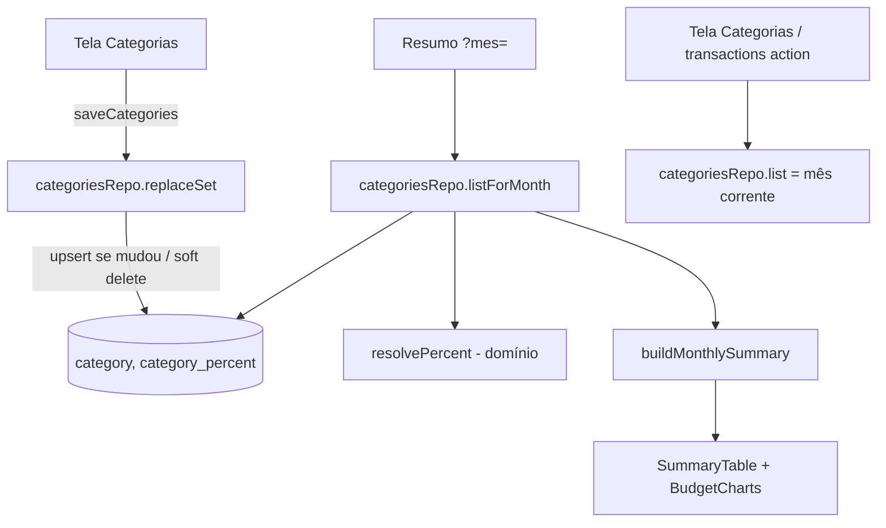

# Percentuais de Categoria com Histórico por Mês Design

**Spec**: `.specs/features/percentuais-historico/spec.md`
**Status**: Approved

---

## Architecture Overview

O percentual sai de `category` e passa para `category_percent` (uma linha por mudança, com mês inicial). A exclusão de categoria vira lógica (`category.deleted_from`). A resolução "percentual vigente em M" é uma função pura de domínio; o repositório carrega categorias e vigências do usuário e resolve em TypeScript, sem SQL com subconsulta por mês.



Abordagens consideradas (mesmo escopo):

| Abordagem | Trade-off |
| --------- | --------- |
| **Tabela de vigência (escolhida)** | Grava só mudanças; mês futuro e meses sem edição resolvem sozinhos; backfill é uma linha por categoria |
| Snapshot por mês | Exige materializar cada mês (inclusive os que o usuário nunca abriu) e preencher os futuros; muito mais linhas e jobs |
| Coluna JSON de histórico em `category` | Sem integridade referencial nem check de faixa; consulta e teste piores |

---

## Code Reuse Analysis

### Existing Components to Leverage

| Component | Location | How to Use |
| --------- | -------- | ---------- |
| `categoriesRepo.replaceSet` / `list` | `src/lib/db/repos/categories.ts` | Estender: gravar vigência, soft delete, listar por mês |
| `buildMonthlySummary`, `allocateCents` | `src/lib/domain/budget.ts` | Inalterados no cálculo; passam a receber categorias já resolvidas para o mês |
| `currentMonth`, `monthRange`, `parseMonth` | `src/lib/domain/month.ts` | Mês corrente (America/Sao_Paulo) e primeiro dia do mês |
| `validateCategorySet` | `src/lib/domain/budget.ts` | Inalterada (soma 100%) |
| `migrateTestDb`, `truncateAll` | `src/test/db-reset.ts` | Migração aplicada nos testes; conferir que `truncateAll` cobre a tabela nova |

### Integration Points

| System | Integration Method |
| ------ | ------------------ |
| Resumo `src/app/(app)/page.tsx` | `categoriesRepo.list(userId)` → `listForMonth(userId, month)` |
| Categorias `src/app/(app)/categorias/page.tsx` | Continua com `list(userId)` (mês corrente) |
| `checkOwnership` em `src/actions/transactions.ts` | Continua com `list(userId)`: só categorias ativas aceitam gasto novo |
| Banco | Migração Drizzle 0007 (create + backfill + drop), no estilo da 0006 (SQL editado à mão) |

---

## Components

### `percent-history` (domínio)

- **Purpose**: Resolver o percentual vigente de uma categoria em um mês.
- **Location**: `src/lib/domain/percent-history.ts`
- **Interfaces**:
  - `type PercentVersion = { fromMonth: string; percentMicro: number }` (`fromMonth` = AAAA-MM-01)
  - `resolvePercent(versions: PercentVersion[], monthStart: string): number | null` - maior `fromMonth` ≤ `monthStart`; `null` se nenhuma
  - `monthStartOf(m: YearMonth): string` - AAAA-MM-01
- **Dependencies**: `YearMonth` de `month.ts`
- **Reuses**: `monthRange(m).start` pode substituir `monthStartOf` se der o mesmo valor

### `categoriesRepo` (estendido)

- **Purpose**: Persistir categorias e vigências; listar por mês.
- **Location**: `src/lib/db/repos/categories.ts`
- **Interfaces**:
  - `list(userId, now = new Date()): Promise<Category[]>` - categorias ativas, percentual vigente no mês de `now`
  - `listForMonth(userId, month: YearMonth, now = new Date()): Promise<Category[]>` - categorias do mês M: ativas em M (`deleted_from` nulo ou M < `deleted_from`) com `percentMicro` resolvido; sem vigência em M → `percentMicro: 0` e `hasPercent: false`
  - `replaceSet(userId, cats, now = new Date()): Promise<CategorySetResult>` - regra abaixo
- **Dependencies**: `resolvePercent`, `currentMonth`
- **Reuses**: transação, validação e checagem de gastos de `replaceSet` atuais

Regra de `replaceSet` (mês `F` = primeiro dia do mês corrente de `now`):
1. Só categorias com `deleted_from IS NULL` contam como existentes; `id` de categoria excluída → "Categoria não encontrada".
2. Categoria nova: insere `category` e a vigência `(id, F, percent)`.
3. Categoria existente: carrega as vigências de todas e compara o percentual enviado com `resolvePercent(versions, F)`; só se diferir, faz upsert (`ON CONFLICT (category_id, from_month) DO UPDATE`) em `(id, F)`. Nome/cor/subcategorias seguem como hoje.
4. Categoria removida: mesma checagem de gastos (mensagem existente); sem gastos → `UPDATE category SET deleted_from = F` (não apaga linha nem vigências). Subcategorias ficam.

### `buildMonthlySummary` (ajuste)

- **Purpose**: Calcular a linha de cada categoria; a que não tem vigência no mês fica com meta 0 (HIST-05). A omissão original foi substituída pela feature `categorias-meses-anteriores`.
- **Location**: `src/lib/domain/budget.ts`
- **Interfaces**: `Category` ganha `hasPercent?: boolean` (omitido = `true`). `rows` inclui a categoria com `hasPercent === false`, com meta 0; sem gasto não há estouro, com gasto fica `overspent` verdadeiro. A tabela exibe "Sem meta".
- **Dependencies**: nenhuma nova
- **Reuses**: o cálculo atual de `allocateCents` e `consumedPct`

### Páginas

- `src/app/(app)/page.tsx`: `categoriesRepo.listForMonth(userId, month)`. O filtro de transações recebe as mesmas categorias do mês.
- Demais consumidores não mudam.

---

## Data Models

```typescript
// category: remove percent_micro; adiciona deleted_from
deletedFrom: date("deleted_from", { mode: "string" }) // AAAA-MM-01 do mês da exclusão; null = ativa
// índice de nome único passa a ser parcial: (user_id, lower(name)) WHERE deleted_from IS NULL

// category_percent
export const categoryPercent = pgTable("category_percent", {
  categoryId: uuid("category_id").notNull().references(() => category.id, { onDelete: "cascade" }),
  fromMonth: date("from_month", { mode: "string" }).notNull(), // dia 1; 0001-01-01 = desde sempre
  percentMicro: integer("percent_micro").notNull(),
}, (t) => [
  primaryKey({ columns: [t.categoryId, t.fromMonth] }),
  check("category_percent_micro_range", sql`${t.percentMicro} BETWEEN 1 AND 100000000`),
  check("category_percent_month_start", sql`EXTRACT(DAY FROM ${t.fromMonth}) = 1`),
]);
```

**Relationships**: `category_percent.category_id` → `category.id` (cascade; com exclusão lógica o cascade só dispara se o usuário for apagado). `category.deleted_from` só é preenchida por `replaceSet`.

**Migrações (expand/contract, duas)**: a **0007** cria `category_percent`, faz o backfill, adiciona `deleted_from`, recria o índice parcial e torna `category.percent_micro` nullable; a **0008** (depois que nenhum código usa a coluna) remove o check e a coluna. Isso mantém cada commit verde. Ordem original, agora dividida entre as duas: criar `category_percent` → `INSERT ... SELECT id, '0001-01-01', percent_micro FROM category` → adicionar `deleted_from` → recriar o índice único como parcial → dropar `category_percent_micro_range` e a coluna `percent_micro` de `category`.

---

## Error Handling Strategy

| Error Scenario | Handling | User Impact |
| -------------- | -------- | ----------- |
| Soma ≠ 100% | `validateCategorySet` antes da transação; nada gravado | Mensagem existente |
| Falha em qualquer escrita | Tudo na mesma `db.transaction`; rollback | `SAVE_FAILED` existente |
| Excluir categoria com gastos | Mesma checagem antes do soft delete | Mensagem existente |
| Salvamentos concorrentes | Upsert por PK `(category_id, from_month)`; último a confirmar vence | Sem duplicata |
| Virada de mês com tela aberta | `now` lido dentro de `replaceSet` | Vigência no mês do salvamento |

---

## Risks & Concerns

| Concern | Location (file:line) | Impact | Mitigation |
| ------- | -------------------- | ------ | ---------- |
| Muitos testes inserem `category` direto com `percentMicro` | `src/lib/db/schema.int.test.ts:35`, `src/lib/db/repos/*.int.test.ts`, `src/actions/*.int.test.ts` | Quebram com a coluna removida | Helper `insertCategory` em `src/test/db.ts` que grava categoria + vigência sentinela; trocar os inserts |
| Migração de dados irreversível (drop de coluna) | `drizzle/0007_*.sql` | Perda do percentual se o backfill falhar | Backfill e drop na mesma migração; teste de integração do backfill; sem push/deploy sem go-ahead |
| Categoria criada e excluída no mesmo mês deixa linhas invisíveis | `categories.ts` (soft delete) | Acúmulo mínimo de linhas | Aceito; nunca aparece em nenhum mês (mês inicial = mês de exclusão) |
| `Category.hasPercent` opcional pode ser esquecido por quem monta categorias | `src/lib/domain/budget.ts:75` | Linha sem meta aparece com "Sem meta" (comportamento desejado desde `categorias-meses-anteriores`) | Só `listForMonth` define `false`; teste unitário de omissão do campo |
| `truncateAll` pode não conhecer a tabela nova | `src/test/db-reset.ts` | Vazamento de dados entre testes | Conferir na task da migração; o cascade a partir de `category` já limpa se a lista usar CASCADE |

---

## Tech Decisions

| Decision | Choice | Rationale |
| -------- | ------ | --------- |
| Resolução da vigência | Em TypeScript sobre todas as vigências do usuário | Poucas linhas por usuário; função pura testável sem banco |
| Sentinela do backfill | `0001-01-01` | Cobre qualquer mês, inclusive anterior à criação da categoria, mantendo o resultado atual |
| Percentual 0% em mês sem vigência | Só na camada de leitura (`hasPercent: false`) | O check 1..100000000 da tabela continua válido |
| Exclusão lógica | `category.deleted_from` | Preserva metas passadas; nome fica livre pelo índice parcial |

> Project-level: nova **AD-007** em `.specs/STATE.md` (vigência mensal + exclusão lógica; AD-006 passa a "superseded by AD-007" apenas quanto ao local de armazenamento; a unidade micro-percentual continua).
