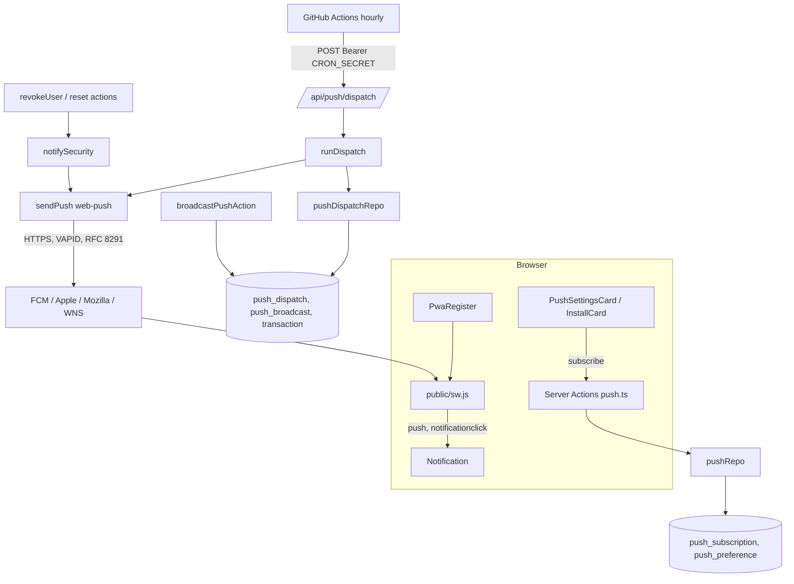

# PWA e Push Design

**Spec**: `.specs/features/pwa/spec.md`
**Status**: Draft

---

## Constraints from STATE.md

| AD | Efeito neste design |
| -- | ------------------- |
| AD-001 | Escritas só por Server Action; o dispatch é o único Route Handler novo (chamado por máquina, não por UI). |
| AD-004 | "Vence hoje" reaproveita o filtro de recorrência (`applicableInMonth` / `occurrenceDate`), sem reimplementar. |
| AD-005 | Sem e2e. UI por inspeção; lógica em unit/integration. |
| AD-007 | Fuso `America/Sao_Paulo` para "hoje". |
| AD-009 / AD-015 | Só usuário `approved` recebe push; revogado não recebe lembretes. |
| AD-011 | Payload nunca leva dado financeiro; o servidor só usa a estrutura em claro (data, recorrência). |
| AD-013 | Exceção: o push passa pelo serviço do navegador. Vira **AD-016** (escrita na task de documentação). `connect-src 'self'` não muda: `pushManager.subscribe` e o envio do servidor não passam pelo CSP da página. |

Lição aplicada: L-002 (mensagens de validação com texto exato na spec; os schemas usam esses textos).

---

## Architecture Overview

Três partes independentes: **PWA estático** (manifest, ícones, `sw.js`, `offline.html`), **inscrição** (UI em `/conta` + Server Actions + 2 tabelas) e **envio** (dispatch horário + avisos imediatos de segurança).

Abordagens consideradas para o disparo:

| Abordagem | Prós | Contras |
| --------- | ---- | ------- |
| **A. GitHub Actions horário chama `POST /api/push/dispatch` (recomendada)** | Grátis; permite hora por usuário; o repo já usa Actions; idempotência por tabela tolera atraso | Depende de segredo e do GitHub (desativa cron após 60 dias sem atividade em repo público; atrasos de minutos) |
| B. Vercel Cron diário | Sem dependência externa | Hobby só roda 1×/dia: sem hora por usuário |
| C. Worker próprio (fila, VM) | Controle total | Custo e infraestrutura fora do plano gratuito (`docs/hospedagem-gratuita.md`) |



---

## Code Reuse Analysis

| Component | Location | How to Use |
| --------- | -------- | ---------- |
| Guards | `src/lib/auth-guard.ts` | `requireSessionForAction` / `requireAdminForAction` nas ações novas |
| `ActionResult`, `invalidInput`, `SAVE_FAILED` | `src/lib/action-result.ts` | Retorno das ações |
| `logActionError` | `src/lib/log.ts` | Só código de erro; falha de push loga `push_<status>` sem endpoint nem chaves |
| Recorrência | `src/lib/domain/recurrence.ts` (`appliesInMonth`, `occurrenceDate`, tipo `Segment`) | Decide "vence hoje" sobre linhas `transaction` recorrentes |
| Filtro SQL de recorrência | `applicableInMonth` em `src/lib/db/repos/transactions.ts` (hoje não exportado) | Exportar e reusar na query do dispatch para não duplicar AD-004 |
| `PUBLIC_PATHS`, matcher, `PATHS_OUTSIDE_PROXY` | `src/lib/route-decision.ts`, `src/proxy.ts`, `src/lib/security-headers.ts` | Adicionar as rotas do PWA e do dispatch |
| `ContentCard`, `Switch`, `Select`, `Button` | `src/components/` | Cartões novos em `/conta` e no admin |
| Padrão de workflow e do teste que lê YAML | `.github/workflows/backup.yml`, `src/lib/backup-workflow.test.ts` | Mesmo formato para `push-dispatch.yml` |
| Padrão de repo + teste de integração | `src/lib/db/repos/*.ts`, `src/test/db.ts` (`setupTestDb`, `insertTestUser`) | `pushRepo`, `pushDispatchRepo` |
| `resolveBaseUrl` (padrão de função pura com env por argumento) | `src/lib/base-url.ts` | `resolvePushConfig(env)` segue o mesmo desenho |
| `recoveryMaterialFor` | `src/lib/db/repos/password-resets.ts` | Obter o dono do token antes de consumi-lo, para avisar "senha redefinida" sem mudar o retorno de `consume*` |

### Integration Points

| System | Integration Method |
| ------ | ------------------ |
| `user` (Better Auth) | FK `on delete cascade` nas tabelas novas (PUSH-11) |
| `revokeUser` | `src/actions/admin-users.ts`: após `transition` ok com `action === "revoke"`, chamar `notifySecurity(id, "revoked")` |
| Reset de senha | `resetPasswordAction` e `resetPasswordSealedAction`: ler o dono com `recoveryMaterialFor(token)` antes de consumir; após `ok`, `notifySecurity(userId, "password_reset")` (antes do `redirect`, que lança) |
| Admin | `UserAdminList` ganha irmão `BroadcastForm` em `/admin/cadastros` |
| Layout raiz | `PwaRegister` + `metadata` (`appleWebApp`, `icons.apple`) + `viewport.themeColor` |

---

## Components

### `resolvePushConfig(env)` (puro)
- **Location**: `src/lib/push/config.ts`
- **Interfaces**: `resolvePushConfig(env): { publicKey; privateKey; subject } | null` — `null` se faltar qualquer um; `subject` deve começar com `mailto:` ou `https:`. `resolveCronSecret(env): string | null`.

### Mensagens (puro)
- **Location**: `src/lib/domain/push-messages.ts`
- **Interfaces**: `PUSH_TITLE = "ANON"`, `PUSH_TEXT` (os cinco textos fixos + o genérico de fallback), `pushPayload(body: string): string` (JSON `{"title","body","url":"/"}`), `PUSH_TTL = 86400`.
- **Regra**: único lugar com texto de notificação, exceto o do admin (que também passa por `pushPayload`).

### Validação (puro)
- **Location**: `src/lib/validation/push.ts`
- **Interfaces**:
  - `isAllowedPushEndpoint(raw: string): boolean` — `new URL`, protocolo `https:`, sem usuário/senha/porta, host ∈ {`fcm.googleapis.com`, `updates.push.services.mozilla.com`} ou termina em `.push.apple.com` / `.notify.windows.com`.
  - `subscriptionSchema` (zod): `endpoint` (mensagem "Este navegador não é compatível com notificações"), `p256dh` (base64url → 65 bytes, primeiro 0x04) e `auth` (16 bytes) (mensagem "Inscrição inválida").
  - `preferencesSchema`: `reminder|due|security|admin` boolean, `hour` inteiro 0..23 ("Preferências inválidas").
  - `broadcastSchema`: `trim`, 1..140 ("A mensagem deve ter de 1 a 140 caracteres").

### Relógio local e vencimento (puro)
- **Location**: `src/lib/domain/push-schedule.ts`
- **Interfaces**:
  - `localClock(now: Date): { date: string; hour: number }` — `Intl.DateTimeFormat("en-CA", { timeZone: "America/Sao_Paulo", ... })`.
  - `hasOccurrenceOn(segments: Segment[], date: string): boolean` — `appliesInMonth` + `occurrenceDate(seg, key) === date`.
  - `isDueHour(clockHour, prefHour): boolean` (`clockHour >= prefHour`).

### Esquema de dados e migração
- **Location**: `src/lib/db/schema.ts`, `drizzle/0017_*.sql` (via `npm run db:generate`)
- Ver "Data Models".

### `pushRepo`
- **Location**: `src/lib/db/repos/push.ts`
- **Interfaces**:
  - `subscribe(userId, sub): Promise<"ok" | "limit">` — transação com `pg_advisory_xact_lock(hashtext(userId))`; upsert por `endpoint` (atualiza chaves e dono); recusa a 6ª; cria `push_preference` com `on conflict do nothing`.
  - `unsubscribe(userId, endpoint): Promise<void>` — apaga só a linha do dono.
  - `removeByEndpoint(endpoint): Promise<void>` — para 404/410 (sem checar dono).
  - `settingsFor(userId): Promise<{ devices: number; prefs: Prefs | null }>`
  - `updatePrefs(userId, prefs): Promise<"ok" | "no_prefs">`
  - `subscriptionsOf(userId): Promise<StoredSub[]>`
  - `securityTargets(userId): Promise<StoredSub[]>` — vazio se `security = false` ou sem `push_preference`.

### `pushDispatchRepo`
- **Location**: `src/lib/db/repos/push-dispatch.ts`
- **Interfaces**:
  - `reminderCandidates(date, hour): Promise<Candidate[]>` — usuários `approved` com `reminder`, `hour <= clockHour`, ≥1 inscrição e sem linha `push_dispatch(user,'reminder',date)`; cada `Candidate` traz `userId` e `subs`.
  - `dueCandidates(date, hour): Promise<Candidate[]>` — idem para `due`, filtrando antes no SQL por `applicableInMonth` do mês de `date` (linhas recorrentes), e depois `hasOccurrenceOn` em TypeScript.
  - `broadcastCandidates(): Promise<{ broadcast: Broadcast; targets: Candidate[] }[]>` — broadcasts sem `sent_at`; alvos `approved` com `admin`, ≥1 inscrição e sem claim.
  - `claim(userId, kind, ref): Promise<boolean>` — `insert ... on conflict do nothing returning`.
  - `markBroadcastSent(id)`, `enqueueBroadcast(text)`, `prune(olderThan: Date)`.

### `sendPush`
- **Location**: `src/lib/push/send.ts`
- **Interfaces**: `sendPush(config, sub, body: string): Promise<"sent" | "gone" | "failed">`. Chama `webpush.sendNotification({ endpoint, keys: { p256dh, auth } }, pushPayload(body), { TTL, vapidDetails })`; `statusCode` 404/410 → `gone`; qualquer outro erro → `failed` (logado com `logActionError("sendPush", { code: "push_" + status })`). Revalida `isAllowedPushEndpoint` antes de enviar (defesa em profundidade; linha antiga ou adulterada nunca vira SSRF).
- **Dependencies**: `web-push` (+ `@types/web-push`). **A confirmar na primeira task** com um teste de contrato: forma de `sendNotification` e do erro (`WebPushError.statusCode`), por não estar nos docs do Next.

### `runDispatch`
- **Location**: `src/lib/push/dispatch.ts`
- **Interfaces**: `runDispatch(deps: { now: Date; config; repo; send; deadlineMs?: number }): Promise<{ sent; removed; failed }>`.
- **Fluxo**: `localClock(now)` → reunir jobs (`reminder`, `due`, cada `broadcast`) → para cada job, pular se `usado + subs.length > 1000` ou se passou o prazo (padrão 40 s; mantém a função dentro de `maxDuration = 60`) → `claim` → enviar às inscrições → 410/404 chama `removeByEndpoint` → ao fim `markBroadcastSent` para cada broadcast sem alvo restante e `prune(now - 7d)`. Pool de 20 jobs em paralelo.

### Rota `POST /api/push/dispatch`
- **Location**: `src/app/api/push/dispatch/route.ts`; `export const maxDuration = 60`, `dynamic = "force-dynamic"`.
- **Interfaces**: 503 se `resolveCronSecret` ou `resolvePushConfig` for `null` (checado antes do segredo); 401 se o `Authorization` não confere (`timingSafeEqual` sobre SHA-256 dos dois lados, para comprimentos iguais); senão 200 com `{sent, removed, failed}`. Só `POST` (outros métodos: 405 do Next). Corpo de erro vazio.
- **Ordem exata**: 503 antes de 401? A spec dá 401 sem segredo (PUSH-20) e 503 com variável faltando (PUSH-21). Escolha: **configuração primeiro (503)**, porque sem `CRON_SECRET` não há como autenticar; os testes cobrem as duas condições separadamente.

### `notifySecurity`
- **Location**: `src/lib/push/security.ts`
- **Interfaces**: `notifySecurity(userId, kind: "password_reset" | "revoked", deps?): Promise<void>` — nunca lança; `resolvePushConfig` nulo → retorna; `securityTargets` vazio → retorna; envia a todas, remove as `gone`.

### Server Actions
- **Location**: `src/actions/push.ts` (`subscribePushAction`, `unsubscribePushAction`, `updatePushPreferencesAction`), `src/actions/push-admin.ts` (`broadcastPushAction`).
- **Regras**: guard primeiro; `safeParse`; chamar o repo; `logActionError` + `SAVE_FAILED` em exceção; nunca aceitar `userId` do cliente. `subscribePushAction` devolve "Limite de 5 dispositivos atingido" quando `limit`; `updatePushPreferencesAction` devolve "Ative as notificações primeiro" quando `no_prefs`. Sem configuração VAPID, `subscribePushAction` recusa (a seção já fica oculta).

### UI
- **`PushSettingsCard`** (`src/components/push-settings-card.tsx`, cliente): props `{ publicKey: string; devices: number; prefs: Prefs | null }`. Estados via função pura `pushUiState({ supported, standaloneIos, permission, subscribedHere })` (testável): `unsupported | ios-install | blocked | off | on`. Ativar: `Notification.requestPermission()` → `registration.pushManager.subscribe({ userVisibleOnly: true, applicationServerKey })` → `subscribePushAction(sub.toJSON())`; se a ação falhar, chama `sub.unsubscribe()` (não deixa inscrição órfã no navegador). Desativar na ordem do PUSH-09. Switches e seletor de hora chamam `updatePushPreferencesAction` e mostram o erro devolvido.
- **`InstallCard`** (`src/components/install-card.tsx`, cliente): `installHint({ userAgent, standalone, hasPrompt }): "button" | "ios" | "none"` (puro) + captura de `beforeinstallprompt`.
- **`PwaRegister`** (`src/components/pwa-register.tsx`, cliente) chama `registerServiceWorker({ nodeEnv, nav })` (puro, em `src/lib/pwa/register.ts`).
- **`BroadcastForm`** (`src/components/broadcast-form.tsx`, cliente) em `/admin/cadastros`.
- A chave pública VAPID chega por prop do Server Component de `/conta` (`resolvePushConfig(process.env)?.publicKey`).

### Arquivos estáticos e infra do PWA
- `src/app/manifest.ts` (valores do PWA-01/02), `public/sw.js`, `public/offline.html`, `public/icon-192.png`, `icon-512.png`, `icon-maskable-512.png`, `apple-touch-icon.png`, `scripts/generate-pwa-icons.ts` (usa `sharp`, que já vem com o Next; entra em `devDependencies` para ficar explícito).
- `src/proxy.ts`: matcher exclui `manifest\.webmanifest|sw\.js|offline\.html`. `src/lib/security-headers.ts`: `PATHS_OUTSIDE_PROXY` ganha `/manifest.webmanifest`; regras próprias para `/sw.js` (CSP `default-src 'self'; script-src 'self'`, `Cache-Control: no-cache, no-store, must-revalidate`, `Content-Type: application/javascript; charset=utf-8`) e `/offline.html` (CSP `default-src 'none'; style-src 'unsafe-inline'; frame-ancestors 'none'; base-uri 'self'`, porque `STATIC_CSP` bloquearia o `<style>` inline).
- `src/lib/route-decision.ts`: `PUBLIC_PATHS` ganha `/api/push/dispatch`.
- `.github/workflows/push-dispatch.yml`, `.env.example`, `docs/hospedagem-gratuita.md` (runbook: gerar VAPID com `npx web-push generate-vapid-keys`, criar `CRON_SECRET`, secrets `APP_URL` e `CRON_SECRET` no GitHub).

### `public/sw.js` (visão geral)
Constantes `CACHE = "anon-static-v1"`, `PRECACHE = ["/offline.html", "/icon-192.png", "/icon-512.png"]`. Eventos: `install` (precache + `skipWaiting`), `activate` (apaga outros caches + `clients.claim`), `fetch` (regras PWA-09..12), `push` (PUSH-42/43), `notificationclick` (PUSH-44/45). Funções puras internas (`safeTarget(url)`, `parsePush(event)`) ficam no arquivo e são exercidas pelo teste em `vm`.

---

## Data Models

```typescript
// push_subscription — uma por navegador/dispositivo
interface PushSubscriptionRow {
  id: string            // uuid, pk
  userId: string        // fk user.id, on delete cascade
  endpoint: string      // unique, text
  p256dh: string        // text
  auth: string          // text
  createdAt: Date
}                       // index (user_id)

// push_preference — uma por usuário
interface PushPreferenceRow {
  userId: string        // pk, fk user.id, on delete cascade
  reminder: boolean     // default false
  due: boolean          // default false
  security: boolean     // default true
  admin: boolean        // default true
  hour: number          // smallint 0..23, check, default 9
  updatedAt: Date
}

// push_dispatch — controle de idempotência
interface PushDispatchRow {
  userId: string        // fk user.id, on delete cascade
  kind: "reminder" | "due" | "broadcast"
  ref: string           // data local 'YYYY-MM-DD' ou id do broadcast
  sentAt: Date
}                       // pk (user_id, kind, ref); index (sent_at) para a limpeza

// push_broadcast — fila do administrador
interface PushBroadcastRow {
  id: string            // uuid, pk
  text: string          // check char_length 1..140
  createdAt: Date
  sentAt: Date | null
}
```

**Relationships**: as três primeiras referenciam `user` com cascade (PUSH-11). `push_broadcast` não pertence a usuário. Tudo em claro: endpoint, chaves públicas, preferências e datas (declarado na página de privacidade, PUSH-52).

---

## Error Handling Strategy

| Error Scenario | Handling | User Impact |
| -------------- | -------- | ----------- |
| Permissão negada | Nenhuma chamada ao servidor | "Notificações bloqueadas no navegador. Libere nas configurações do site." |
| Endpoint fora da lista / chaves inválidas / 6º dispositivo | `safeParse` ou `limit` devolve o texto da spec | Mensagem na seção; navegador desfaz a inscrição local |
| `subscribePushAction` falha após o navegador inscrever | Cliente chama `sub.unsubscribe()` | Mensagem `SAVE_FAILED`; nada órfão |
| Banco indisponível numa ação | `logActionError` + `SAVE_FAILED` | "Não foi possível salvar. Tente novamente" |
| 404/410 do serviço de push | Apaga a inscrição | Nenhum |
| Outro erro do serviço de push | Loga `push_<status>`, mantém a inscrição, segue | Aviso daquele dia pode não chegar |
| Dispatch sem segredo certo / sem config | 401 / 503, corpo vazio, nada enviado | Nenhum |
| Dispatch excede prazo ou limite | Para de reivindicar jobs; o resto sai na próxima hora | Atraso de ≤ 1 h |
| Aviso de segurança falha | `notifySecurity` engole e loga; reset/revogação já concluídos | Nenhum |

---

## Risks & Concerns

| Concern | Location | Impact | Mitigation |
| ------- | -------- | ------ | ---------- |
| SSRF: o endpoint vem do cliente e o servidor faz POST nele | `src/lib/validation/push.ts` (novo) | Servidor chamaria host interno | Allowlist de hosts `https` na inscrição **e** de novo no `sendPush`; testes com `localhost`, IP, porta e `evil.push.apple.com.attacker.net` |
| Reivindicar antes de enviar perde o aviso se a função morrer no meio | `runDispatch` (novo) | Um usuário não recebe o aviso do dia | Aceito (at-most-once, evita spam); prazo de 40 s dentro de `maxDuration = 60` reduz o risco; documentado na spec |
| Filtro de recorrência duplicado | `src/lib/db/repos/transactions.ts:66` (`applicableInMonth` não exportado) | Dois lugares divergem da AD-004 | Exportar o filtro e usá-lo no repo de dispatch; teste de integração com série encerrada e dia 31 |
| `matcher` do proxy e `PATHS_OUTSIDE_PROXY` precisam concordar | `src/proxy.ts:35`, `src/lib/security-headers.ts:60` | Rota nova redireciona para `/login` ou fica sem CSP | Task única altera os dois, com teste que lê o matcher e confere as três rotas do PWA |
| `STATIC_CSP` (`default-src 'none'`) quebra `offline.html` e `sw.js` | `src/lib/security-headers.ts:55` | Tela offline sem estilo; SW sem `fetch` | Regras próprias para os dois arquivos (acima) |
| Páginas com nonce não podem ser cacheadas | `src/app/layout.tsx:44` | HTML velho com nonce inválido | Navegações são network-only; offline é estático sem script |
| Cron do GitHub atrasa e é desativado após 60 dias sem atividade (repo público) | `.github/workflows/push-dispatch.yml` (novo) | Avisos param em silêncio | Catch-up por hora (`>=`) e idempotência; runbook avisa; `workflow_dispatch` manual |
| Segredo comparado com `===` vaza por tempo | rota do dispatch (nova) | Brute force do `CRON_SECRET` | `timingSafeEqual` sobre SHA-256 |
| `web-push` fora dos docs do Next; API do erro não verificada aqui | `src/lib/push/send.ts` (novo) | Remoção em 410 não funcionar | Task 1 do push fixa a forma da API com teste de contrato antes de construir sobre ela; se divergir, registrar e ajustar |
| Testes de integração disputam o banco `orcamento_test` entre sessões | `src/test/db.ts` | Falhas falsas | Usar `DATABASE_URL` de banco privado `*_test` (memória do projeto); Node 20 no PATH |
| `auth-schema.ts` é gerado pelo Better Auth | `src/lib/db/auth-schema.ts` | Regeneração apaga mudanças | Tabelas novas ficam em `schema.ts`, sem tocar no auth-schema |
| Sem teste de UI (AD-005) | componentes novos | Regressão visual passa | Lógica de estado em funções puras testadas (`pushUiState`, `installHint`, `registerServiceWorker`); UI verificada por inspeção `file:line` no Verifier |

---

## Tech Decisions (only non-obvious ones)

| Decision | Choice | Rationale |
| -------- | ------ | --------- |
| Biblioteca de envio | `web-push` 3.6.x | Cifra RFC 8291 + VAPID prontas; ~6 dependências; Node ≥ 16 |
| SW em `public/` sem build | JS puro em `public/sw.js` | Sem Serwist; caminho estável `/sw.js`; testável em `vm` |
| Chave VAPID pública | Prop do Server Component, não `NEXT_PUBLIC_*` | Não fica embutida no build; trocar a chave não exige rebuild |
| Claim antes do envio | `insert ... on conflict do nothing` decide quem envia | Idempotência com concorrência sem lock |
| Limite de 5 dispositivos | `pg_advisory_xact_lock` por usuário | Evita ultrapassar o limite com duas inscrições simultâneas |
| Dono do token de reset | `recoveryMaterialFor` antes de `consume*` | Não altera o contrato nem os testes existentes dos repos |
| Hora do dispatch | `>=` à hora do usuário, mesmo dia | Cobre atraso/pulo do cron sem repetir |
| Prazo interno | 40 s, `maxDuration` 60 | Margem para encerrar com a resposta antes do corte da plataforma |

> **Project-level**: a exceção à AD-013 (terceiro recebe endpoint e texto genérico) entra em `.specs/STATE.md` como **AD-016** na task de documentação.

---

## Proposed Task Phases (input for Tasks)

1. **PWA estático**: ícones + manifest + metadata/viewport; `offline.html`; `sw.js` (cache) + testes em `vm`; proxy/headers/rotas públicas; `registerServiceWorker` + `PwaRegister`; `installHint` + `InstallCard`.
2. **Fundação do push**: `web-push` + teste de contrato; `config`, `push-messages`, `validation/push`, `push-schedule`; schema + migração.
3. **Inscrição**: `pushRepo`; ações; `pushUiState` + `PushSettingsCard`; integração em `/conta`; `sw.js` com `push`/`notificationclick`.
4. **Envio**: `sendPush`; `pushDispatchRepo`; `runDispatch`; rota; avisos de segurança nas ações existentes; broadcast (ação + form).
5. **Operação e docs**: workflow, `.env.example`, runbook, AD-016, texto de privacidade.
