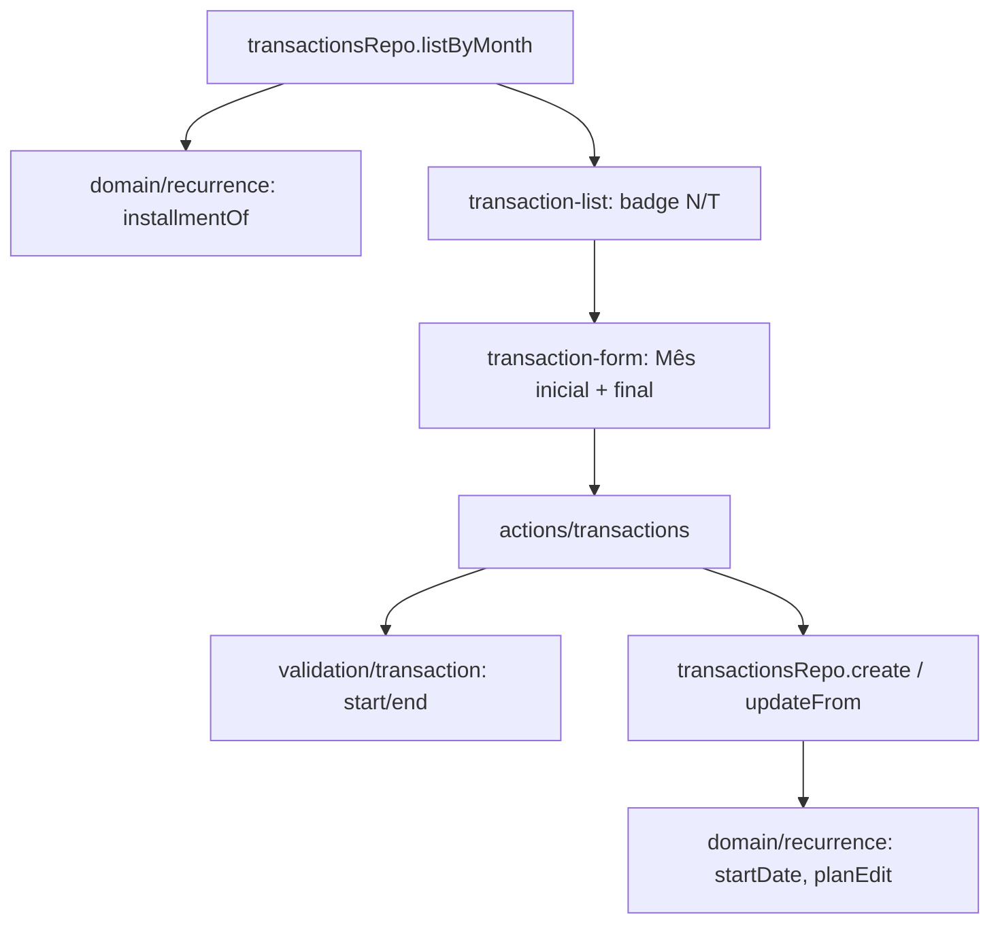

# Recorrência com Mês Inicial e Parcelas Design

**Spec**: `.specs/features/recorrencia-parcelas/spec.md`
**Status**: Draft

---

## Architecture Overview

Sem mudança de schema. A primeira ocorrência de um segmento já é `transaction.date`, então o Mês inicial só decide qual `date` é gravada (AD-004 continua valendo: `applicableInMonth` filtra por `date`). A parcela é derivada na leitura: `listByMonth` busca os segmentos das séries que aparecem no mês e uma função pura calcula N/T.



---

## Code Reuse Analysis

| Component | Location | How to Use |
| --------- | -------- | ---------- |
| `occurrenceDate`, `monthKey`, `previousMonthKey`, `lastDayOfMonth` | `src/lib/domain/recurrence.ts` | Primeira ocorrência = `occurrenceDate({recurringDay: dia}, mesInicial)` (já faz o clamp do dia 31) |
| `planEdit`, `resolveDay` | `src/lib/domain/recurrence.ts` | Estender `EditedData` com `startMonth`; a data do segmento passa a vir do mês inicial |
| `isValidMonth` + `superRefine` | `src/lib/validation/transaction.ts` | Mesmas regras para `recurrenceStart`, com mensagens novas |
| `recurrenceFields` / `lockSeries` | `src/lib/db/repos/transactions.ts` | `create` calcula `date` pelo mês inicial; `lockSeries` já carrega todos os segmentos da série |
| Campo `type="month"` do Mês final | `src/components/transaction-form.tsx` | Mesmo controle para Mês inicial |
| Badge "Recorrente" | `src/components/transaction-list.tsx` | Mesmo elemento, texto "N/T" quando há parcela |

### Integration Points

| System | Integration Method |
| ------ | ------------------ |
| Postgres | Nenhuma coluna nova; `recurrence_end >= date_trunc('month', date)` continua válido porque o fim é validado contra o início |
| `updateTransaction` action | Recebe `recurrenceStart`; consulta `findStored` (ampliado) para validar o fim contra o início efetivo |

---

## Components

### Domínio da recorrência

- **Purpose**: Regras puras de início de série e parcela.
- **Location**: `src/lib/domain/recurrence.ts`
- **Interfaces**:
  - `startOfSeries(segments: Segment[]): string` - menor `monthKey(date)` entre os segmentos (AAAA-MM)
  - `installmentOf(segments: Segment[], month: string): { number: number; total: number } | null` - `null` quando o último segmento (maior `date`) não tem `endMonth`, ou a série não é recorrente; `number = meses(início→month)+1`, `total = meses(início→fim)+1`
  - `EditedData.startMonth: string | null` - mês inicial submetido (só lido quando `recurring` e `endMonth !== null`)
  - `planEdit`: se o segmento editado é o primeiro da série (`startOfSeries === month`) e `startMonth` existe, `date = occurrenceDate({recurringDay: dia}, startMonth)`; caso contrário ignora `startMonth` e mantém `next.date`
- **Dependencies**: `YearMonth` de `month.ts`
- **Reuses**: helpers de mês já existentes

### Validação

- **Purpose**: Aceitar e validar o Mês inicial.
- **Location**: `src/lib/validation/transaction.ts`
- **Interfaces**:
  - entrada `recurrenceStart?: string` (AAAA-MM); saída `recurrenceStartMonth: string | null` (só quando `recurrence === "until"`)
  - ordem dos erros em "until": `Informe o mês inicial` → `Mês inicial inválido` (campo `recurrenceStart`); `Informe o mês final` → `Mês final inválido` → `O mês final deve ser igual ou posterior ao mês inicial` (campo `recurrenceEnd`, comparando com `recurrenceStart`)
- **Reuses**: `isValidMonth`

### Repositório

- **Purpose**: Gravar a data da primeira ocorrência e entregar a parcela.
- **Location**: `src/lib/db/repos/transactions.ts`
- **Interfaces**:
  - `TransactionData.recurrenceStartMonth?: string | null`
  - `create`: quando `recurrence === "until"`, `date = occurrenceDate({recurringDay: diaDaData}, recurrenceStartMonth)` e `recurrenceDay` = dia da Data submetida (preserva 31)
  - `updateFrom`: repassa `startMonth` ao `planEdit`; `lockSeries` já dá os segmentos
  - `Occurrence.installment: { number: number; total: number } | null` e `Occurrence.seriesStart: string | null` (AAAA-MM do início da série; `null` se avulso)
  - `listByMonth`: depois da consulta do mês, uma segunda consulta `select seriesId, date, recurrenceDay, recurrenceEnd from transaction where userId = ? and seriesId in (...)` para os `seriesId` presentes; agrupa por série e chama `startOfSeries`/`installmentOf`
  - `findStored`: passa a devolver também `seriesStart: string | null`
- **Dependencies**: Drizzle (`inArray`)
- **Reuses**: `segmentFields`, `lockSeries`

### Action `updateTransaction`

- **Purpose**: Validar o fim contra o início efetivo na edição.
- **Location**: `src/actions/transactions.ts`
- **Interfaces**: com `stored.seriesStart` e `occurrenceMonth`, o início efetivo é `recurrenceStartMonth` se `seriesStart === occurrenceMonth` (ou a linha é avulsa), senão `occurrenceMonth`; se `recurrenceEndMonth < início efetivo`, retorna `fieldErrors.recurrenceEnd = "O mês final deve ser igual ou posterior ao mês inicial"`.

### Formulário

- **Purpose**: Campos Mês inicial e Mês final.
- **Location**: `src/components/transaction-form.tsx`
- **Interfaces**:
  - `TransactionFormValues.recurrenceStart?: string`; novo prop `startLocked?: boolean`
  - ao escolher "until", `recurrenceStart` recebe o mês da Data (se vazio); o campo é mostrado antes do Mês final e desabilitado quando `startLocked`
  - `submit` envia `recurrenceStart`
- **Reuses**: `field()`, `set()`, bloco do Mês final

### Lista

- **Purpose**: Mostrar "N/T".
- **Location**: `src/components/transaction-list.tsx`
- **Interfaces**: `t.installment` → badge `data-testid="installment-badge"` com `${number}/${total}`; `t.recurring && !t.installment` → badge "Recorrente" (testid atual). Na edição: `recurrenceStart = seriesStart`, `startLocked = seriesStart !== editing.month` quando recorrente; avulso: `recurrenceStart = mês da data`, destravado.

---

## Data Models

Sem alteração de tabela. Tipos novos:

```typescript
type Installment = { number: number; total: number };
// Occurrence += { installment: Installment | null; seriesStart: string | null }
// TransactionData += { recurrenceStartMonth?: string | null }
```

**Relationships**: segmentos de uma série são contíguos (`planEdit`/`planDelete` truncam em M-1 e iniciam em M), então o total é a distância entre o início da série e o fim do último segmento.

---

## Error Handling Strategy

| Error Scenario | Handling | User Impact |
| -------------- | -------- | ----------- |
| Mês inicial vazio/inválido | `superRefine` em `recurrenceStart` | Mensagem no campo Mês inicial |
| Fim anterior ao início (criação, ou edição do primeiro mês) | `superRefine` | Mensagem no campo Mês final |
| Fim anterior ao mês da ocorrência editada no meio da série | Checagem na action com `findStored` | Mesma mensagem no campo Mês final |
| Segunda consulta de parcelas falha | Propaga como a lista já faz | Erro de carregamento existente |

---

## Risks & Concerns

| Concern | Location (file:line) | Impact | Mitigation |
| ------- | -------------------- | ------ | ---------- |
| Dois lugares conhecem o início efetivo (action e `planEdit`) | `src/actions/transactions.ts`, `src/lib/domain/recurrence.ts` | Divergência gravaria `recurrence_end < date` e violaria o CHECK do banco | Ambos usam `startOfSeries`; teste de integração cobre início movido, edição do meio e avulso→until |
| Mês da Data ignorado em "até mês/ano" pode confundir | `src/components/transaction-form.tsx` | Usuário muda a Data achando que muda o início | Mês inicial vem preenchido com o mês da Data; Data só fornece o dia (decidido na spec) |
| Consulta extra por mês | `src/lib/db/repos/transactions.ts` (`listByMonth`) | Uma ida a mais ao banco | Roda só se há séries no mês; filtra por `series_id` com índice por usuário; volume pequeno |
| Componentes sem teste automático (AD-005) | `transaction-list.tsx`, `transaction-form.tsx` | Regressão de UI não detectada | Toda a lógica fica em domínio/repo/validação com unit e integração; UI conferida manualmente |

---

## Tech Decisions

| Decision | Choice | Rationale |
| -------- | ------ | --------- |
| Onde guardar o mês inicial | Reaproveitar `transaction.date` | Sem migração; `applicableInMonth` e o CHECK do banco continuam corretos |
| Parcela guardada ou derivada | Derivada na leitura | Edição e exclusão já reescrevem segmentos; guardar exigiria sincronizar |
| Mês inicial em edição do meio | Ignorado no servidor | Evita mover o início da série por uma ocorrência do meio |

Nenhuma decisão aqui vira AD de projeto: segue o AD-004.
