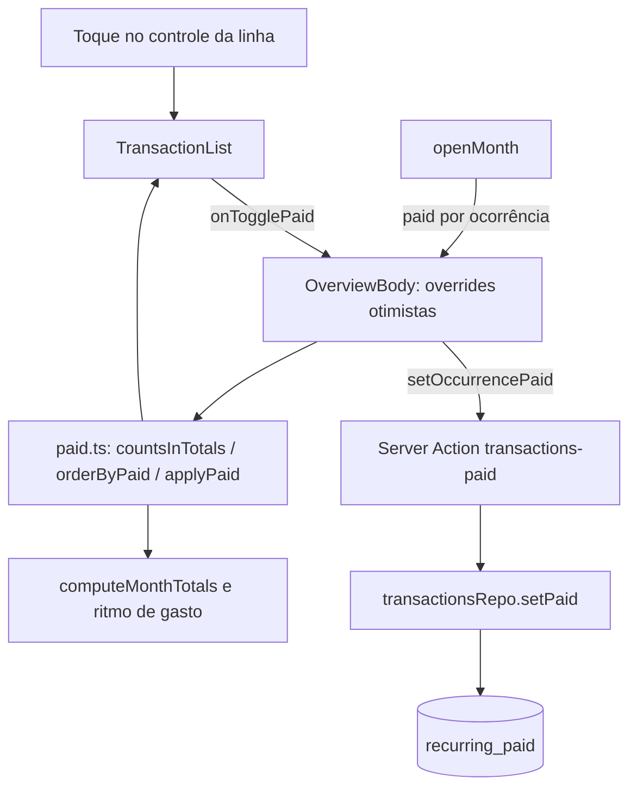

# Recorrentes: pago e não pago Design

**Spec**: `.specs/features/recorrentes-pago/spec.md`
**Status**: Draft

---

## Architecture Overview

Segue a AD-011 e a AD-004: o servidor guarda estrutura em claro e entrega `paid` por ocorrência; o cliente decide o que conta nos totais, ordena a lista e aplica a opacidade. O estado é uma tabela própria (decisão AD-018), não uma coluna de `transaction`, porque a série é projetada e o estado é por mês.

**Abordagens consideradas**

| Abordagem | Prós | Contras |
| --------- | ---- | ------- |
| **A. Tabela `recurring_paid` (série+mês), presença = paga (recomendada)** | Estado por mês sobrevive à divisão de série na edição (o `series_id` não muda); sem linha por mês futuro; escrita idempotente por PK | Tabela e migração novas; limpeza ao excluir/encurtar |
| B. Coluna JSON de meses pagos em `transaction` | Sem tabela nova | A edição divide a série em segmentos: o JSON teria de ser copiado e podado; sem FK nem PK |
| C. Gravar uma linha real por mês | Estado simples | Contradiz a AD-004 (ocorrências projetadas) |



---

## Code Reuse Analysis

### Existing Components to Leverage

| Component | Location | How to Use |
| --------- | -------- | ---------- |
| `lockSeries`, `appliesInMonth` | `src/lib/db/repos/transactions.ts:127`, `src/lib/domain/recurrence.ts:44` | Validar dono, recorrência e mês da ocorrência antes de gravar o estado |
| `planDelete` / `planEdit` | `src/lib/domain/recurrence.ts:96,140` | Já dizem quais segmentos somem e onde a série termina; derivar daí os meses a apagar |
| `listByMonthSealed` | `src/lib/db/repos/transactions.ts:296` | Juntar `recurring_paid` do mês e preencher `paid` |
| `computeMonthTotals` | `src/lib/vault/month-totals.ts:15` | Passa a ignorar não pagas (via `countsInTotals`) |
| `netByDay` | `src/lib/domain/day-total.ts` | Chamada só com as linhas que contam |
| `buildSpendingPaceViews` | `src/lib/domain/spending-pace.ts:72` | Receber só ocorrências que contam |
| `useOpened` + `revalidatePath("/")` | `src/components/use-opened.ts`, `src/actions/transactions-sealed.ts` | Mesmo ciclo de refresh após gravar |
| `sealedInvalidInput`, `requireSessionForAction`, `logActionError` | `src/lib/validation/sealed`, `src/lib/auth-guard`, `src/lib/log` | Padrão das ações |

### Integration Points

| System | Integration Method |
| ------ | ------------------ |
| Banco | Migração Drizzle 0018: cria `recurring_paid` e popula meses passados das séries existentes |
| `MonthPayload` / `Occurrence` | Campo novo `paid: boolean \| null` (`null` = não recorrente) |
| Export/Import | `ExportPayload.paidMonths`; arquivo e `ImportPayload` com `paidMonths` opcional (ausente = `[]`); `import-payload.ts` remapeia `seriesId` |
| Exclusão de conta | `ON DELETE CASCADE` em `user_id` |

---

## Components

### Tabela `recurring_paid` e migração 0018

- **Purpose**: Guardar os meses pagos por série.
- **Location**: `src/lib/db/schema.ts`, `drizzle/0018_*.sql`
- **Interfaces**: PK (`series_id`, `month`); `user_id` FK cascade; `month` é `date` dia 1, `CHECK (extract(day from month) = 1)`; índice `(user_id, month)`.
- **Migração de dados**: para cada segmento recorrente, inserir os meses de `date_trunc('month', date)` até `least(coalesce(recurrence_end, mês_corrente - 1), mês_corrente - 1)`, onde `mês_corrente = date_trunc('month', now() AT TIME ZONE 'America/Sao_Paulo')`. `ON CONFLICT DO NOTHING` (segmentos da mesma série não se sobrepõem, mas a PK protege). Sem `userId` próprio na PK: o `series_id` é UUID global.
- **Reuses**: padrão de `push_dispatch` (PK composta, cascade).

### Domínio `paid.ts`

- **Purpose**: Regras puras de contagem, ordem e override otimista.
- **Location**: `src/lib/domain/paid.ts`
- **Interfaces**:
  - `countsInTotals(o: { recurring: boolean; paid: boolean | null }): boolean` - `!recurring || paid === true`.
  - `orderByPaid<T>(rows: T[]): T[]` - partição estável: primeiro as que contam, depois as não pagas; mantém a ordem relativa.
  - `applyPaid<T extends { id: string; recurring: boolean; paid: boolean | null }>(rows: T[], overrides: ReadonlyMap<string, boolean>): T[]` - aplica o override só em recorrentes.
  - `paidLabel(kind, paid): string` - "Pago"/"Não pago"/"Recebido"/"Não recebido".
- **Reuses**: nenhum; isomórfico (sem import de servidor), como `freedom.ts`.

### Repo: leitura, escrita e limpeza

- **Purpose**: Entregar `paid`, gravar o estado e podar meses removidos.
- **Location**: `src/lib/db/repos/transactions.ts`
- **Interfaces**:
  - `listByMonthSealed` - consulta `recurring_paid` do mês para os `seriesId` das linhas; `paid = recurring ? present : null`.
  - `setPaid(userId, id, month, paid): Promise<boolean>` - em transação: `lockSeries`; `false` se não existe, não é recorrente ou não aplica no mês; `paid` → `INSERT ... ON CONFLICT DO NOTHING`; senão `DELETE`. Idempotente, sem duplicata (PAGO-10).
  - `deleteFrom` e `updateFromSealed` - após o plano, apagar `recurring_paid` do `series_id` com `month >= month` quando a série some dali em diante (`deleteFrom`; edição para "Não recorrente"), e com `month > novo fim` quando a edição define ou encurta o fim. Edição que mantém a série não toca nos estados (PAGO-02, AC 7).
- **Reuses**: `lockSeries`, `planDelete`, `planEdit`.

### Server Action `setOccurrencePaid`

- **Purpose**: Alternar o estado de uma ocorrência.
- **Location**: `src/actions/transactions-paid.ts`
- **Interfaces**: `setOccurrencePaid(id: string, month: string, paid: boolean): Promise<ActionResult>` - sessão aprovada; valida `id` uuid, `month` `AAAA-MM`, `paid` boolean (zod); ocorrência inexistente/de outro usuário/fora da série → `{ ok: false, error: "Transação não encontrada" }` sem alterar nada; falha inesperada → `{ ok: false, error: PAID_FAILED }` com `PAID_FAILED = "Não foi possível atualizar o estado. Tente novamente."`; sucesso → `revalidatePath("/")`.
- **Reuses**: padrão de `updateTransactionSealed`.

### Tipos e abertura do mês

- **Location**: `src/lib/vault/types.ts`, `src/lib/vault/open.ts`, `src/lib/db/repos/transactions.ts` (tipo `Occurrence`)
- **Interfaces**: `MonthPayload.occurrences[].paid: boolean | null`; `Occurrence.paid: boolean | null`. `openMonth` repassa por spread (`...o`), sem mudança de lógica.

### Totais e ritmo de gasto

- **Location**: `src/lib/vault/month-totals.ts`, `src/components/overview-client.tsx`, `src/components/categories-client.tsx`
- **Interfaces**: `computeMonthTotals` recebe também `recurring` e `paid` e pula quem `!countsInTotals`. `OverviewBody` passa ao ritmo de gasto só ocorrências que contam. `categories-client` herda a regra (receita de referência passa a ignorar ganho recorrente não recebido; consequência direta de PAGO-05).

### Lista de transações

- **Purpose**: Ordenar, esmaecer e alternar.
- **Location**: `src/components/transaction-list.tsx`, `src/components/overview-client.tsx`
- **Interfaces**:
  - `OverviewBody` guarda `overrides: { base: Occurrence[]; map: Map<string, boolean> }`; o override só vale enquanto `base === transactions` (nova abertura do mês descarta, sem efeito). Calcula `effective = applyPaid(transactions, map)`, totais sobre `effective`, `shown = orderByPaid(search(filter(effective)))`.
  - `handleTogglePaid(t)`: grava override otimista, chama `setOccurrencePaid(t.id, t.month, !paid)`; em `ok: false` remove o override e mostra o erro em `role="alert"` acima da lista.
  - `TransactionList` ganha `onTogglePaid(t)` e `paidError`; linha com `data-paid="true|false"` e classe `opacity-50` quando `paid === false`; botão `aria-pressed` com `paidLabel`, só se `t.recurring`; cabeçalho de dia calculado por grupo: dia novo quando a data ou o grupo muda; saldo só no grupo que conta (via `netByDay(countedRows)`), sem saldo no grupo não pago.
- **Reuses**: `TransactionRowMenu`, estilos de badge existentes, `useTransition`.

### Export e import

- **Location**: `src/lib/db/repos/export.ts`, `src/lib/vault/types.ts`, `src/lib/vault/export.ts`, `src/lib/vault/import-file.ts`, `src/lib/vault/import-payload.ts`, `src/lib/validation/import-sealed.ts`, `src/lib/db/repos/import.ts`
- **Interfaces**: `paidMonths: { seriesId: string; month: string }[]` (`month` AAAA-MM no arquivo, `date` dia 1 no banco). Arquivo sem o campo → `[]` (todas não pagas, PAGO-09). `import-payload` troca `seriesId` pelo id remapeado. `importSealed` insere em lotes (`BATCH`). Validação: `seriesId` deve existir entre as séries do arquivo e `month` deve estar em 2000-01..2100-12; linha inválida rejeita o arquivo como as demais.
- **Reuses**: `chunks`, `seriesIds` map.

---

## Data Models

```typescript
// src/lib/db/schema.ts
recurringPaid = pgTable("recurring_paid", {
  userId: text("user_id").notNull().references(() => user.id, { onDelete: "cascade" }),
  seriesId: uuid("series_id").notNull(),
  month: date("month", { mode: "string" }).notNull(), // AAAA-MM-01
}, (t) => [primaryKey({ columns: [t.seriesId, t.month] }), index("recurring_paid_user_month_idx").on(t.userId, t.month)]);

// src/lib/vault/types.ts
occurrences[].paid: boolean | null; // null = não recorrente
ExportPayload.paidMonths: { seriesId: string; month: string }[];
```

**Relationships**: `series_id` refere o id do primeiro segmento da série (sem FK, pois não é único em `transaction`); a limpeza em edição/exclusão e o cascade por usuário evitam órfãos.

---

## Error Handling Strategy

| Error Scenario | Handling | User Impact |
| -------------- | -------- | ----------- |
| Ação falha (rede, banco) | Remove o override otimista; ação devolve `PAID_FAILED` | Linha volta ao estado anterior; alerta "Não foi possível atualizar o estado. Tente novamente." |
| Ocorrência de outro usuário ou fora da série | `setPaid` devolve `false`; ação rejeita sem gravar | Mesma mensagem de "Transação não encontrada" |
| Dois toques simultâneos no mesmo mês | PK + `ON CONFLICT DO NOTHING`/`DELETE` idempotentes | Estado final = último recebido, sem duplicata |
| Arquivo de importação com estado de série inexistente | Rejeita o arquivo na validação | Erro de arquivo inválido já existente |

---

## Risks & Concerns

| Concern | Location (file:line) | Impact | Mitigation |
| ------- | -------------------- | ------ | ---------- |
| Totais derivam de `computeMonthTotals`, mas o ritmo de gasto usa `occurrences` direto | `src/components/overview-client.tsx:119-124` | Ritmo de gasto contaria não pagas e divergiria do resumo | Filtrar por `countsInTotals` antes do ritmo; teste de domínio em `paid.ts` e inspeção de código na integração |
| Receita de referência herda a nova regra | `src/components/categories-client.tsx:46` | Ganho recorrente não recebido reduz a receita de referência das metas | Consequência de PAGO-05 (decisão do usuário); registrar no relatório de validação |
| Edição divide a série e deleta segmentos posteriores | `src/lib/db/repos/transactions.ts:228-262` | Poda errada apagaria o estado de meses que continuam | Poda só quando a série acaba ou encurta; testes de integração por cenário (editar, encurtar, excluir, virar avulso) |
| Migração depende do fuso e de `now()` da execução | `drizzle/0018_*.sql` | Mês corrente errado marcaria/desmarcaria o mês limite | Usar `America/Sao_Paulo` explícito; teste de integração com séries antes e depois do limite |
| Lista sem teste de componente (AD-005) | `src/components/transaction-list.tsx` | Ordem/opacidade podem regredir sem aviso | Toda a lógica em `paid.ts` (unit); UI verificada por inspeção `file:line` |
| `recurrence_end` fica em dia 1 e `series_id` sem FK | `src/lib/db/schema.ts:133` | Estado órfão se a poda falhar | Poda dentro da mesma transação do plano; teste que confere ausência de órfãos |

---

## Tech Decisions (only non-obvious ones)

| Decision | Choice | Rationale |
| -------- | ------ | --------- |
| Presença = paga | Sem coluna booleana | Não pago é o padrão e a maioria dos meses futuros; não gera linha por mês |
| `paid: boolean \| null` | `null` em avulsos | Impede ler "pago" onde o conceito não existe |
| Override otimista por lista de base | Estado com `base` e mapa | Evita efeito e piscada: a nova abertura do mês invalida o override sozinha |
| Contagem no cliente | `countsInTotals` | Totais já rodam no cliente sobre dados abertos (AD-011) |

> **Project-level decision:** registrada como AD-018 em `.specs/STATE.md`.
