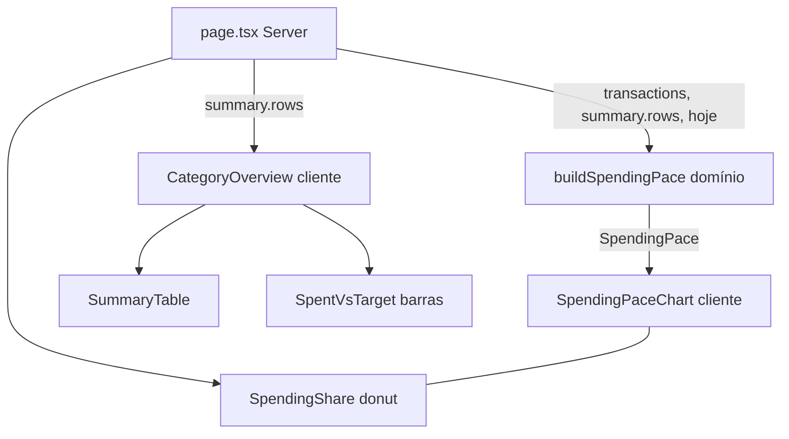

# Resumo: Visões e Ritmo Design

**Spec**: `.specs/features/resumo-visoes/spec.md`
**Status**: Draft

---

## Architecture Overview

Só apresentação. A página (Server Component) já carrega `transactions` (ocorrências do mês, recorrentes projetadas) e `summary`. Uma função pura nova transforma essas ocorrências na série diária; dois componentes cliente consomem os dados prontos.



---

## Code Reuse Analysis

| Component | Location | How to Use |
| --------- | -------- | ---------- |
| `ContentCard` | `src/components/content-card.tsx` | Moldura dos dois cards; o seletor entra pela prop `action`. |
| `Tabs`/`TabsList`/`TabsTrigger`/`TabsContent` (Radix) | `src/components/ui/tabs.tsx` | Seletor com `aria-selected`, setas e Tab prontos (VISOES-01); `TabsContent` desmonta a visão inativa (VISOES-02). |
| `SummaryTable` | `src/components/summary-table.tsx` | Visão "Tabela", sem mudança; ao desmontar, o estado de expansão zera (AC 4). |
| `SpentVsTarget` | `src/components/budget-charts.tsx` | Passa a ser exportado e vira a visão "Barras", sem mudança de render. |
| `SpendingShare`, `Swatch`, `tooltipStyle`, `tick`, `compactBRL` | `src/components/budget-charts.tsx` | O donut fica; helpers de gráfico são reutilizados pelo novo gráfico de linha. |
| `monthRange`, `currentMonth` | `src/lib/domain/month.ts` | Limites do mês e comparação com hoje. |
| `mulDivRound` | `src/lib/domain/percent.ts` | Arredondar `meta × D ÷ dias` em centavos inteiros (AD-003). |
| `formatBRL` | `src/lib/domain/money.ts` | Rótulos e tooltip. |
| `--viz-target`, `--viz-spent`, `--viz-over`, `--viz-grid` | `src/app/globals.css:170` | Cores do gráfico em claro e escuro. |

### Integration Points

| System | Integration Method |
| ------ | ------------------ |
| `transactionsRepo.listByMonth` | Sem mudança. Já devolve a data projetada das recorrentes (AD-004); a série lê `kind`, `amountCents`, `date`. |
| `todayInSaoPaulo()` | Já existe em `page.tsx`; passa a alimentar também `buildSpendingPace`. |

---

## Components

### buildSpendingPace

- **Purpose**: Calcula a série diária de gasto acumulado e a referência ideal do mês.
- **Location**: `src/lib/domain/spending-pace.ts` (puro, sem import de servidor)
- **Interfaces**:
  - `buildSpendingPace(input: { month: YearMonth; today: string; totalTargetCents: number; occurrences: { kind: "income" | "expense"; amountCents: number; date: string }[] }): SpendingPace`
- **Dependencies**: `month.ts`, `percent.ts`
- **Reuses**: `mulDivRound`, `monthRange`

### SpendingPaceChart

- **Purpose**: Card "Ritmo de gastos": linha de gasto acumulado, linha tracejada do ritmo ideal, legenda, tooltip e aviso "Acima do ritmo ideal".
- **Location**: `src/components/spending-pace-chart.tsx` (cliente, Recharts `LineChart`)
- **Interfaces**: `SpendingPaceChart({ pace }: { pace: SpendingPace })`
- **Dependencies**: Recharts, `ContentCard`
- **Reuses**: helpers de estilo de `budget-charts.tsx` (movidos para um módulo compartilhado `chart-style.ts` se a importação circular surgir)

### CategoryOverview

- **Purpose**: Card "Gastos por categoria" com seletor Tabela/Barras.
- **Location**: `src/components/category-overview.tsx` (cliente)
- **Interfaces**: `CategoryOverview({ rows }: { rows: CategorySummary[] })`
- **Dependencies**: `Tabs`, `SummaryTable`, `SpentVsTarget`, `ContentCard`
- **Reuses**: `ContentCard` com `action={<TabsList>…}`; `note` com a contagem de categorias continua. Sem categorias: renderiza só `SummaryTable` (link "Crie suas categorias primeiro") e nenhum seletor (VISOES-03).

### BudgetCharts (alterado)

- **Purpose**: Grade de duas colunas com "Ritmo de gastos" e "Participação no gasto do mês".
- **Location**: `src/components/budget-charts.tsx`
- **Interfaces**: `BudgetCharts({ rows, spentCents, pace })`; remove o card "Gasto × meta por categoria"; exporta `SpentVsTarget`.

---

## Data Models

```typescript
type SpendingPacePoint = {
  day: number; // 1..daysInMonth
  spentCents: number | null; // null depois de "hoje" (mês corrente) ou em mês futuro
  idealCents: number | null; // null quando a meta total é 0
};

type SpendingPace = {
  points: SpendingPacePoint[]; // length = dias do mês (28..31)
  hasReference: boolean; // totalTargetCents > 0
  hasSpending: boolean; // algum gasto no mês; false => "Sem gastos no mês"
  aboveIdeal: boolean; // último spentCents não nulo > idealCents do mesmo dia
};
```

Regras de cálculo:
- `spent(D)` = soma de `amountCents` das ocorrências `expense` com dia ≤ D; receitas ignoradas.
- `ideal(D)` = `mulDivRound(totalTargetCents, D, daysInMonth)`; o último dia vale exatamente a meta total.
- Corte por `today`: `today < início` ⇒ nenhum ponto de gasto; `today ≥ fim` ⇒ todos; senão até o dia de `today`.
- `aboveIdeal` só é `true` com referência e pelo menos um ponto de gasto.

**Relationships**: `totalTargetCents` = soma de `targetCents` de `summary.rows` (inclui categorias excluídas após o mês, como o resumo).

---

## Error Handling Strategy

| Error Scenario | Handling | User Impact |
| -------------- | -------- | ----------- |
| Mês sem despesas | `hasSpending = false` | Texto "Sem gastos no mês" no lugar do gráfico. |
| Meta total zero | `hasReference = false`, `idealCents = null` | Só a curva de gasto; sem legenda "Ritmo ideal". |
| Mês futuro | Todos os `spentCents = null` | Só a referência; sem curva. |
| Sem categorias | `CategoryOverview` não mostra seletor | Link "Crie suas categorias primeiro". |

---

## Risks & Concerns

| Concern | Location (file:line) | Impact | Mitigation |
| ------- | -------------------- | ------ | ---------- |
| `budget-charts.tsx` junta três gráficos e ganha um quarto | `src/components/budget-charts.tsx` | Arquivo cresce e `CategoryOverview` importaria dele | Novo gráfico em arquivo próprio; só `SpentVsTarget` passa a ser exportado. |
| Sem testing-library: componentes cliente não têm teste automatizado | `package.json` (só `vitest`, projetos unit/integration) | UI do seletor e do gráfico sem rede de segurança | Toda a regra numérica vai para `buildSpendingPace` (teste unitário); a UI fica com verificação manual, coerente com AD-005. |
| "Hoje" depende de fuso | `src/app/(app)/page.tsx:22` | Mês corrente cortado no dia errado perto da meia-noite | `today` vem do servidor em America/Sao_Paulo e entra como parâmetro; testes passam datas fixas. |
| Teste de recharts em jsdom é frágil (ResponsiveContainer) | `src/components/budget-charts.tsx` | Teste de render inútil | Não testar render do gráfico; testar a série. |

---

## Tech Decisions (only non-obvious ones)

| Decision | Choice | Rationale |
| -------- | ------ | --------- |
| Seletor | `Tabs` do Radix, não `RadioGroup` | Entrega `aria-selected`, setas e desmontagem do painel inativo sem código novo. |
| Onde calcular a série | Servidor, em função pura | Dados já estão na página; o cliente só desenha; função testável sem DOM. |
| Arredondamento da referência | Por dia sobre a meta total (`mulDivRound`), não incremental | Evita erro acumulado; o último dia bate com a meta. |
| Estado do seletor | `useState` local em `CategoryOverview` | Persistência está fora do escopo da spec. |
