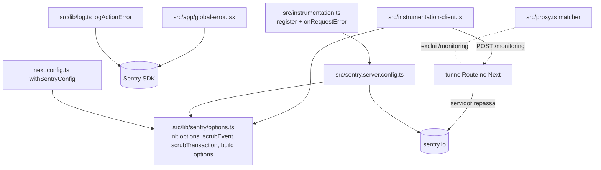

# Monitoramento de erros com Sentry Design

**Spec**: `.specs/features/sentry-monitoramento/spec.md`
**Status**: Draft

---

## Architecture Overview

Instalação manual de `@sentry/nextjs` (sem o wizard, que reescreve arquivos e cria exemplos fora do padrão do projeto). Toda decisão de dados fica em um módulo puro, `src/lib/sentry/options.ts`, usado pelos dois pontos de `Sentry.init`; assim o scrubbing e as taxas têm teste unitário sem carregar o SDK.

Fluxo de um erro de navegador: SDK captura → `beforeSend` (scrub) → POST same-origin em `/monitoring` → o Next repassa ao Sentry. O CSP não muda.

---

## Code Reuse Analysis

### Existing Components to Leverage

| Component | Location | How to Use |
| --- | --- | --- |
| `logActionError` | `src/lib/log.ts` | Continua com `console.error(action, code)`; ganha uma chamada ao Sentry com tags. Os 15 callers não mudam |
| `PATHS_OUTSIDE_PROXY`, `securityHeaderRules` | `src/lib/security-headers.ts` | Recebe `/monitoring` para a resposta do túnel levar o CSP estático, como `/api/auth` |
| matcher do proxy | `src/proxy.ts:40` | Exclui `/monitoring`, como `api/auth` (o túnel não é página) |
| `PUBLIC_PATHS`, `decideRoute` | `src/lib/route-decision.ts` | Inclui `/sentry-example-page` e `/api/sentry-example-api` |
| padrão de teste de funções puras | `src/lib/security-headers.test.ts`, `route-decision.test.ts` | Mesmo formato para `options.test.ts` |
| `.env.example` | raiz | Documenta as 3 variáveis novas |

### Integration Points

| System | Integration Method |
| --- | --- |
| Next 16 | `src/instrumentation.ts` (`register`, `onRequestError`) e `src/instrumentation-client.ts` (documentado em `node_modules/next/dist/docs/01-app/03-api-reference/03-file-conventions/`) |
| Sentry (org `anon-finance`, projeto `javascript-nextjs`) | DSN por variável de ambiente; token só no build |
| CSP por nonce (`src/lib/security-headers.ts:27`) | Sem alteração; o túnel evita `connect-src` externo |

---

## Components

### Sentry options (módulo puro)

- **Purpose**: Concentrar tudo que decide o que sai do app.
- **Location**: `src/lib/sentry/options.ts`
- **Interfaces**:
  - `sentryInitOptions(env: { dsn?: string; nodeEnv?: string }): InitOptions` - `enabled` só com DSN; `dataCollection` com todas as categorias desligadas (sem `sendDefaultPii`, que não existe no v11); `tracesSampleRate` 0.1 em produção, senão 0; `maxBreadcrumbs: 0`; `beforeBreadcrumb: () => null`; `beforeSend`/`beforeSendTransaction` abaixo.
  - `scrubEvent<T extends ErrorEvent>(event: T): T` - mantém `exception.values[].type` e `stacktrace`, `tags`, `release`, `environment`, `transaction` (rota sem query), `contexts.{runtime,os,browser}`; remove o resto. Nunca lança em evento sem `exception`.
  - `scrubTransaction(event)` - tira query string e fragmento de `transaction`, `request.url` (que então é removido por inteiro) e do nome do span raiz.
  - `sentryBuildOptions(env: { token?: string; ci?: boolean }): SentryBuildOptions` - `org: "anon-finance"`, `project: "javascript-nextjs"`, `tunnelRoute: "/monitoring"`, `silent: !ci`, `authToken: token`, `telemetry: false`, `sourcemaps.deleteSourcemapsAfterUpload: true`; sem token, `sourcemaps.disable: "disable-upload"`.
- **Dependencies**: só tipos de `@sentry/nextjs` (import de tipo; o módulo roda sem o SDK).
- **Reuses**: padrão de funções puras com teste de `security-headers.ts`.

### Init do servidor

- **Purpose**: `Sentry.init(sentryInitOptions({ dsn: process.env.SENTRY_DSN, nodeEnv: process.env.NODE_ENV }))`.
- **Location**: `src/sentry.server.config.ts`, carregado por `register()` em `src/instrumentation.ts` quando `NEXT_RUNTIME === "nodejs"`; `onRequestError = Sentry.captureRequestError`.
- **Reuses**: Sentry options.

### Init do navegador

- **Purpose**: `Sentry.init` com `process.env.NEXT_PUBLIC_SENTRY_DSN`, sem integrações de Replay/Feedback; exporta `onRouterTransitionStart = Sentry.captureRouterTransitionStart`.
- **Location**: `src/instrumentation-client.ts`
- **Reuses**: Sentry options.

### Tela de erro global

- **Purpose**: Capturar erros de render do layout raiz e mostrar recuperação.
- **Location**: `src/app/global-error.tsx` (client component; renderiza `<html lang="pt-BR">`/`<body>` próprios, pois substitui o layout)
- **Interfaces**: `GlobalError({ error, reset })` - `useEffect` chama `Sentry.captureException(error)`; mostra "Algo deu errado" e botão "Tentar novamente" que chama `reset()`; não exibe `error.message`.
- **Reuses**: `Button` de `src/components/ui/button.tsx`, `BRAND_NAME` de `src/lib/brand.ts`. Como substitui o layout, não há fonte nem tema: usa as variáveis do `globals.css` importado ali.

### Relato de falha de Server Action

- **Purpose**: Mandar ao Sentry só ação e código (SENTRY-06).
- **Location**: `src/lib/log.ts`
- **Interfaces**: `logActionError(action, error)` - além do `console.error`, chama `Sentry.captureException(new Error("server_action_failed"), { tags: { action, code } })`. A mensagem fixa é removida pelo `scrubEvent`; o objeto de erro original nunca é passado.
- **Reuses**: a extração de `code` que já existe.

### Rotas e proxy

- **Purpose**: Deixar o túnel e a página de exemplo acessíveis a anônimos.
- **Location**: `src/proxy.ts` (matcher ganha `monitoring`), `src/lib/security-headers.ts` (`/monitoring/:path*` em `PATHS_OUTSIDE_PROXY`), `src/lib/route-decision.ts` (`PUBLIC_PATHS`).

### Página de exemplo

- **Purpose**: Validar a integração manualmente.
- **Location**: `src/app/sentry-example-page/page.tsx` e `src/app/api/sentry-example-api/route.ts`
- **Interfaces**: ambos chamam `notFound()`/respondem 404 quando `process.env.NODE_ENV === "production"`; fora disso, dois botões (erro de cliente, erro de servidor via fetch ao route handler).
- **Reuses**: `Button`, `Card`.

### Config de build

- **Purpose**: Envolver `nextConfig` em `withSentryConfig(nextConfig, sentryBuildOptions(...))` em `next.config.ts`; source maps apagados após o upload (SENTRY-14).

---

## Data Models

N/A - não há dado persistido.

---

## Error Handling Strategy

| Error Scenario | Handling | User Impact |
| --- | --- | --- |
| Sentry indisponível ou rejeita evento | SDK descarta em silêncio; nenhuma await bloqueia a resposta | Nenhum |
| DSN ausente | `enabled: false`, sem `init` de rede | Nenhum |
| `beforeSend` recebe evento sem `exception` | Remove campos sensíveis e devolve o evento; nunca lança | Nenhum |
| `scrubEvent` lança por bug | Envolver em try/catch e devolver `null` (descarta o evento): falhar fechado | Evento perdido, nunca vazado |
| Erro de render no layout raiz | `global-error` captura e mostra "Tentar novamente" | Tela de recuperação em pt-BR |
| Falha de upload de source maps | Build termina; só sai aviso (`silent` falso em CI) | Stack trace minificado até novo build |

---

## Risks & Concerns

| Concern | Location (file:line) | Impact | Mitigation |
| --- | --- | --- | --- |
| Mensagem de erro no cliente pode conter dado decifrado | `src/lib/vault` (erros de decifragem) | Vazamento de dado financeiro ao Sentry | `scrubEvent` remove todo `exception.values[].value` e `message`; teste com evento carregando e-mail e valor em R$ |
| `dataCollection` só vale no SDK ≥ 10.57; `sendDefaultPii` é obsoleto | doc do Sentry (options) | Duas formas de configurar; defaults mudam no v11 | Definir os dois; o `scrubEvent` é a barreira real e não depende deles |
| O `request` do `onRequestError` leva headers e cookies | `src/instrumentation.ts` | Cookies de sessão em evento | `scrubEvent` remove `request` por inteiro; `dataCollection.cookies/httpHeaders: false` |
| Upload de source maps com Turbopack (build padrão do Next 16) não confirmado nos docs que li | `next.config.ts` | Stack traces sem mapa | Primeira task faz `next build` com e sem token e verifica; se falhar, registrar a limitação e seguir sem bloquear (SENTRY-13) |
| Nome exato da opção que apaga `.map` após upload não confirmado (`sourcemaps.deleteSourcemapsAfterUpload`) | `next.config.ts` | `.map` público | Confirmar nos tipos do pacote instalado antes de usar; teste checa a opção |
| `log.ts` passa a importar o SDK | `src/lib/log.ts:1` | Bundle do cliente, se algum client component importar `log.ts` | Só Server Actions importam; teste/lint garante que nenhum client component o importa |
| Matcher do proxy e `PATHS_OUTSIDE_PROXY` precisam concordar | `src/proxy.ts:40`, `src/lib/security-headers.ts:50` | CSP faltando ou redirect ao login no túnel | Os dois recebem `/monitoring` no mesmo commit; `security-headers.test.ts` cobre a lista |
| Erros esperados (validação) não devem virar evento | `src/actions/*` | Ruído | Eles retornam `ActionResult`, não lançam; só `logActionError` (falha inesperada) reporta |
| Pacote ainda não instalado: API só verificada pela documentação web | - | Nomes de opção podem divergir | Task 1 instala e confere os tipos; discrepância vira ajuste no design antes de seguir |

### Fatos confirmados na T1 (`@sentry/nextjs` 11.6.0 instalado, Next 16.3.8)

Verificado nos tipos em `node_modules/@sentry/{core,nextjs}/build/types`.

| Ponto | Confirmado | Divergência do design |
| --- | --- | --- |
| Apagar `.map` após upload | `sourcemaps.deleteSourcemapsAfterUpload?: boolean` (`nextjs/.../config/types.d.ts:387`), padrão `true`; `sourcemaps.filesToDeleteAfterUpload` sobrescreve; `sourcemaps.disable: boolean \| 'disable-upload'` | Nenhuma de nome. Como o padrão já é `true`, `sentryBuildOptions` define `deleteSourcemapsAfterUpload: true` explícito |
| `dataCollection` | Existe (`core/.../options.d.ts:346`). Chaves reais: `userInfo`, `cookies`, `httpHeaders`, `httpBodies` (`[]` desliga), `urlQueryParams`, `graphQL`, `genAI`, `databaseQueryData`, `queues`, `stackFrameVariables`, `frameContextLines` | O design citava só `cookies/httpHeaders`. Valores desligados: `userInfo`, `cookies`, `httpHeaders`, `urlQueryParams`, `databaseQueryData`, `queues`, `stackFrameVariables` em `false`, `httpBodies: []`, `graphQL` e `genAI` com todos os campos `false`. `frameContextLines` fica no padrão (o trecho de código vem do código-fonte, não de dado do usuário) |
| `sendDefaultPii` | NÃO existe no v11.6.0: ausente dos tipos e do código (`grep` em `core`, `nextjs`, `node`, `browser`). Foi substituído por `dataCollection` | SPEC_DEVIATION em SENTRY-04: `sendDefaultPii: false` não pode ser definido (erro de tipo, sem efeito). O equivalente é `dataCollection.userInfo: false` mais as demais categorias desligadas; o teste afirma isso. O design supunha SDK ≥ 10.57 com as duas formas |
| `captureRequestError` | `(error: unknown, request: { path: string; method: string; headers: Record<string, string \| string[] \| undefined> }, errorContext: { routerKind: string; routePath: string; routeType: string }): void` (`nextjs/.../common/captureRequestError.d.ts:14`), compatível com `onRequestError` | Nenhuma; atribuir direto como `onRequestError` |
| `withSentryConfig` | Importar de `@sentry/nextjs/config` (o export `.` não o traz; `package.json` exports e `build/types/config/index.d.ts:1-2`, que também exporta o tipo `SentryBuildOptions`). `withSentryConfig<C>(nextConfig?: C, sentryBuildOptions?: SentryBuildOptions): C`; `tunnelRoute?: string \| boolean` (`types.d.ts:231`); `org`, `project`, `authToken`, `silent`, `telemetry`, `sourcemaps` vêm de `BuildTimeOptionsBase` | Nenhuma. A doc do tipo confirma que o túnel passa pelo `proxy.ts` e pede exclusão no `matcher` (já planejado). `telemetry: false` também será definido para o build não enviar telemetria do plugin |
| Upload com Turbopack | O SDK tem o caminho `after-production-compile-turbopack` e `useRunAfterProductionCompileHook` vale `true` por padrão com Turbopack (`types.d.ts:303`); exige Next >= 15. Suportado em teoria; a prova real (sem token) é na T13 | Nenhuma por ora. Efeito colateral: com Turbopack o SDK não aplica a instrumentação de build-time via webpack (`types.d.ts:75`) |
| Replay / Feedback | Pacotes `@sentry/replay` e `@sentry/feedback` vêm como dependências, mas só entram no bundle se a integração for importada | Nenhuma; T5 não as importa |

---

## Tech Decisions (only non-obvious ones)

| Decision | Choice | Rationale |
| --- | --- | --- |
| Wizard x manual | Manual | O wizard sobrescreve `next.config.ts`, cria `app/` fora de `src/` e injeta exemplo com envio de dados; o projeto exige scrubbing próprio |
| Edge config | Não criar | Proxy roda em Node no Next 16; nenhuma rota usa edge |
| Reportar falha de action | Tags `action` e `code`, erro sintético | Mantém o contrato de `logActionError` (nunca passar o erro real) |
| Falha do scrubber | Descartar o evento | Prefere perder um evento a vazar dado |
| Breadcrumbs | `maxBreadcrumbs: 0` + `beforeBreadcrumb` nulo | Além do scrub final, não coleta nada de console, DOM ou rede |
| DSN no repositório | Não; variáveis de ambiente (`.env`, Vercel) | O DSN que você colou é público por natureza, mas fica fora do código para trocar por ambiente |
| Instruções coladas para baixar `skills.sentry.dev/instrument` por curl | Não executar | Seria rodar conteúdo remoto não pedido; a documentação oficial basta |

> **Project-level decision (propor para STATE.md):** AD-013 - "Nenhum dado de usuário sai para serviços de terceiros; o monitoramento envia só tipo de exceção, stack trace, rota e tags, filtrado por `scrubEvent`, e o navegador só fala com a própria origem (túnel `/monitoring`)". Registro assim que você aprovar o design.
