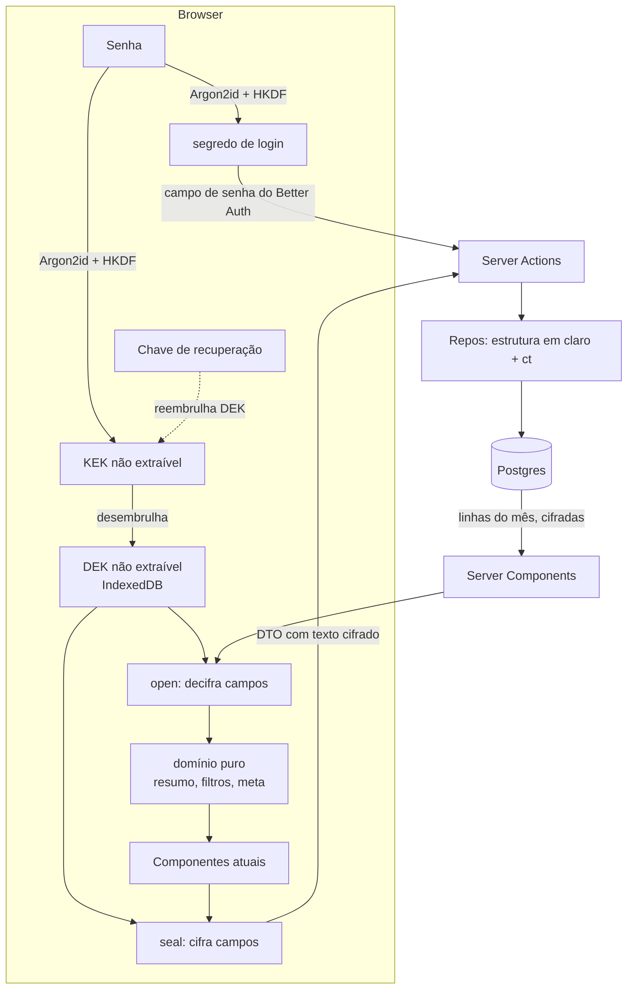
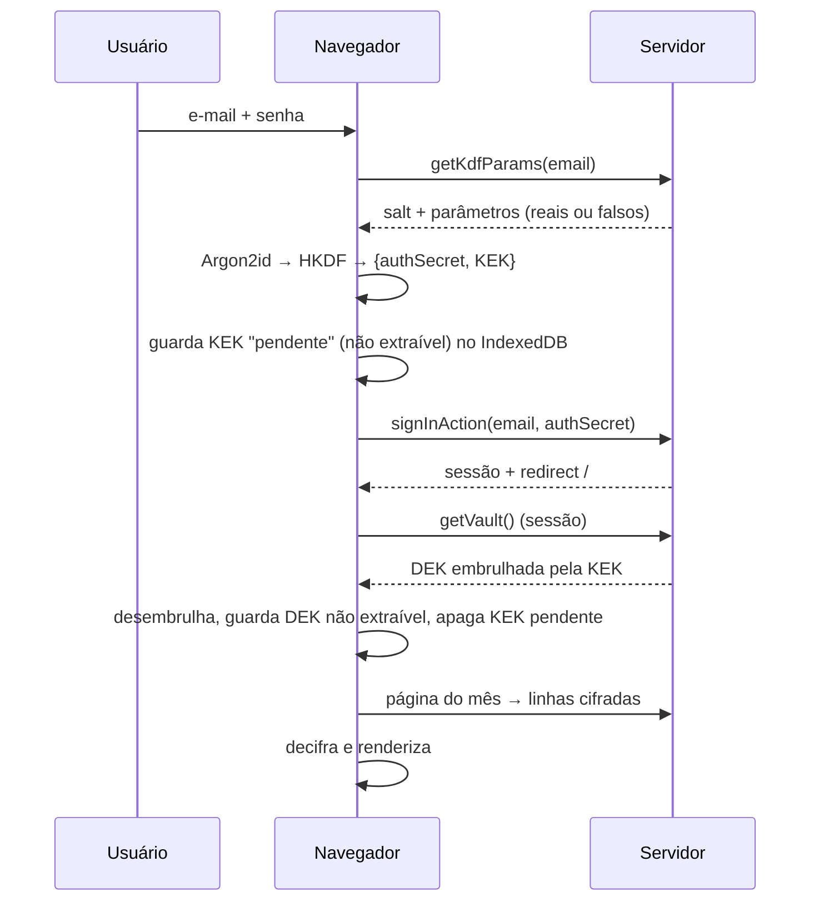

# Sigilo dos Dados Design

**Spec**: `.specs/features/sigilo-dados/spec.md`
**Status**: Approved

---

## Architecture Overview

O navegador é o único lugar onde existem a senha, a KEK, a DEK e os dados em claro. O servidor guarda o hash do segredo de login, o material do cofre (salt, parâmetros do KDF, DEK embrulhada duas vezes) e linhas com os campos sensíveis em `v1:<base64url>`. A estrutura consultável (datas, tipo, ids, recorrência, cor, flag de investimento) segue em texto puro para o servidor filtrar por mês (AD-004) e validar posse.

Leitura (abordagem A, aprovada): a Server Component continua buscando só o mês pedido, mas devolve **linhas cifradas**; um componente cliente decifra com a DEK do dispositivo e roda o domínio puro que já existe (`buildMonthlySummary`, `spending-pace`, `transaction-filter`, `freedom`). Escrita: o formulário valida e cifra no cliente e chama a Server Action com um DTO que carrega só texto cifrado e estrutura.



Fluxos de chave (todos no navegador):



---

## Code Reuse Analysis

### Existing Components to Leverage

| Component | Location | How to Use |
| --------- | -------- | ---------- |
| Domínio puro (`buildMonthlySummary`, `validateCategorySet`, `resolvePercent`, `searchTransactions`, `filterTransactions`, `buildSpendingPaceViews`, `summarize`, `goalSchema`) | `src/lib/domain/*`, `src/lib/validation/goal.ts` | Rodam sem mudança no cliente sobre dados decifrados (AD-008 já exige que sejam isomórficos) |
| `planEdit` / `planDelete` / `appliesInMonth` | `src/lib/domain/recurrence.ts` | Seguem no servidor: usam só datas e ids em claro |
| `applicableInMonth` | `src/lib/db/repos/transactions.ts:81` | Filtro por mês continua em SQL sobre colunas em claro |
| Better Auth (`signInEmail`, hash scrypt, sessão, hook `status`) | `src/lib/auth.ts`, `src/actions/auth.ts` | O `authSecret` entra no campo `password`; bloqueio por tentativas, `status` e sessão não mudam |
| `passwordResetsRepo` (token SHA-256, transação) | `src/lib/db/repos/password-resets.ts` | `consume` passa a gravar `authSecret` + material do cofre em vez de senha |
| `ActionResult`, `SAVE_FAILED`, `invalidInput`, guards | `src/lib/action-result.ts`, `src/lib/auth-guard.ts` | Convenção das actions mantida |
| `PasswordInput`, `Dialog`, `Alert`, `Checkbox` | `src/components/*`, `src/components/ui/*` | Telas de desbloqueio, chave de recuperação e `/proteger-dados` |
| Helpers de teste (`setupTestDb`, `insertTestUser`, `insertCategory`) | `src/test/db.ts` | Ganham variantes cifradas (chave de teste fixa) |
| `@noble/hashes` 2.4.0 (`argon2id`, `hkdf`) | `node_modules` (transitivo do Better Auth) | Passa a dependência direta; Argon2id puro JS com `asyncTick` |

### Integration Points

| System | Integration Method |
| ------ | ------------------ |
| Better Auth | `authSecret` (base64url, 43 chars) como senha; `signUpAction`/`resetPasswordAction`/`seedUser` já hasheiam o que recebem; nenhuma mudança no plugin |
| Postgres | Migração aditiva `0010` (colunas `*_ct`, tabela `user_vault`, colunas em claro viram nullable); `scripts/finalize-vault.ts` remove o legado |
| Next 16 proxy | `src/proxy.ts` passa a gerar o nonce da CSP e cabeçalhos para todas as rotas, mantendo o redirecionamento para `/login` só nas rotas protegidas |

---

## Components

### Núcleo de cripto (isomórfico, sem React)

- **Purpose**: Primitivas puras de KDF, AEAD, embrulho de chave, chave de recuperação e codecs por campo.
- **Location**: `src/lib/crypto/` (`kdf.ts`, `aead.ts`, `wrap.ts`, `recovery.ts`, `fields.ts`, `base64url.ts`)
- **Interfaces**:
  - `deriveKeys(password: string, salt: Uint8Array, params: KdfParams): Promise<{ authSecret: string; kek: CryptoKey }>` - Argon2id (`asyncTick`), depois HKDF-SHA256 com `info` `orcamento/auth/v1` e `orcamento/kek/v1`
  - `encryptField(dek: CryptoKey, plaintext: string, aad: string): Promise<string>` / `decryptField(dek, ct, aad): Promise<string>` - `v1:<b64url(iv‖ct‖tag)>`
  - `aad(table, column, userId, rowId?): string` - `tabela.coluna.userId[.rowId]`
  - `wrapDek(kek, dekRaw, userId)` / `unwrapDek(kek, wrapped, userId): Promise<Uint8Array>` - AES-GCM com AAD `vault.dek.<userId>`
  - `generateRecoveryKey(): { display: string; bytes: Uint8Array }` e `recoveryKek(bytes): Promise<CryptoKey>` (HKDF, `info` `orcamento/recovery/v1`; sem KDF lento, a chave já tem 128 bits)
  - `codecs`: `centsCodec`, `microCodec`, `intCodec`, `textCodec`, `dateCodec` (número ↔ texto decimal)
- **Dependencies**: `globalThis.crypto.subtle` (navegador e Node 20), `@noble/hashes`
- **Reuses**: nada; é a base testável por unit (vetores fixos + propriedades)

### Selagem tipada (seal/open)

- **Purpose**: Converter entre os tipos de domínio e os DTOs cifrados, aplicando o AAD certo por campo.
- **Location**: `src/lib/vault/seal.ts`, `src/lib/vault/open.ts`, `src/lib/vault/types.ts`
- **Interfaces**:
  - `sealTransaction(dek, userId, rowId, tx): Promise<{ amountCt: string; descriptionCt: string | null }>`
  - `sealCategorySet(dek, userId, items): Promise<CategorySetDto>` - nome, subcategorias e versão de percentual com `fromMonth`, decidindo no cliente se o percentual mudou
  - `sealGoal(dek, userId, goal): Promise<GoalDto>`; `sealBirthDate(dek, userId, iso): Promise<string>`
  - `openMonth(dek, userId, payload: MonthPayload): Promise<{ categories: Category[]; occurrences: Occurrence[] }>` - devolve os tipos que os componentes já usam
  - `openGoal`, `openBirthDate`, `openExport(dek, userId, payload): Promise<ExportFile>`
- **Dependencies**: Núcleo de cripto, tipos do domínio
- **Reuses**: tipos `Occurrence`, `Category`, `Goal`; `resolvePercent`, `occurrenceDate`

### Cofre no cliente

- **Purpose**: Guardar a DEK no dispositivo, desbloquear e expor a DEK à árvore React.
- **Location**: `src/lib/vault/device-key.ts`, `src/components/vault-provider.tsx`, `src/components/unlock-screen.tsx`, `src/components/use-vault.ts`
- **Interfaces**:
  - `deviceKey.load(userId) / save(userId, dek) / clear()`; `pendingKek.save/take/clear()` - IndexedDB, `CryptoKey` não extraível
  - `<VaultProvider userId>` - estados `loading | locked | ready | error`; `locked` renderiza `<UnlockScreen>` no lugar dos filhos (SIGILO-17); se existe KEK pendente, tenta `getVaultAction` e desembrulha (SIGILO-13)
  - `useVault(): { dek: CryptoKey; userId: string }`
  - `useOpened<T>(open: (dek) => Promise<T>, deps): { data: T | null; error: boolean }` - decifra em efeito; erro vira "Não foi possível carregar seus dados. Tente novamente" (SIGILO-06)
- **Dependencies**: `deriveKeys`, `unwrapDek`, `getVaultAction`
- **Reuses**: layout `(app)` (envolve `children`), `Alert`

### Páginas de dados no cliente

- **Purpose**: Mover o corpo das páginas para componentes cliente que decifram e calculam, mantendo a Server Component só como carregador de linhas cifradas.
- **Location**: `src/app/(app)/page.tsx` → `src/components/overview-client.tsx`; `categorias/page.tsx` → `src/components/categories-client.tsx`; `liberdade/page.tsx` → usa `GoalExperience` com dados abertos por `useOpened`
- **Interfaces**:
  - `<OverviewClient payload={MonthPayload} month params />` - executa o corpo atual da página (resumo, ritmo, filtros por `searchParams` repassados como strings)
  - `monthPayload(userId, range): Promise<MonthPayload>` (servidor) - categorias, versões de percentual, subcategorias e ocorrências, todas com `*Ct`
- **Dependencies**: `VaultProvider`, `openMonth`, domínio puro
- **Reuses**: componentes de UI existentes sem mudança de props (`SummaryCards`, `CategoryOverview`, `BudgetCharts`, `TransactionList`...)

### Repositórios (servidor)

- **Purpose**: Persistir e ler só estrutura em claro e texto cifrado; sem soma, sem comparação de valor.
- **Location**: `src/lib/db/repos/transactions.ts`, `categories.ts`, `goals.ts`, `users.ts`, novo `vault.ts`, novo `legacy.ts`
- **Interfaces**:
  - `transactionsRepo.create/update/updateFrom(userId, ..., sealed)`: recebe `amountCt`, `descriptionCt`; `updateFrom` recebe também `newRowId` e `insertedCt` (o segmento novo, `plan.insert`, vira linha com id escolhido pelo cliente, para o AAD fechar)
  - `transactionsRepo.listByMonth(userId, range)`: devolve ocorrências com `amountCt`/`descriptionCt`; **remove** `monthTotals`
  - `categoriesRepo.listForMonthCt`, `replaceSet(userId, dto)`: o DTO traz `nameCt`, `percentCt`+`fromMonth` apenas das categorias cujo percentual mudou (decisão do cliente), `subcategories[].nameCt`; posse, bloqueio de exclusão com gastos (`count` por id) e soft delete seguem no servidor
  - `goalsRepo.getCt/upsertCt`; `usersRepo.getBirthDateCt/setBirthDateCt`
  - `vaultRepo.get(userId)`, `kdfParamsFor(email)` (reais ou falsos), `create(tx, userId, material)`, `rewrap(tx, userId, material)`, `wipeFinancialData(tx, userId)`
  - `legacyRepo` (transitório): `isLegacy(userId)`, `readPlain(userId)`, `commitMigration(userId, oldPassword, package)`
- **Dependencies**: schema novo, `verifyPassword`/`hashPassword` do Better Auth
- **Reuses**: `ownedBy`, `applicableInMonth`, `lockSeries`, `planEdit`

### Server Actions e validação estrutural

- **Purpose**: Autorizar, validar formato e estrutura, gravar.
- **Location**: `src/actions/*.ts`, `src/lib/validation/ciphertext.ts`, `src/lib/validation/vault.ts`
- **Interfaces**:
  - `ciphertextSchema = z.string().regex(/^v1:[A-Za-z0-9_-]+$/).max(2048)` (SIGILO-10)
  - `getKdfParamsAction(email)` → `{ mode: "v1", salt, m, t, p } | { mode: "legacy" }`
  - `getVaultAction()` (sessão) → `{ dekWrappedPw, dekWrappedRecovery, salt, params }`
  - `signUpAction` recebe `userId` (uuid do cliente), `authSecret`, material do cofre, `birthDateCt`
  - `resetPasswordAction` recebe `token`, `authSecret`, material novo (SIGILO-19) ou `wipe: true` (SIGILO-21); `getResetVaultAction(token)` devolve `dekWrappedRecovery` se o token vale
  - `exportDataAction()` → todas as linhas cifradas do usuário da sessão (SIGILO-37)
  - `deleteAccountAction(authSecret)` → confere hash, recusa admin, remove (SIGILO-38 a 40)
  - `commitLegacyMigrationAction(...)` (SIGILO-23/24)
- **Dependencies**: repos, guards
- **Reuses**: `requireSessionForAction`, `ActionResult`

### Telas de chave

- **Purpose**: Cadastro, login, reset, desbloqueio e migração fazem a criptografia no cliente.
- **Location**: `src/app/cadastro/signup-form.tsx`, `src/app/login/login-form.tsx`, `src/app/redefinir-senha/reset-form.tsx`, `src/components/unlock-screen.tsx`, novo `src/app/proteger-dados/`, `src/components/recovery-key-dialog.tsx`, `src/app/(app)/privacidade-conta/` (exportar e excluir)
- **Interfaces**: cada formulário intercepta o submit, deriva no cliente (`import()` dinâmico de `@noble/hashes` para não pesar o bundle do app), monta o `FormData` com `authSecret` no campo `password` e chama a action existente; o login mantém `useActionState(signInAction)`
- **Dependencies**: Núcleo de cripto, `device-key`
- **Reuses**: `PasswordInput`, `signupSchema` (valida a senha no cliente: 8 a 128, confirmação), mensagens atuais

### Privacidade

- **Purpose**: Política pública e links.
- **Location**: `src/app/privacidade/page.tsx` (fora de `(app)`, pública), link em `login-form.tsx`, `signup-form.tsx`, `app-nav.tsx`
- **Interfaces**: página estática com as três frases exatas dos SIGILO-32 a 34 e as listas de SIGILO-31; `/privacidade` entra na exceção do matcher de autenticação
- **Reuses**: `Logo`, layout das páginas públicas

### Cabeçalhos e CSP

- **Purpose**: Cabeçalhos de SIGILO-27 a 29 e logs de SIGILO-26.
- **Location**: `src/proxy.ts` (nonce + CSP + `Cache-Control: no-store` nas rotas protegidas), `next.config.ts` (`headers()` estáticos), `src/lib/log.ts` (`logActionError(name, error)` registra só `name` e `error.code`)
- **Interfaces**: `logActionError(action: string, error: unknown): void`
- **Reuses**: `proxy.ts` atual (cookie de sessão), troca todo `console.error(name, error)` das actions

---

## Data Models

### Colunas novas (migração `0010`, aditiva)

```typescript
// user_vault: 1:1 com user; ausência da linha = conta legada
interface UserVault {
  userId: string;            // PK, FK user ON DELETE CASCADE
  kdfVersion: 1;
  salt: string;              // base64url, 16 bytes
  memKib: number;            // 65536
  iterations: number;        // 3
  parallelism: number;       // 1
  dekWrappedPw: string;      // v1:... AES-GCM da DEK pela KEK, AAD vault.dek.<userId>
  dekWrappedRecovery: string;// v1:... AES-GCM da DEK pela chave de recuperação
  updatedAt: Date;
}

// Colunas *_ct (text, nullable na 0010; NOT NULL na finalização quando o campo é obrigatório)
// transaction.amount_ct, transaction.description_ct
// category.name_ct; subcategory.name_ct; category_percent.percent_ct
// financial_goal.monthly_income_ct, saved_ct, retirement_age_ct, annual_rate_ct, withdrawal_rate_ct
// user.birth_date_ct
```

**Relationships**: `user_vault` 1:1 com `user`. As colunas em claro correspondentes ficam nullable na `0010` (conta migrada tem `NULL` nelas) e saem em `scripts/finalize-vault.ts`, junto com os `CHECK` de faixa e os índices únicos de nome. `financial_goal` ganha PK/colunas ct; a chave primária `category_percent(category_id, from_month)` não muda.

### DTOs

```typescript
type Ct = string; // v1:<base64url>, <= 2048 chars

interface TransactionDto {
  id: string; kind: "income" | "expense"; date: string;
  categoryId: string | null; subcategoryId: string | null;
  amountCt: Ct; descriptionCt: Ct | null;
  recurrence: "none" | "indefinite" | "until"; recurrenceStartMonth?: string; recurrenceEndMonth?: string;
}
interface UpdateTransactionDto extends TransactionDto {
  newRowId: string; insertedCt: { amountCt: Ct; descriptionCt: Ct | null }; // AAD do segmento novo
}
interface CategorySetDto {
  items: {
    id?: string; clientId: string; color: number; isInvestment: boolean;
    nameCt: Ct; percentChange?: { fromMonth: string; percentCt: Ct };
    subcategories: { id?: string; nameCt: Ct }[];
  }[];
}
interface MonthPayload { // servidor → cliente
  categories: { id: string; color: number; isInvestment: boolean; deleted: boolean; nameCt: Ct;
                versions: { fromMonth: string; percentCt: Ct }[];
                subcategories: { id: string; nameCt: Ct }[] }[];
  occurrences: {
    id: string; kind: "income" | "expense"; date: string; month: string;
    categoryId: string | null; subcategoryId: string | null;
    amountCt: Ct; descriptionCt: Ct | null; recurring: boolean;
    installment: { number: number; total: number } | null; seriesStart: string | null;
  }[];
  totalTransactions: number;
}
```

IDs novos (categoria, subcategoria) são gerados no cliente (`crypto.randomUUID()`) para o AAD fechar antes do insert; o servidor recusa id repetido (PK).

---

## Error Handling Strategy

| Error Scenario | Handling | User Impact |
| -------------- | -------- | ----------- |
| Tag GCM falha ou AAD não confere | `decryptField` lança; `useOpened` marca `error`, nenhum dado parcial renderiza (SIGILO-05/06) | "Não foi possível carregar seus dados. Tente novamente" |
| Valor fora de faixa digitado | Validação do domínio no cliente antes de cifrar; nada é enviado (SIGILO-09) | Mensagem de campo atual |
| Texto cifrado malformado ou > 2048 | `ciphertextSchema` recusa; nada grava (SIGILO-10) | `SAVE_FAILED` |
| IndexedDB indisponível (modo privado) | `deviceKey.save` falha em silêncio; a DEK vive só em memória | Reabrir a aba pede a senha na tela "Desbloquear" |
| Senha errada no desbloqueio | `unwrapDek` falha (tag) | "Senha incorreta" no desbloqueio |
| Login com senha errada ou e-mail inexistente | `signInAction` igual a hoje com `authSecret` (parâmetros falsos para inexistente) | "E-mail ou senha inválidos" |
| Chave de recuperação inválida no reset | `unwrapDek` pela chave de recuperação falha no cliente, antes de qualquer envio | "Chave de recuperação inválida" |
| Falha no commit da migração do usuário | Transação única faz rollback; conta segue legada | `SAVE_FAILED`; pode tentar de novo |
| Corpo de Server Action acima do limite | `serverActions.bodySizeLimit: "8mb"` em `next.config.ts` cobre a migração de contas grandes | Sem erro nos volumes esperados |
| Erro de banco numa action | `logActionError` registra só nome e `code` (SIGILO-26) | `SAVE_FAILED` |

---

## Risks & Concerns

| Concern | Location (file:line) | Impact | Mitigation |
| ------- | -------------------- | ------ | ---------- |
| Server Components deixam de renderizar valores; primeira pintura vira esqueleto até decifrar | `src/app/(app)/page.tsx:36` | Percepção de lentidão no carregamento | `useOpened` decifra em lote com `Promise.all`; esqueleto leve; decifra por mês, não o histórico |
| Argon2id de 64 MiB em JS: ~1,25 s medido em Node 20 desktop; celular não medido | `src/lib/crypto/kdf.ts` (novo) | Login lento em aparelho fraco | `asyncTick` mantém a UI viva; indicador "Protegendo seus dados"; import dinâmico; revisitar parâmetros após medir em celular real |
| Servidor serve o JS: operador mal-intencionado captura a senha | `src/proxy.ts:6` | Quebra a garantia | CSP restrita a script próprio (SIGILO-28); a política declara o limite (SIGILO-34) |
| `getKdfParams` revela contas legadas (`mode: "legacy"`) e abre enumeração temporária | `src/actions/auth.ts` | Vaza quais e-mails têm conta legada | Janela curta (até a migração); some com `finalize-vault`; contas inexistentes devolvem parâmetros falsos v1 |
| Migração entrega ao servidor a senha e os dados em claro uma última vez | `legacyRepo.commitMigration` (novo) | Exposição única das contas existentes | Declarado na política; HTTPS; operação única e atômica |
| Perda da chave de recuperação + senha = perda total | `recovery-key-dialog.tsx` (novo) | Dados irrecuperáveis | Confirmação obrigatória no cadastro (SIGILO-18); reinício explícito (SIGILO-21) |
| Cálculos que dependiam de SQL somam agora em TS; regressão silenciosa de totais | `src/lib/db/repos/transactions.ts:363`, `categories.ts:170` | Totais errados | Teste de paridade com conjunto fixo e valores esperados fixos (SIGILO-07), cobrindo recorrência e subcategorias |
| `saveCategories` hoje valida no servidor (`validateCategorySet`) e decide "percentual mudou" por comparação em SQL-side | `src/lib/db/repos/categories.ts:107,198` | Sem o valor, o servidor não decide | O cliente valida e envia só `percentChange`; o servidor mantém posse, bloqueio de exclusão com gastos e unicidade estrutural |
| Séries recorrentes dividem a linha no servidor (`plan.insert` com `randomUUID`) | `src/lib/db/repos/transactions.ts:252-255` | Ciphertext do segmento novo sairia sem AAD válido | `UpdateTransactionDto` carrega `newRowId` e `insertedCt` gerados no cliente |
| Cobertura de UI por inspeção de código (AD-005) | componentes cliente novos | Regressão de tela sem teste automático | Lógica testável fica em `src/lib/crypto` e `src/lib/vault` (unit); repos e actions em integration |
| Metadados em claro (datas, tipo, contagem por categoria) | `src/lib/db/schema.ts:93-123` | O administrador vê quando e quantos lançamentos, não quanto nem o quê | Declarado na política (SIGILO-31); decisão do usuário pela abordagem A |
| Sessões longas (30 dias) com DEK no dispositivo | `src/lib/auth.ts:13` | Dispositivo roubado desbloqueado enquanto durar a sessão | "Sair" apaga a DEK; `/login` também limpa; revogação de sessão pelo admin continua valendo |

---

## Tech Decisions (only non-obvious ones)

| Decision | Choice | Rationale |
| -------- | ------ | --------- |
| Biblioteca de Argon2id | `@noble/hashes` (puro JS, auditado, já no lockfile) | Sem WASM nem bundling extra; 1,25 s medido; troca por WASM possível sem mudar a API do núcleo |
| KDF → duas saídas | Argon2id (32 bytes) → HKDF-SHA256 com `info` distintos para `authSecret` e `KEK` | Uma senha; saídas independentes; o servidor não deriva a KEK do `authSecret` |
| Entrega da KEK após o login | KEK não extraível guardada como "pendente" no IndexedDB antes do `signInAction`, consumida no mount do `VaultProvider` | O `signInAction` redireciona no servidor; o contexto JS sobrevive à navegação, mas o desembrulho precisa de sessão |
| `authSecret` no campo `password` | Sem plugin novo no Better Auth | Preserva bloqueio, `status`, sessão e hook de criação (AD-009) |
| AAD | `tabela.coluna.userId.rowId` (cofre: `vault.dek.userId`) | Falha ao mover valor entre linhas, colunas ou usuários (SIGILO-05) |
| ID de usuário no cadastro | Gerado no cliente (uuid) e validado no servidor | O AAD da data de nascimento precisa do `userId` antes do insert |
| Percentual de categoria | O cliente envia só `percentChange` (vigência no mês corrente); o servidor grava com upsert | AD-007 preservada sem o servidor comparar valores |
| Coexistência com contas legadas | Colunas `*_ct` ao lado das em claro; `user_vault` ausente = legada; layout redireciona legadas para `/proteger-dados`; repos normais nunca leem texto puro | Migração por usuário sem janela de indisponibilidade |
| Remoção do legado | `scripts/finalize-vault.ts` (guarda: recusa se há conta sem `user_vault`; DDL em transação) e um follow-up que tira as colunas do `schema.ts` | Garantia de SIGILO-14/25 sem quebrar os testes das rotas legadas |
| Body de Server Action | `bodySizeLimit: "8mb"` | A migração envia todo o histórico da conta numa transação |
| CSP | `script-src 'self' 'nonce-…' 'strict-dynamic'`, `style-src 'self' 'unsafe-inline'`, `object-src 'none'`, `base-uri 'self'`, `frame-ancestors 'none'` | `unsafe-inline` só em estilos (recharts usa `style`); o risco de roubo de senha é de script |
| Prefetch e cache | `Cache-Control: no-store` no proxy para rotas protegidas | Páginas só têm texto cifrado, mas a estrutura não deve ficar em cache compartilhado |

> **Project-level decisions:** AD-011 (cofre no cliente, supersede parcialmente AD-001) e AD-012 (coexistência com contas legadas e remoção por script) foram adicionadas a `.specs/STATE.md`.
