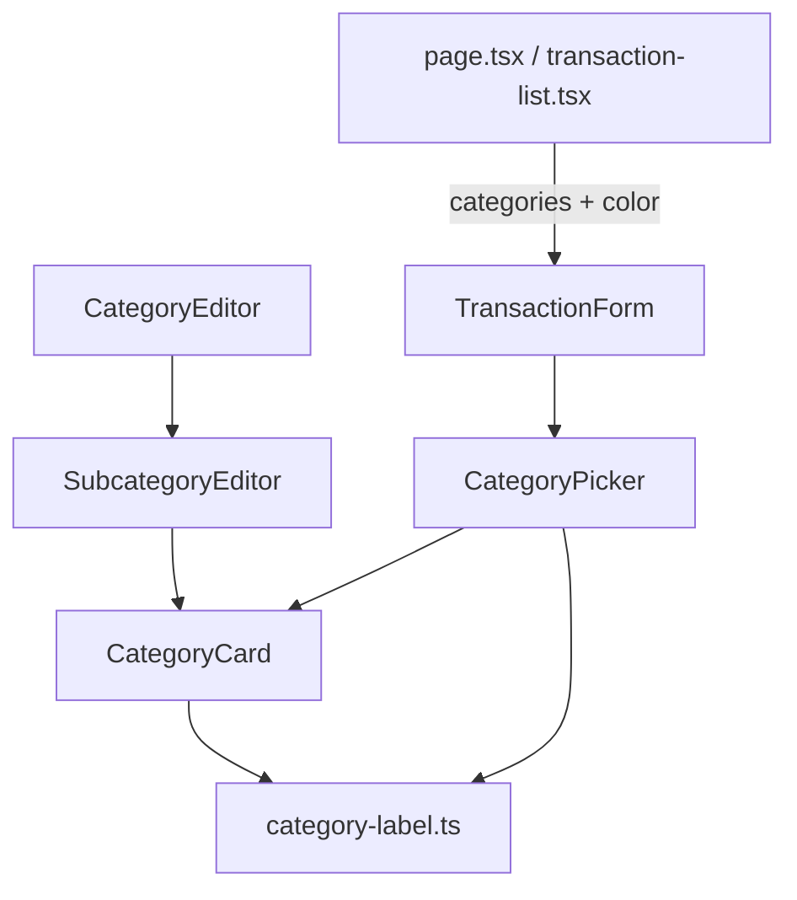

# Subcategorias Colapsáveis Design

**Spec**: `.specs/features/subcategorias-colapsaveis/spec.md`
**Status**: Draft

---

## Architecture Overview

Mudança só de UI. Um componente novo, `CategoryCard`, desenha o cabeçalho colapsável (quadrado colorido, nome, contagem, chevron) e o painel. Os dois consumidores o usam com conteúdos diferentes: o `SubcategoryEditor` (edição, em /categorias) e o novo `CategoryPicker` (escolha, no formulário de lançamento). Regras puras (rótulo de contagem, inicial do quadrado, mapeamento seleção → ids) ficam em `src/lib/domain/` com teste unitário, porque o projeto não tem teste de componente. Sem mudança de schema, action ou repositório (AD-001, AD-003 preservados).

---

## Code Reuse Analysis

### Existing Components to Leverage

| Component | Location | How to Use |
| --- | --- | --- |
| SubcategoryEditor | `src/components/subcategory-editor.tsx` | Mantém props, estado e chaves de erro; troca o link por `CategoryCard`, a lista por linhas com marcador e a ação por "Nova subcategoria em …" |
| colorVar | `src/lib/domain/color.ts` | Cor do quadrado e dos marcadores |
| MAX_SUBCATEGORIES | `src/lib/domain/budget.ts` | Desabilita a linha de adição (SUBCOL-03) |
| Category (tipo) | `src/lib/domain/budget.ts` | Já traz `color`; as páginas passam a repassá-lo ao formulário |
| Padrão aria-expanded/aria-controls | `subcategory-editor.tsx:36-46` | Mesmo contrato no `CategoryCard` |
| lucide-react | já em uso (`PlusIcon`) | `ChevronDownIcon`, `ChevronUpIcon`, `PlusIcon` |

### Integration Points

| System | Integration Method |
| --- | --- |
| `saveCategories` | Inalterado: `CategoryEditor` continua enviando `subcategories` por categoria |
| `createTransaction` / `updateTransaction` | Inalterados: o picker escreve `categoryId` e `subcategoryId` nos mesmos `values` |
| `page.tsx:91` e `transaction-list.tsx:133` | Passam `color` em cada categoria do prop `categories` |

---

## Components

### category-label (domínio)

- **Purpose**: Regras puras de texto e seleção usadas pelos dois consumidores.
- **Location**: `src/lib/domain/category-label.ts`
- **Interfaces**:
  - `subcategoryCountLabel(n: number): string` - "1 subcategoria" para 1, "N subcategorias" nos demais, incluindo 0
  - `categoryDisplayName(name: string): string` - nome sem espaços nas pontas ou "Nova categoria" se vazio
  - `categoryInitial(name: string): string` - primeira letra em maiúscula do nome exibido
  - `addSubcategoryLabel(name: string): string` - "Nova subcategoria em <nome exibido>"
  - `pickSelection(categoryId: string, subcategoryId?: string): { categoryId: string; subcategoryId: string }` - subcategoryId vazio quando omitido
- **Dependencies**: nenhuma

### CategoryCard

- **Purpose**: Cabeçalho colapsável com quadrado colorido, nome, contagem e chevron, mais painel de conteúdo.
- **Location**: `src/components/category-card.tsx`
- **Interfaces**:
  - `CategoryCard({ id, name, color, count, open, onToggle, children }): JSX` - componente controlado; o pai guarda `open`. O cabeçalho é `<button aria-expanded aria-controls={id}>`; o painel tem `id` e só renderiza `children` quando aberto
- **Dependencies**: `category-label`, `colorVar`, lucide-react
- **Reuses**: padrão de botão do editor atual

### SubcategoryEditor (alterado)

- **Purpose**: Lista editável de subcategorias de uma categoria dentro de `CategoryCard`.
- **Location**: `src/components/subcategory-editor.tsx`
- **Interfaces**: props atuais + `name: string` e `color: number` (nome e cor da categoria, lidos da linha em edição)
  - Abre sozinho quando há erro em `errors["<i>.subcategories"]` ou `errors["<i>.subcategories.<j>.name"]` (regra atual `open = expanded || …`)
  - Cada item: marcador `colorVar(color)`, `Input` com os mesmos `aria-label`, botão "Remover" com os mesmos `aria-label`
  - Última linha: botão "Nova subcategoria em <nome>" com `PlusIcon`, `disabled` com `items.length >= MAX_SUBCATEGORIES`; ao clicar adiciona o item e foca o novo `Input` (ref + `useEffect` sobre a chave do último item criado)
- **Reuses**: `CategoryCard`, `Input`, `Button`

### CategoryPicker

- **Purpose**: Seletor único de categoria e subcategoria para o formulário de gasto.
- **Location**: `src/components/category-picker.tsx`
- **Interfaces**:
  - `CategoryPicker({ categories, categoryId, subcategoryId, invalid, onChange }): JSX` - `categories` com `{ id, name, color, subcategories }`; `onChange({ categoryId, subcategoryId })`
  - Categoria com subcategorias: `CategoryCard` aberto na categoria atual; dentro, radios "Sem subcategoria" e uma por subcategoria
  - Categoria sem subcategorias: linha selecionável direta, sem chevron
  - Opções são `<input type="radio" name=…>` dentro de um `radiogroup` rotulado "Categoria" (mesma escolha de inputs nativos do formulário atual, ver SPEC_DEVIATION em `transaction-form.tsx:55`)
- **Dependencies**: `CategoryCard`, `pickSelection`
- **Reuses**: `colorVar`, classes de borda do `selectClass`

### TransactionForm (alterado)

- **Purpose**: Troca os dois `<select>` (linhas ~160-200) pelo `CategoryPicker`.
- **Location**: `src/components/transaction-form.tsx`
- **Interfaces**: o tipo de `categories` ganha `color: number`; `fieldErrors.categoryId` e `fieldErrors.subcategoryId` continuam exibidos abaixo do picker; o ramo `needsCategories` fica igual.

---

## Data Models

Nenhum. `Category` já tem `color`; o formulário apenas passa a recebê-lo.

---

## Error Handling Strategy

| Error Scenario | Handling | User Impact |
| --- | --- | --- |
| Salvamento rejeitado com erro de subcategoria em categoria fechada | `open = expanded \|\| listError \|\| hasNameError` | A categoria abre e mostra a mensagem |
| Fechar e reabrir o painel | Estado das linhas fica em `CategoryEditor` (`rows`), não no painel | Texto digitado é preservado (SUBCOL-01) |
| Limite de 30 | Botão de adição `disabled` | Linha "Nova subcategoria em …" cinza e inerte |
| Gasto sem categoria | `fieldErrors.categoryId` da action continua exibido | Mesma mensagem de hoje |

---

## Risks & Concerns

| Concern | Location (file:line) | Impact | Mitigation |
| --- | --- | --- | --- |
| Sem teste de componente no projeto; AD-005 suspende e2e | `vitest.config.ts`, `AD-005` | UI nova sem cobertura automatizada | Lógica extraída para `category-label.ts` com teste unitário; UI verificada manualmente na etapa de validação |
| `category-editor.tsx` usa `Fragment` com indentação irregular e `colSpan` fixo em 5 | `src/components/category-editor.tsx:196` | Trocar o bloco dentro da célula pode quebrar o layout | Manter a linha `TableRow` com `colSpan={5}`; só o conteúdo da célula muda |
| Erros de `fieldErrors` indexados por posição da categoria | `src/components/subcategory-editor.tsx:30` | Reordenar ou remover categorias desloca os índices | Sem mudança de comportamento; o picker e o card não criam novos índices |
| Radios nativos dentro de painel que só renderiza aberto | `CategoryPicker` | Categoria atual precisa estar aberta para o radio marcado existir no DOM | Estado inicial abre a categoria atual (SUBCOL-04 critério 1) |
| Nome da categoria vazio gera `aria-label` e texto sem nome | `SubcategoryEditor` | Rótulo "Nova subcategoria em " | `categoryDisplayName` devolve "Nova categoria" |

---

## Tech Decisions (only non-obvious ones)

| Decision | Choice | Rationale |
| --- | --- | --- |
| Componente do painel | `CategoryCard` próprio com botão + `aria-expanded`, sem Radix Collapsible/Accordion | O projeto só tem `button`, `dialog`, `input`, `label`, `progress`, `table` em `ui/`; o padrão atual já é botão com `aria-expanded` e evita dependência nova |
| Estado aberto/fechado | Controlado pelo pai | O editor precisa forçar abertura em erro; o picker precisa abrir a categoria atual |
| Seletor do formulário | Radios nativos agrupados, não `<select>` com `<optgroup>` | `<optgroup>` não colapsa e não mostra contagem nem cor; radios mantêm teclado e leitor de tela |
| Ícone | Quadrado `colorVar(color)` com inicial | Decidido na spec; sem mudança de banco |
| Ordem de entrega | Domínio → CategoryCard → editor de subcategorias → picker + formulário | P1 entrega valor sozinho; P2 depende só do `CategoryCard` |

> Nenhuma decisão aqui vira `AD-NNN`: são convenções locais de UI. Nenhuma decisão ativa foi contrariada (AD-001, 003, 004 intactas; AD-005 aplicada).

---

## Requirement Mapping

| Requirement | Onde é atendido |
| --- | --- |
| SUBCOL-01 | `CategoryCard`, `subcategoryCountLabel`, estado em `CategoryEditor` |
| SUBCOL-02 | `SubcategoryEditor` (linhas, marcador, "Nova subcategoria em …", foco) |
| SUBCOL-03 | `SubcategoryEditor` (`disabled` no limite, abertura por erro) |
| SUBCOL-04 | `CategoryPicker`, `pickSelection` |
| SUBCOL-05 | `TransactionForm` (erro de categoria, ramo de ganho sem picker) |
