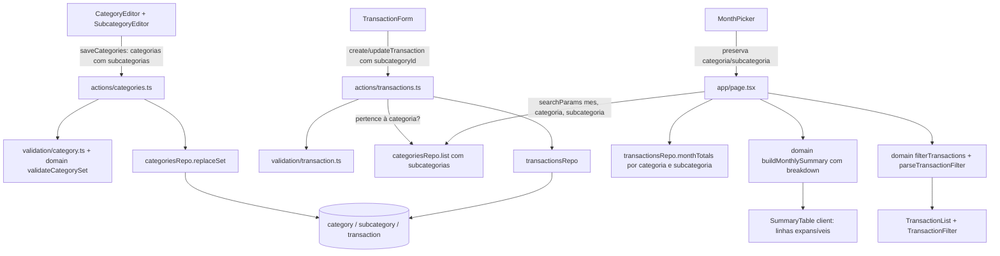

# Subcategorias Design

**Spec**: `.specs/features/subcategorias/spec.md`
**Status**: Approved

**Depends on**: `simulacao-categorias` concluída e commitada. Ela altera os mesmos arquivos (`schema.ts`, `categories.ts` repo, `validation/category.ts`, `category-editor.tsx`, `budget.ts`) e a migração 0002. Esta feature começa na migração 0003, em cima do código com `color`.

---

## Architecture Overview

Segue AD-001 (Server Components leem, Server Actions escrevem), AD-002 (Drizzle + node-postgres) e AD-003 (centavos e pontos-base inteiros). Nenhuma decisão ativa é substituída.

Abordagem escolhida: **tabela própria `subcategory`** e coluna anulável `transaction.subcategory_id`. Uma FK composta `(subcategory_id, category_id)` garante no banco que a subcategoria pertence à categoria do gasto. As subcategorias viajam aninhadas em cada categoria no payload de `saveCategories` e são gravadas pelo mesmo `replaceSet`, na mesma transação.



**Alternativas descartadas:**
- **Auto-relacionamento (`category.parent_id`)**: `percent_bp` e `color` virariam anuláveis, e a regra de 100%, o índice de nome único e todas as consultas existentes precisariam filtrar por nível.
- **Action separada por subcategoria**: contraria a premissa da spec de salvar junto com o conjunto.

---

## Code Reuse Analysis

### Existing Components to Leverage

| Component | Location | How to Use |
| --------- | -------- | ---------- |
| `replaceSet` (substituição atômica do conjunto) | `src/lib/db/repos/categories.ts` | Estender: para cada categoria, aplicar a mesma lógica (manter/criar/excluir, bloquear exclusão com gastos) às subcategorias, na mesma transação |
| `validateCategorySet` | `src/lib/domain/budget.ts` | Estender com regras de nome de subcategoria (1–40, única por categoria sem diferenciar maiúsculas) e limite de 30 |
| `categorySetSchema` | `src/lib/validation/category.ts` | Adicionar `subcategories: {id?, name}[]` ao item; mapear `fieldErrors` aninhados (`"0.subcategories.2.name"`) |
| `invalidInput` | `src/lib/action-result.ts` | Já junta paths com `.`: chaves aninhadas funcionam sem mudança |
| `isOwnCategory` | `src/actions/transactions.ts:20` | Estender: também confere se `subcategoryId` está nas subcategorias da categoria (usa `categoriesRepo.list` com subcategorias) |
| `transactionSchema` | `src/lib/validation/transaction.ts` | Adicionar `subcategoryId` opcional (uuid) em gasto; em ganho, `z.undefined` como já é feito com `categoryId` |
| `monthTotals` (um SUM … GROUP BY) | `src/lib/db/repos/transactions.ts` | Agrupar também por `subcategory_id`; derivar `spentByCategory` somando as linhas |
| `buildMonthlySummary` | `src/lib/domain/budget.ts` | Adicionar `breakdown` a cada `CategorySummary` |
| `formatBRL`, `Intl.NumberFormat pt-BR` | `src/lib/domain/money.ts`, `percent.ts` | Formatar valor e participação |
| `MonthPicker` + `?mes=` | `src/components/month-picker.tsx` | Mesmo padrão de estado na URL para o filtro |
| `selectClass` (select nativo) | `src/components/transaction-form.tsx:44` | Seletores de subcategoria e de filtro (mesma SPEC_DEVIATION já aceita) |

### Integration Points

| System | Integration Method |
| ------ | ------------------ |
| Postgres | Migração `0003_subcategory.sql` gerada por `drizzle-kit generate`: nova tabela e nova coluna anulável. Sem backfill: gastos existentes ficam com `subcategory_id NULL` (SUB-05 AC 9) |
| `saveCategories` | Contrato de entrada ganha `subcategories` por item; a saída (`ActionResult`) não muda |
| `create/updateTransaction` | Contrato de entrada ganha `subcategoryId?`; a saída não muda |
| Página `/` | Lê `categoria` e `subcategoria` de `searchParams` além de `mes` |

---

## Components

### Schema `subcategory` + `transaction.subcategory_id`

- **Purpose**: Guardar subcategorias e o vínculo opcional do gasto, com integridade garantida no banco.
- **Location**: `src/lib/db/schema.ts`, `drizzle/0003_subcategory.sql`
- **Interfaces**: ver Data Models.
- **Dependencies**: `category`, `user`, `transaction`.
- **Reuses**: convenções de `category` (`uuid defaultRandom`, `clock_timestamp()`, unique index com `lower(name)`).

### Domain: regras do conjunto e resumo

- **Purpose**: Validar subcategorias no conjunto e calcular o detalhamento do resumo, como funções puras.
- **Location**: `src/lib/domain/budget.ts` (+ `budget.test.ts`)
- **Interfaces**:
  - `validateCategorySet(cats: (CategoryInput & { subcategories: { name: string }[] })[]): CategorySetResult`: novos erros em `"<i>.subcategories.<j>.name"` e `"<i>.subcategories"` (limite)
  - `buildMonthlySummary({ categories, incomeCents, spentBySubcategory }): MonthlySummary`: `spentBySubcategory: Map<categoryId, Map<subcategoryId | null, cents>>`; cada linha ganha `breakdown`
  - `shareBp(partCents: number, totalCents: number): number`: round(part × 10000 / total); 0 quando total = 0
- **Dependencies**: nenhuma (puro).
- **Reuses**: `TOTAL_BP`, `MAX_CATEGORY_NAME`, padrão de `fieldErrors`.

### Domain: filtro de transações

- **Purpose**: Interpretar o filtro da URL e aplicá-lo à lista do mês.
- **Location**: `src/lib/domain/transaction-filter.ts` (+ `.test.ts`)
- **Interfaces**:
  - `parseTransactionFilter(params: { categoria?: string; subcategoria?: string }, categories: Category[]): TransactionFilter`: ids desconhecidos viram "Todas" (SUB-10 AC 9); `subcategoria` sem `categoria` válida é ignorada
  - `filterTransactions(txs: Transaction[], filter: TransactionFilter): Transaction[]`
  - `type TransactionFilter = { categoryId: string | null; subcategoryId: string | "none" | null }`
- **Dependencies**: tipos `Category`, `Transaction`.
- **Reuses**: nenhum; segue o estilo de `parseMonth`.

### Repo `categoriesRepo`

- **Purpose**: Ler categorias com subcategorias e substituir o conjunto inteiro, subcategorias incluídas.
- **Location**: `src/lib/db/repos/categories.ts` (+ `.int.test.ts`)
- **Interfaces**:
  - `list(userId): Promise<Category[]>`: cada categoria com `subcategories: Subcategory[]` em ordem de criação (2 queries: categorias e subcategorias do usuário, agrupadas em JS)
  - `replaceSet(userId, cats: CategoryItem[]): Promise<CategorySetResult>`: `CategoryItem` ganha `subcategories: { id?: string; name: string }[]`
- **Fluxo de `replaceSet`** (uma transação):
  1. Validação do domínio (já existe).
  2. Conferir ids de categorias (já existe) e de subcategorias: todo `id` de subcategoria enviado precisa existir **na mesma categoria**; senão `"Subcategoria não encontrada"`.
  3. Calcular as subcategorias removidas: as que existem e não vieram, inclusive as de categorias removidas. Se alguma tiver gasto → `{ ok: false, error: "Esta subcategoria tem N gasto(s) e não pode ser excluída", fieldErrors: { "<i>.subcategories": … } }` quando a mãe continua no conjunto.
  4. Bloqueio de categoria com gastos (já existe). Precisa rodar **antes** do passo 3 para uma categoria removida, para manter a mensagem atual de categoria.
  5. Excluir subcategorias removidas e categorias removidas (o cascade cobre as subcategorias da categoria).
  6. Atualizar/inserir categorias em ordem (já existe; o insert passa a usar `.returning({ id })`) e depois atualizar/inserir as subcategorias de cada uma, em ordem.
- **Dependencies**: `db`, schema.
- **Reuses**: estrutura atual de `replaceSet`, `expensesMessage`.

### Repo `transactionsRepo`

- **Purpose**: Persistir `subcategoryId` e totalizar por subcategoria.
- **Location**: `src/lib/db/repos/transactions.ts` (+ `.int.test.ts`)
- **Interfaces**:
  - `TransactionData.subcategoryId?: string | null` (gravado em `fields`)
  - `monthTotals(userId, range): Promise<{ incomeCents; spentBySubcategory: Map<string, Map<string | null, number>> }>`: `GROUP BY kind, category_id, subcategory_id`
- **Reuses**: `fields`, `inMonth`, `columns` (+ `subcategoryId`).

### Validation + Actions

- **Purpose**: Aceitar e validar subcategorias nas entradas.
- **Location**: `src/lib/validation/category.ts`, `src/lib/validation/transaction.ts`, `src/actions/transactions.ts`
- **Interfaces**:
  - item de `categorySetSchema`: `subcategories: z.array(z.object({ id: z.uuid().optional(), name: z.string().trim() })).default([])`
  - gasto em `transactionSchema`: `subcategoryId: z.uuid().optional().or(z.literal("").transform(() => undefined))`; ganho: `subcategoryId: z.undefined({ error: "Ganho não tem subcategoria" }).optional()`
  - `isOwnCategory` → `checkOwnership(userId, tx): ActionResult | null`: devolve `categoryNotFound` ou `{ fieldErrors: { subcategoryId: "Subcategoria não pertence à categoria" } }`
- **Reuses**: `invalidInput`, padrão de `categoryNotFound`.

### UI: `SubcategoryEditor`

- **Purpose**: Editar a lista de subcategorias de uma categoria dentro do `CategoryEditor`.
- **Location**: `src/components/subcategory-editor.tsx` (novo); `category-editor.tsx` passa a guardar `subcategories: { key; id?; name }[]` em cada `Row` e renderiza uma linha extra recolhível por categoria (botão "Subcategorias (N)")
- **Interfaces**: `SubcategoryEditor({ index, items, errors, onChange }: Props)`: adicionar, renomear, remover; erros por `"<i>.subcategories.<j>.name"` e `"<i>.subcategories"`
- **Reuses**: `Input`, `Button`, convenção de `aria-label` numerado do editor de categorias.

### UI: `TransactionForm`

- **Purpose**: Seletor de subcategoria dependente da categoria.
- **Location**: `src/components/transaction-form.tsx`
- **Interfaces**: `TransactionFormValues.subcategoryId: string` ("" = sem subcategoria); `categories` prop passa a ter `subcategories`; trocar categoria faz `subcategoryId = ""` (SUB-04 AC 5); select desabilitado com "Sem subcategoria" quando a categoria não tem subcategorias (AC 7). Depois de salvar uma criação, mantém categoria e subcategoria, como já faz com a categoria.

### UI: `SummaryTable` (vira client component)

- **Purpose**: Linha expansível com o detalhamento por subcategoria.
- **Location**: `src/components/summary-table.tsx`
- **Interfaces**: recebe `CategorySummary[]` com `breakdown`; estado local `expanded: Set<string>`; botão com `aria-expanded` e `aria-controls`, exibido só quando `breakdown` tem alguma linha com `subcategoryId !== null` (SUB-06 AC 1, 6). Linhas filhas `data-testid="summary-subrow"` com nome, R$ e participação.
- **Reuses**: `Table*`, `formatBRL`. Participação formatada com `Intl.NumberFormat("pt-BR", { minimumFractionDigits: 1, maximumFractionDigits: 1 })` sobre `bp / 100`.

### UI: `TransactionList` + `TransactionFilter`

- **Purpose**: Rótulo "Categoria › Subcategoria" e filtro na URL.
- **Location**: `src/components/transaction-list.tsx`, `src/components/transaction-filter.tsx` (novo)
- **Interfaces**:
  - `TransactionFilter({ categories, filter }: Props)`: dois selects; ao mudar, `router.replace` com `URLSearchParams` atual (preserva `mes`); trocar categoria remove `subcategoria` (SUB-09 AC 7)
  - `TransactionList` recebe a lista já filtrada e `filtered: boolean` para escolher a mensagem vazia ("Nenhum gasto encontrado para este filtro" vs. "Nenhuma transação neste mês")
- **Reuses**: `selectClass`, padrão da URL do `MonthPicker`.

### UI: `MonthPicker`

- **Purpose**: Manter o filtro ao trocar de mês (SUB-10 AC 8).
- **Location**: `src/components/month-picker.tsx`
- **Interfaces**: `href(m)` passa a partir de `useSearchParams()`, troca só `mes` e mantém os demais parâmetros. O mesmo vale para o `router.push` do `<input type="month">`.

---

## Data Models

### subcategory (nova tabela)

```typescript
export const subcategory = pgTable(
  "subcategory",
  {
    id: uuid("id").primaryKey().defaultRandom(),
    userId: text("user_id").notNull().references(() => user.id, { onDelete: "cascade" }),
    categoryId: uuid("category_id").notNull().references(() => category.id, { onDelete: "cascade" }),
    name: varchar("name", { length: 40 }).notNull(),
    createdAt: timestamp("created_at", { withTimezone: true }).notNull().default(sql`clock_timestamp()`),
  },
  (t) => [
    uniqueIndex("subcategory_category_lower_name_unique").on(t.categoryId, sql`lower(${t.name})`),
    // Alvo da FK composta de transaction: garante subcategoria ∈ categoria do gasto.
    unique("subcategory_id_category_unique").on(t.id, t.categoryId),
  ],
);
```

### transaction (coluna nova)

```typescript
subcategoryId: uuid("subcategory_id"),
// em constraints:
foreignKey({
  name: "transaction_subcategory_category_fk",
  columns: [t.subcategoryId, t.categoryId],
  foreignColumns: [subcategory.id, subcategory.categoryId],
}).onDelete("restrict"),
// MATCH SIMPLE não confere a FK quando alguma coluna é NULL: um ganho (category_id NULL)
// com subcategory_id passaria. O CHECK fecha essa brecha.
check("transaction_subcategory_needs_category", sql`${t.subcategoryId} IS NULL OR ${t.categoryId} IS NOT NULL`),
```

### Tipos de domínio

```typescript
export type Subcategory = { id: string; name: string };
export type Category = { id: string; name: string; percentBp: number; color: number; subcategories: Subcategory[] };

export type SubcategorySpend = {
  subcategoryId: string | null; // null = "Sem subcategoria"
  name: string;                 // "Sem subcategoria" quando null
  spentCents: number;
  shareBp: number;              // round(spent × 10000 / spentCents da categoria)
};

export type CategorySummary = Category & { /* campos atuais */ breakdown: SubcategorySpend[] };
// breakdown: só linhas com spentCents > 0, ordem decrescente de gasto; empate: ordem de criação,
// "Sem subcategoria" por último. Soma de spentCents === spentCents da categoria (SUB-07 AC 5).
```

**Relationships**: category 1:N subcategory (cascade); subcategory 1:N transaction (restrict, via FK composta); user 1:N subcategory (cascade, para apagar junto com o usuário).

---

## Error Handling Strategy

| Error Scenario | Handling | User Impact |
| -------------- | -------- | ----------- |
| Nome de subcategoria vazio, > 40 ou repetido na categoria | `validateCategorySet` → `fieldErrors["i.subcategories.j.name"]` | Mensagem sob o campo; nada é salvo |
| Mais de 30 subcategorias | `fieldErrors["i.subcategories"]` = "Máximo de 30 subcategorias por categoria" | Mensagem no bloco da categoria; o botão "Adicionar subcategoria" fica desabilitado em 30 |
| Excluir subcategoria com gastos | `replaceSet` aborta a transação | "Esta subcategoria tem N gasto(s) e não pode ser excluída"; nada é salvo |
| Id de subcategoria de outra categoria/usuário no `replaceSet` | Aborta | "Subcategoria não encontrada" |
| Gasto com subcategoria fora da categoria | `checkOwnership` antes do insert; a FK composta é a última barreira | "Subcategoria não pertence à categoria" no campo |
| Ganho com subcategoria | Zod (`z.undefined`) + CHECK no banco | Mensagem de validação |
| Violação de unique de nome por corrida | N/A: um usuário; a validação do domínio cobre | Se acontecer: `SAVE_FAILED` (já é o catch atual) |
| Banco indisponível | catch atual das actions | "Não foi possível salvar. Tente novamente"; edições mantidas no estado do editor |
| Filtro com id inexistente na URL | `parseTransactionFilter` ignora | Lista como "Todas" |

---

## Risks & Concerns

| Concern | Location (file:line) | Impact | Mitigation |
| ------- | -------------------- | ------ | ---------- |
| Feature simulacao-categorias em execução em paralelo, mexendo nos mesmos arquivos | `src/lib/db/schema.ts`, `src/lib/db/repos/categories.ts`, `src/components/category-editor.tsx`, `src/lib/validation/category.ts` | Conflitos e migrações fora de ordem | Executar subcategorias só depois que simulacao-categorias estiver commitada e validada; a migração é a 0003 |
| `MonthPicker` monta `href` só com `mes` | `src/components/month-picker.tsx:22` | Trocar de mês apaga o filtro (quebra SUB-10 AC 8) | Montar o href a partir de `useSearchParams()` trocando só `mes`; verificar à mão |
| FK composta com MATCH SIMPLE ignora linhas com NULL | `src/lib/db/schema.ts` (transaction) | Ganho com `subcategory_id` passaria no banco | CHECK `transaction_subcategory_needs_category`; teste de integração insere direto no banco e espera erro |
| `CategoryEditor` já tem ~200 linhas e um único `Row` plano | `src/components/category-editor.tsx:23` | Aninhar subcategorias no mesmo arquivo deixa o componente difícil de manter | Extrair `SubcategoryEditor`; o `CategoryEditor` só guarda o estado aninhado e repassa |
| `Category` ganha `subcategories` e é espalhado em `CategorySummary` | `src/lib/domain/budget.ts:48`, `budget-charts.tsx` | Testes e fixtures existentes que montam `Category` quebram na tipagem | Atualizar fixtures na mesma task do tipo; `typecheck` é parte do gate |
| `replaceSet` faz um statement por item | `src/lib/db/repos/categories.ts:66` | Com até 30 subcategorias × N categorias são mais statements por salvamento | Aceitável para um usuário (dezenas de linhas); preserva a ordem de criação via `clock_timestamp()` |
| `SummaryTable` é server component | `src/components/summary-table.tsx` | A expansão precisa de estado no cliente | Marcar `"use client"`; as props já são serializáveis |
| `monthTotals` muda de forma (`spentByCategory` → `spentBySubcategory`) | `src/lib/db/repos/transactions.ts:82`, `src/app/(app)/page.tsx:27` | Quebra quem consome `spentByCategory` | `buildMonthlySummary` deriva o total por categoria somando o mapa interno; atualizar a página e os testes na mesma task |

---

## Tech Decisions (only non-obvious ones)

| Decision | Choice | Rationale |
| -------- | ------ | --------- |
| Integridade subcategoria ∈ categoria | FK composta `(subcategory_id, category_id)` → `subcategory(id, category_id)` + CHECK para ganho | Garantida no banco, não só na action; uma subcategoria de outra categoria é impossível de gravar |
| `user_id` em `subcategory` | Redundante com a categoria, mas presente | Consulta de `list` por usuário sem join; cascade de usuário direto, igual às outras tabelas |
| Filtro aplicado em memória | `filterTransactions` sobre `listByMonth` | A lista do mês já é carregada inteira; função pura testável; o resumo continua usando `monthTotals` sem filtro (SUB-10 AC 10) |
| Exclusão de categoria removida | `ON DELETE CASCADE` em `subcategory.category_id` | SUB-03 AC 9 sem código extra; categorias com gastos já são bloqueadas antes |
| Participação com 1 casa | `shareBp` inteiro em bp, exibido com `minimumFractionDigits: 1` | AD-003 (bp inteiros); a soma das participações pode dar 99,9% ou 100,1% por arredondamento, mas os centavos sempre fecham |

> Nenhuma decisão aqui vira padrão de projeto; nada a acrescentar em `STATE.md`.
