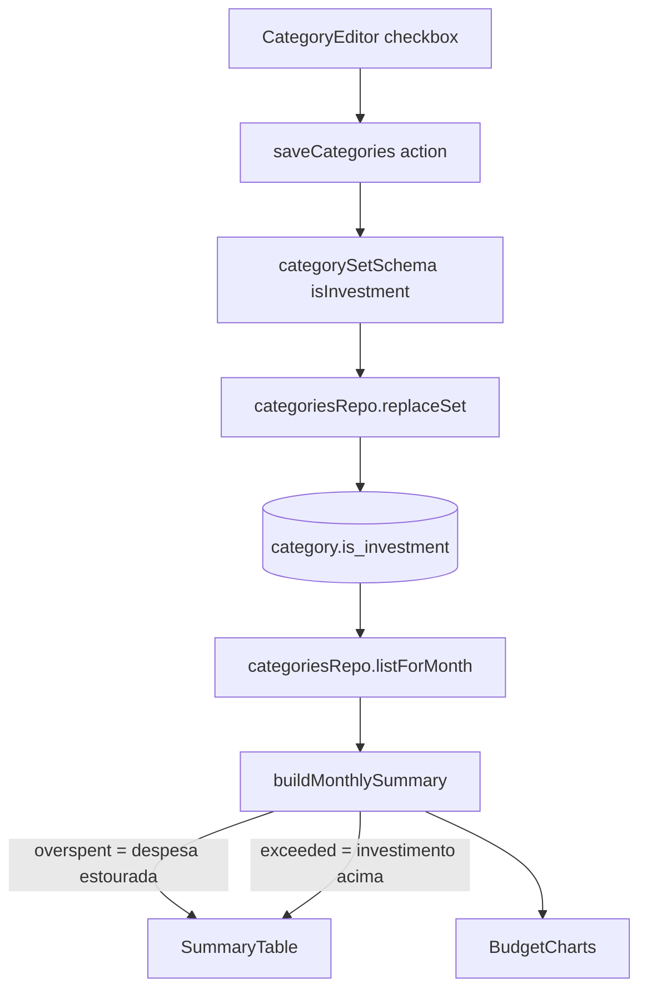

# Tabela de Categorias: Percentual Limpo e Investimento Design

**Spec**: `.specs/features/tabela-categorias-investimento/spec.md`
**Status**: Draft

---

## Architecture Overview

Duas mudanças independentes:

1. **Percentual:** novo formatador `formatPercentCompact` em `percent.ts`; só a tabela passa a usá-lo. `formatPercent` não muda (o editor segue com 6 casas, AD-006).
2. **Investimento:** a flag `is_investment` percorre o mesmo caminho que `color`: schema → repo → domínio → validação → action → editor. No resumo, `overspent`/`overspentCents` passam a significar "despesa estourada" (sempre falso para investimento) e um par novo `exceeded`/`exceededCents` descreve o excesso de investimento. A tabela e o gráfico continuam lendo `overspent`, então o gráfico atende o AC 8 sem alteração de lógica.



---

## Code Reuse Analysis

### Existing Components to Leverage

| Component | Location | How to Use |
| --------- | -------- | ---------- |
| `formatShare` | `src/lib/domain/percent.ts` | Padrão do formatador por `Intl.NumberFormat`; o novo fica ao lado |
| Caminho de `color` | `categories.ts` (repo), `validation/category.ts`, `category-editor.tsx` | Mesmo percurso para `isInvestment` |
| `Checkbox`, `Label` | `src/components/ui/` | Campo do editor |
| `text-income` / `bg-income` | `summary-table.tsx` | Cor positiva já usada em Restante e barra |
| Migração incremental | `drizzle/0009_*.sql` + `meta/_journal.json` | Nova migração `0010` com `drizzle-kit generate` |

### Integration Points

| System | Integration Method |
| ------ | ------------------ |
| Banco | `ALTER TABLE category ADD COLUMN is_investment boolean DEFAULT false NOT NULL` |
| `replaceSet` | Grava a flag no `update`/`insert` da categoria, sem vigência (AD-007 só vale para o percentual) |
| `seed-user.ts` e testes que chamam `replaceSet` | `isInvestment` opcional (padrão `false`), sem quebrar chamadas atuais |

---

## Components

### `formatPercentCompact(micro: number): string`

- **Purpose**: percentual com até 1 casa, sem ",0".
- **Location**: `src/lib/domain/percent.ts`
- **Interfaces**: `Intl.NumberFormat("pt-BR", { maximumFractionDigits: 1 })` sobre `micro / MICRO_PER_PERCENT`, com sufixo "%".
- **Reuses**: constantes e padrão de `formatShare`.

### Resumo mensal

- **Purpose**: distinguir despesa estourada de investimento acima da meta.
- **Location**: `src/lib/domain/budget.ts` (`Category`, `CategorySummary`, `buildMonthlySummary`)
- **Interfaces**:
  - `Category.isInvestment?: boolean` (omitido = `false`, como `hasPercent`)
  - `CategorySummary.overspent = !isInvestment && spent > target`; `overspentCents = overspent ? spent − target : 0`
  - `CategorySummary.exceeded = isInvestment && spent > target`; `exceededCents = exceeded ? spent − target : 0`
- **Reuses**: o cálculo atual de `overspent`.

### Repositório e validação

- **Location**: `src/lib/db/schema.ts`, `src/lib/db/repos/categories.ts`, `src/lib/validation/category.ts`
- **Interfaces**: coluna `isInvestment` em `columns` e `CategoryItem` (opcional); `item` do zod ganha `isInvestment: z.boolean().default(false)`.

### `SummaryTable`

- **Location**: `src/components/summary-table.tsx`
- **Mudanças**: percentual via `formatPercentCompact`; texto "Excedeu a meta em R$ X" quando `exceeded`, com `text-income`; Restante e barra já ficam verdes porque `overspent` é falso. Linha só ganha `bg-destructive/5` e `data-overspent="true"` com `overspent` (comportamento atual preservado).

### `BudgetCharts`

- **Location**: `src/components/budget-charts.tsx`
- **Mudanças**: nenhuma de lógica; o tipo `Row` continua com `overspent`, que agora é falso para investimento. A legenda "Gasto acima da meta (Estourou)" continua válida (descreve despesas).

### `CategoryEditor`

- **Location**: `src/components/category-editor.tsx`
- **Mudanças**: `Row.isInvestment: boolean` (padrão `false` em `add`, `c.isInvestment ?? false` em `toRow`); `save` envia o campo; checkbox "Investimento / aporte" com `aria-label` por linha, abaixo do nome na linha de controles.
- **Reuses**: `update(i, patch)`, `Checkbox`, `Label`.

---

## Data Models

```typescript
// category (nova coluna)
isInvestment: boolean("is_investment").notNull().default(false)

type Category = { /* ... */ isInvestment?: boolean }
type CategorySummary = Category & {
  overspent: boolean;      // só despesa
  overspentCents: number;
  exceeded: boolean;       // só investimento
  exceededCents: number;
}
```

**Relationships**: coluna na própria `category`, sem vigência; migração define `false` nas linhas existentes (default).

---

## Error Handling Strategy

| Error Scenario | Handling | User Impact |
| -------------- | -------- | ----------- |
| `isInvestment` ausente na action | Zod aplica `false` | Nenhum |
| `isInvestment` não booleano | Zod rejeita com a mensagem padrão do esquema | Erro de validação ao salvar |

---

## Risks & Concerns

| Concern | Location (file:line) | Impact | Mitigation |
| ------- | -------------------- | ------ | ---------- |
| `overspent` muda de significado | `src/lib/domain/budget.ts:165` | Consumidores futuros podem achar que investimento nunca excede | Comentário no tipo; `exceeded` expõe o excesso; testes de domínio cobrem os dois casos |
| Somente `summary-table.tsx` e `budget-charts.tsx` leem `overspent` | `grep overspent src` | Baixo | Conferido na análise; nenhum outro consumidor |
| E2E suspenso (AD-005) | `e2e/` | Verde/texto do investimento sem cobertura de navegador | Testes unitários do domínio e do formatador; verificação manual na tela |
| Specs e2e existentes dependem de "Estourou" para despesas | `e2e/` | Nenhum: despesas não mudam | Nenhuma |

---

## Tech Decisions (only non-obvious ones)

| Decision | Choice | Rationale |
| -------- | ------ | --------- |
| Flag fora da vigência | Coluna em `category` | Tipo não afeta metas históricas; evita nova tabela |
| Redefinir `overspent` em vez de checar a flag na UI | Cálculo no domínio | Uma regra só, testável sem React; gráfico acompanha sem mudança |
| `formatPercent` intacto | Novo `formatPercentCompact` | Editor e testes atuais dependem das 6 casas |
