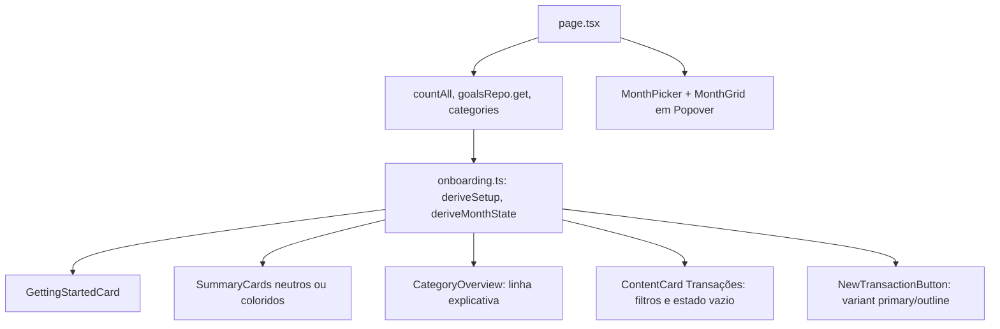

# Visão Geral: Primeiros Passos e Estados Vazios Design

**Spec**: `.specs/features/visao-geral-primeiros-passos/spec.md`
**Status**: Draft

---

## Architecture Overview

Sem migração, sem Server Action nova e sem mudar cálculos. Três mudanças estruturais:

1. **Regras de estado viram funções puras** em `src/lib/domain/onboarding.ts` (passos do checklist, passo atual, tipo de estado vazio, mês anterior, nome do mês), testáveis em unit (AD-005 mantém unit e integration; sem e2e).
2. **Um dado novo no servidor**: `transactionsRepo.countAll(userId)`, para distinguir "primeiro acesso" de "mês vazio com histórico" (VG-07, VG-08). `goalsRepo.get` e `categoriesRepo.list` já existem.
3. **Componentes de apresentação** recebem o resultado já derivado: `page.tsx` calcula `setup` e `monthState` e os repassa; os componentes não consultam banco.



Decisões ativas respeitadas: AD-001 (Server Components leem, sem API), AD-004 (vazio do mês = 0 ocorrências aplicáveis, incluindo recorrentes projetadas; `countAll` conta linhas armazenadas e basta para "tem histórico"), AD-005 (sem e2e novo).

---

## Code Reuse Analysis

### Existing Components to Leverage

| Component | Location | How to Use |
| --------- | -------- | ---------- |
| `ContentCard` | `src/components/content-card.tsx` | Mantém cabeçalho; ganha linha explicativa via novo prop `description` |
| `Progress` | `src/components/ui/progress.tsx` | Barra do checklist (já usada em `AllocationProgress`; reaproveitar o padrão `role="progressbar"` de `allocation-progress.tsx`) |
| `Popover` | `src/components/ui/popover.tsx` | Seletor de mês |
| `Button` (`default`/`outline`) | `src/components/ui/button.tsx` | Hierarquia primária |
| `NewTransactionButton` | `src/components/new-transaction-button.tsx` | Ganha prop `emphasis`; passo 2 reutiliza o mesmo `Dialog` |
| `monthHref`, `YearMonth`, `parseMonth` | `src/lib/domain/month.ts` | Navegação preservando parâmetros; `shift` sai de `month-picker.tsx` para `month.ts` e é reusado |
| `TransactionFilter` | `src/components/transaction-filter.tsx` | Inalterado; só deixa de ser renderizado no vazio |
| `categoriesRepo.list`, `goalsRepo.get` | `src/lib/db/repos/` | Entradas do checklist |

### Integration Points

| System | Integration Method |
| ------ | ------------------ |
| Postgres | `transactionsRepo.countAll`: `select count(*) from transaction where user_id = $1`, sem filtro de mês |
| URL `?mes=` | Seletor de mês continua escrevendo via `monthHref`; "Ver {mês anterior}" é um `Link` com o mesmo helper |

---

## Components

### `onboarding.ts` (domínio)

- **Purpose**: Derivar o estado da tela a partir de contagens, sem I/O.
- **Location**: `src/lib/domain/onboarding.ts` (+ `onboarding.test.ts`)
- **Interfaces**:
  - `deriveSetup(input: { categories: number; transactions: number; hasGoal: boolean }): { steps: { id: "categories" | "transaction" | "goal"; label: string; done: boolean }[]; doneCount: number; currentId: StepId | null; complete: boolean }` - VG-01..06; `currentId` é o primeiro pendente.
  - `deriveMonthState(input: { monthTransactions: number; totalTransactions: number }): "first-access" | "empty-month" | "has-data"` - `first-access` quando `totalTransactions === 0`; `empty-month` quando o mês tem 0 e o total > 0.
  - `previousMonth(m: YearMonth): YearMonth` e `monthLongName(m: YearMonth): string` (pt-BR, minúsculo, sem ano; usa `Intl` com `timeZone: "UTC"`, como `month-picker.tsx`).
- **Dependencies**: `YearMonth` de `month.ts`.
- **Reuses**: `shift` movido para `month.ts`.

### `transactionsRepo.countAll`

- **Purpose**: Total de transações armazenadas do usuário em qualquer mês.
- **Location**: `src/lib/db/repos/transactions.ts` (+ caso em `transactions.int.test.ts`)
- **Interfaces**: `countAll(userId: string): Promise<number>`
- **Reuses**: `db`, `transaction`; isolamento por `userId` como nas outras consultas.

### `GettingStartedCard`

- **Purpose**: Card "Comece por aqui" (VG-01..05).
- **Location**: `src/components/getting-started-card.tsx` (Server Component; sem estado, o botão do passo 2 é o `NewTransactionButton`)
- **Interfaces**: props `{ setup: ReturnType<typeof deriveSetup>; categories; defaultDate }`.
- **Dependencies**: `Progress`, `Button`, `NewTransactionButton`, `Link`.
- **Reuses**: padrão visual dos cards de `page.tsx`.

### `SummaryCards`

- **Purpose**: Extrair os 3 cards de `page.tsx`, aceitando `empty: boolean` (VG-13, VG-14).
- **Location**: `src/components/summary-cards.tsx`
- **Interfaces**: `{ income; spent; balance: number; empty: boolean }`. Com `empty`, `tone`/`iconTone` neutros (`text-foreground`, `bg-muted text-muted-foreground`) e legenda em `<dd>` secundário; `data-testid` preservados.

### `NewTransactionButton` (alteração)

- **Interfaces**: novo prop `emphasis?: "primary" | "secondary"` (default `primary`) → `variant="default" | "outline"` nos dois formatos; FAB passa a `md:hidden` (VG-10, VG-11). O passo 2 usa `variant="header"`-like inline: novo `variant: "inline"` visível em todas as larguras, rótulo "Registrar transação".

### `CategoryOverview` / `SummaryTable` / `TransactionList` (alterações)

- Estado sem categorias: linha `Veja para onde vai seu dinheiro, comparado com o que você planejou.`; `note` omitido com 0 (VG-12, VG-16). O botão vira `outline`, ou some quando o `GettingStartedCard` está visível (prop `hideCta`).
- `TransactionList` recebe `emptyState: "first-access" | "empty-month" | "has-data"`, `monthName` e `previousHref`; renderiza os textos do VG-07/VG-08 antes do ramo filtrado/busca atual, que continua prioritário quando `filtered` ou `searching`.
- `page.tsx` renderiza `TransactionFilter` só se `shown`/mês tem transações **ou** filtro/busca ativos (VG-15), e o `note` `{n} lançamentos` só com n > 0 (VG-16).

### `MonthPicker` + `MonthGrid`

- **Purpose**: Um único controle em pt-BR (VG-17..19).
- **Location**: `src/components/month-picker.tsx` (altera); grade dentro do mesmo arquivo, sem componente novo exportado.
- **Interfaces**: o `span[data-testid=month-label]` vira `PopoverTrigger` (botão com o mesmo texto e `aria-haspopup="dialog"`); conteúdo: cabeçalho com ano e setas `Ano anterior`/`Próximo ano` (estado local do ano de visualização, inicial = ano exibido) e 12 botões `Janeiro`..`Dezembro` via `Intl` pt-BR. Escolha → `router.push(monthHref(...))` e fecha; escolha igual ao mês exibido só fecha. Remove `Input type="month"`.
- **Reuses**: `Popover`, `monthHref`, `shift`.

---

## Data Models

Sem mudanças de schema.

```typescript
type StepId = "categories" | "transaction" | "goal";
type MonthState = "first-access" | "empty-month" | "has-data";
```

---

## Error Handling Strategy

| Error Scenario | Handling | User Impact |
| -------------- | -------- | ----------- |
| `countAll` falha | Exceção propaga ao error boundary da página, como as demais leituras do `Promise.all` | Mesma página de erro atual |
| `?mes=` inválido | `parseMonth` cai no mês corrente | Mês corrente exibido |
| Ano do seletor fora de faixa razoável | Setas de ano sem limite; `monthHref` aceita `AAAA-MM` de 4 dígitos | Navega para o mês escolhido, vazio |

---

## Risks & Concerns

| Concern | Location (file:line) | Impact | Mitigation |
| ------- | -------------------- | ------ | ---------- |
| `page.tsx` acumula leitura, derivação e markup dos cards | `src/app/(app)/page.tsx:34` | Mais um `Promise.all` e ramificações o deixam difícil de ler | Mover cards para `SummaryCards` e derivação para `onboarding.ts`; a página só compõe |
| UI sem teste automático (AD-005) | `src/components/*` | Regressão visual dos estados vazios passa despercebida | Regra de decisão toda em funções puras com unit; UAT manual dos 3 estados no Verifier |
| Spec e2e usa o input nativo de mês | `e2e/month-picker.spec.ts:14,38,53` (`getByLabel("Mês")`) | Remover o input quebra esse spec | A task do seletor reescreve essas 3 asserções para o novo seletor (e2e suspensos pela AD-005, mas o spec não fica obsoleto) |
| Alterações não commitadas em `summary-table.tsx`, `transaction-form.tsx` e `categorias/page.tsx` | working tree | Tasks que tocam `summary-table.tsx` misturam o diff de outra feature | Começar cada task com `git diff` do arquivo; só `git add -p` das hunks da task |
| "N" do rodapé é overlay do `next dev` | `src/app/(app)/layout.tsx:21` | Usuário pode ver como bug do app | Fora de escopo (spec); sem mudança |

---

## Tech Decisions (only non-obvious ones)

| Decision | Choice | Rationale |
| -------- | ------ | --------- |
| Total de transações | `count(*)` global em query separada | O resumo mensal não diz se há histórico; uma contagem indexada por `user_id` é barata |
| Seletor próprio em vez de estilizar o input nativo | `Popover` + grade de 12 meses | O locale do `input[type=month]` é do navegador e não pode ser forçado a pt-BR |
| Onde decidir o estado | Domínio puro (`onboarding.ts`) | Cobertura unitária sem teste de componente (AD-005) |
| Passo 2 abre o diálogo existente | `NewTransactionButton` em modo `inline` | Reusa o formulário e evita duplicar o fluxo |
| Nenhum AD novo | Convenções ficam locais à feature | Nada aqui obriga outras features |
